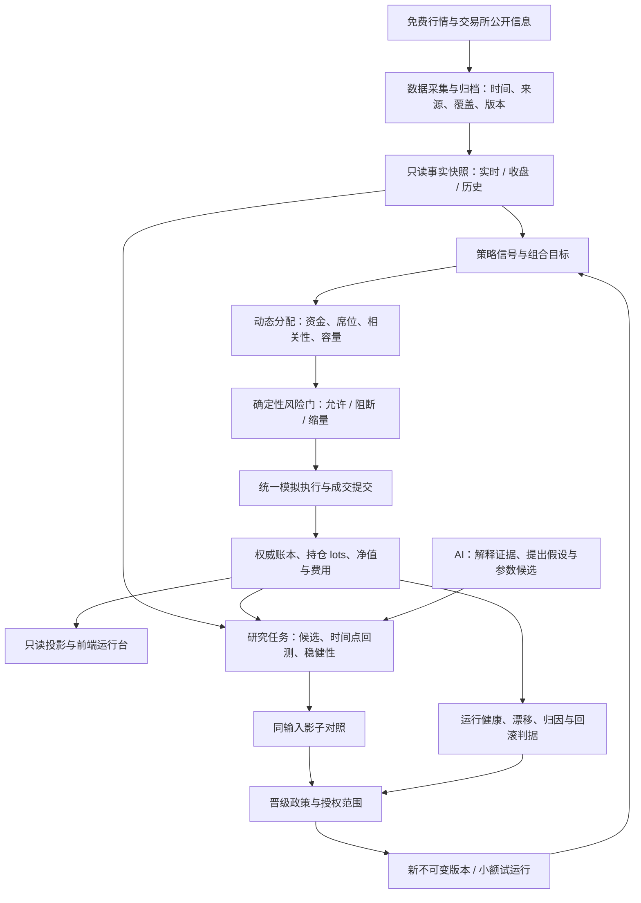

# 自主量化模拟系统：全盘审计与总路线图

审计日期：2026-10-15；服务器取证窗口 11:18–11:27（UTC+08:00）。代码基线：`697f565e4b2e8a553957d73b231cd9e784127dfa`。本地及服务器工作树当时均干净，四个运行容器的构建版本一致。

本报告的完成标准：核实当前能力与实际产出；覆盖数据、研究、交易、资金、风险、AI、自进化、前端、后端与运维；为主要缺口给出复现证据、优先级、实施顺序和验收标准。此次只新增报告，没有修改运行逻辑、交易参数、资金分配、调度或数据库，没有部署。

## 1. 结论与目标定义

**当前是能自动执行规则的量化模拟盘，已经具备较完整的研究与治理模块，但尚未证明形成持续运行、有效学习、自动择优和安全生效的自进化闭环。** 下一阶段最有价值的投入，是让已有链路持续产生可信证据，并使运行状态可见。

应当区分三种能力：

1. **自主交易**：在已授权策略、资金和风控范围内，自动决定买卖并记录模拟成交。当前已有运行证据。
2. **自主研究**：自动提出假设、构建样本、做历史验证和影子对照，保留成功与失败实验。已有模块，生产连续产出不足。
3. **自主进化**：系统根据可信的比较证据，按事先批准的规则切换版本、调整资金并在退化时回退。当前自动应用受人工确认约束，不能把生成候选或完成一代当作已实现。

成熟目标应是：**数据、决策、交易、评价、版本切换和故障恢复均可追溯；授权范围内自动运行，证据不足时等待或降低风险；系统能证明哪些改变有效。** 盈利能力需要独立验证，不能由代码规模、测试数量、AI 共识或运行天数代替。

## 2. 当前成熟度：按证据分层

下表使用文字判断，避免把主观判断包装成精确百分制。这里的“运行”只证明执行过，不代表收益有效。

| 方面 | 已具备的能力 | 本次核实的生产证据 | 当前主要缺口 |
| --- | --- | --- | --- |
| 自动买卖 | 候选、入场、退出、T+1、整手、模拟成交、共享资金 | 当前活跃订单表 1,749 行，成交表 86 行，当日有新增成交 | 长周期稳定性、执行假设偏差及净收益优势未证明 |
| 数据治理 | 行情权威入口、时间与覆盖门禁、免费多源、历史证券主表 | 因子参考日 10-14，5,497 行，记录覆盖率 99.18%；历史成员已有两个归档版本 | 新鲜度持续保障、字段级可用性、历史财务与可交易证据仍需逐项补齐 |
| 风控 | 行情复核、持仓与组合风险、未知即阻断、退出优先 | 风险扫描持续完成；14 轮抽样耗时 6–22 秒 | 全链路决策时延、降级时退出能力与故障演练缺少统一验收 |
| 动态资金分配 | 共享池、权重因子、生命周期系数、席位与冲突策略 | 已有分配计划、资金预占、周期归属等代码边界 | 要证明每次变化的输入、版本、幅度与实际落地效果，而非固定五策略比例 |
| 研究验证 | 时间点验证、滚动验证、成本和稳健性压力测试 | 实验验证权威库中尚无 `experiment_validation_runs` 表；搜索与候选表为 0 行 | 真实输入到实验、对照、晋级的生产闭环未验收 |
| AI 参与 | 结构化研究、通用模型槽位、有界调参、严格输出解析 | 旧审阅表 154 条，其中 140 条完成，最新为 09-04；新研究表 0 条 | 当前持续调用、可靠输出、采纳率和增量收益无证据；“配置过”不能当“正在发挥作用” |
| 自进化 | 分阶段循环、检查点、候选与生效指针隔离、晋级与回滚门 | 学习库有 9 代；最近三代参数起止 ID 都为 1，智能分为空；挑战者与比较表均 0 行 | 尚未证明产生、验证并有效部署过新的优胜版本 |
| 前端可视化 | ECharts 净值图、风险页、策略工坊、执行与研究证据页 | 代码已拆分、统一请求层、按页加载；风控分页故障已通过真实接口复现 | 运行总览、数据状态和决策因果链不够集中，历史查询不完整 |
| 后端可维护性 | 单一成交提交、模块权威、不可变版本、只读投影、架构守护测试 | `paper_trading.py` 15,913 行，`adaptive_engine.py` 5,046 行，`main.py` 2,152 行 | 领域模块已建立，但大编排文件和兼容接口仍集中承担过多职责 |
| 运维与安全 | 四类容器、资源锁、受保护写操作、备份恢复脚本、持续集成 | 四容器无重启、无 OOM；写接口需操作员凭据；磁盘余 4.53 GiB | 系统库版本、磁盘余量、运行指标和恢复演练是近期重点 |

## 3. 可复核的证据与局限

### E01：服务、资源、部署身份

- 四容器均报告同一提交 `697f565`，`RestartCount=0`、`OOMKilled=false`；查询到的 cgroup（容器资源计量）`oom_kill=0`。
- 主机内存总量约 1,707 MiB，可用约 780 MiB；交换区已用约 938 MiB。交换区用量本身不能证明正在频繁换页，本次未采集连续换页速率。
- 四容器内存上限分别为 950 / 650 / 720 / 1,250 MiB。它们的和不是内存预留，但同时运行重任务可能超过主机能力，必须统一做资源准入。
- 模拟盘工作容器累计峰值约 1,102.71 MiB，上限 1,250 MiB；取样时当前约 520.45 MiB，其中匿名内存约 8.20 MiB、文件缓存约 500.98 MiB。不能把累计峰值全解释成 Python 堆内存泄漏。
- 同容器累计 19,664 个 CPU 配额周期中 12,282 个发生限流，累计被限流约 353 秒。这说明确实受到配额约束，但不是“62% 的运行时间被浪费”，也不足以单独定位慢的原因。
- 最近 20 分钟、最多 1,200 行容器日志抽样未发现 Python traceback 或 HTTP 5xx。工作任务可能另写文件，此结果不覆盖全部任务日志。
- 健康接口返回 200 / `ok`；操作员状态为 `authenticated`、写操作保护开启。它们不能证明策略有效、行情新鲜或全链路无故障。

### E02：完整周期慢于风险子阶段

- `paper_job_runs` 最近 14 个已完成任务抽样：175–279 秒，中位数 214.5 秒。
- `paper_risk_scan_runs` 最近 14 个已完成扫描抽样：6–22 秒，中位数 15.5 秒。
- 系统调度同时存在每分钟快速入场、部分时段每三分钟盘中任务，以及其他开收盘与恢复任务。它们的目标和锁不同，不能仅凭调度表达式推算实际完成频率。
- 完整任务详情包含订单、市场、候选和风险快照结果，但这次抽样详情没有足以分解全部耗时的阶段计时。
- 10-13、10-14 的 `close` 任务保存为失败。10-15 收盘尚未发生；此前代码修复不能替代今晚完整收盘验收。

推论：应先补全阶段计时，再确定主要时间花在取数、重复计算、等待锁、写表还是风险快照收尾。当前证据不能支持“全部都是数据库写慢”。

### E03：实时事实可以在健康服务中变旧

- 一次只读行情权威查询返回：5,589 行，`verification_method=coverage_integrity`，源时间 11:18:13，年龄 354.6 秒，分类为 `stale`。
- 现有实时政策窗口为 240 秒；该结果被正确标为过期，没有被升级为新鲜或双源核验。
- `is_cross_source_verified=false`。全市场覆盖验证与逐票成交前的独立源核验是两件事。
- 当时全市场文件已经存在；本轮不据此前的腾讯回退情况断言主源仍然持续不可用。

主要代码：[行情只读入口](../backend/market_data_service.py)、[行情契约](../backend/market_data_contract.py)、[成交行情规则](../backend/paper_quote_policy.py)。

### E04：财报、情绪冷加载已解阻塞，但生命周期尚未完成

`main._load_selection_context()` 在 `_LIVE_CACHE` 中发现非空数据就直接返回，没有根据数据年龄、交易日或提供方版本决定是否刷新。财报提供方自身有缓存时限，但上层提前返回意味着它未必再次被调用。

这是已确认的生命周期缺口，不是本次证明财报具体数值错误。影响在情绪数据上尤其需要关注：进程长时间运行后，“有值”可能被误当作“仍适用于本轮”。当前网页 `context_pending` 主要表达空上下文，无法完整表达非空旧上下文。

应保留最近已知数据及其原时间，按用途决定是否可消费，后台更新；不能重写源时间或用 0 补齐缺失。主要代码：[选股上下文](../backend/main.py)、[提供方缓存](../backend/data_fetcher.py)。

### E05：历史股票池已有进展，研究可用性仍不能一并宣称完成

- 历史成员库有两个免费交易所主表归档，覆盖截止日分别为 10-13、10-14，每份记录数 6,782；两份合计 13,564 行、六位代码去重 6,178。
- 记录数包括归档版本及证券身份转换，不能当作当前 A 股数量，也不能仅按六位代码证明跨交易所身份唯一。
- 历史证券成员存在，不代表同一历史时点的财报披露、停牌、涨跌停、复权因子和系统当时已掌握的信息全部存在。
- 最新持久化学习清单创建于 **09-14**：221,236 条来源记录，合格 0 条，其中 215,672 条因历史时间证据不足排除、5,564 条缺标签。训练、验证、测试分区均为 0。
- 后续样本表已累积到 110,812 行，最新记录为 10-13；本轮没有重新构建这批样本，因此不能把旧清单的 0 外推为“今天仍然没有任何可用样本”。同样不能把新增行数直接视为合格训练数据。
- 学习评估清单为 0 行；实验验证权威表尚未创建；策略候选、生成批次、实验搜索、标准影子运行及影子比较表均为 0 行。

主要代码：[历史成员](../backend/historical_universe_archive.py)、[学习数据契约](../backend/learning_dataset.py)、[学习评价](../backend/learning_evaluation.py)、[候选历史验证执行器](../backend/candidate_experiment_service.py)、[候选稳健性执行器](../backend/candidate_robustness_service.py)。这些执行器已经存在，应首先接通和验证，而非另建一套。

### E06：AI 与进化“功能存在”尚未转化成近期有效结果

- 新研究表 `ai_research_runs=0`，通用审阅运行表 `dual_ai_tuning_runs=0`。
- 旧有界调参记录 40 条：27 条被双源门阻断、8 条冷却、5 条维持；最近为 09-04。不能由此证明近期有有效提案或已应用参数。
- `evolution_tracking=0`；生效参数指针 1 条，激活历史 1 条；最近三代起止参数 ID 相同且智能分为空。
- 配置：AI 审阅关闭、有界调参开启、AI 自动应用关闭、必须双源开启、保守风控与有界选股自动应用关闭。
- 模型槽位库仅查到 `ai2` 已启用且存在凭据。本轮没有输出凭据、验证上游服务、调用付费模型或更改开关；不能直接判定缺另一槽位就是阻断原因。
- 两条旧学习任务同时标记 `running` 且存在结束时间，日期均为 10-13。这是状态矛盾，应结合进程与租约核实，不能直接改为完成或杀任务。
- `evolution_loop._intelligence_score()` 把共识率、评估分与失败率加权。它是过程指标，不能充当扣费后收益、预测能力或晋级资格。
- `strategy_promotion.evaluate()` 对 `paper → production_sim` 明确返回 `paper_runtime_evidence_owner_unavailable`。最高模拟级别缺少权威运行证据接线，并非改一个状态枚举即可完成。

主要代码：[进化循环](../backend/evolution_loop.py)、[人工确认应用](../backend/evolution_apply.py)、[策略晋级](../backend/strategy_promotion.py)、[AI 研究服务](../backend/ai_research_service.py)、[严格模型输出解析](../backend/ai_research_provider.py)。

### E07：前端历史分页确实无效

11:25–11:26 对真实只读接口分别请求：

```text
GET /api/paper/risk-audit?limit=160&page=1&page_size=10
GET /api/paper/risk-audit?limit=160&page=2&page_size=10
```

两次都返回 160 条 `alerts`，没有 `pagination`，两次 `alerts` 规范化 JSON 的 SHA-256 相同：

```text
786587d311ca74ab5cf7901c96c77481d27c05a68f257731ce925bfd3293f731
```

原因：[API 分页分支](../backend/api_paper.py) 仅在结果为列表时切片，而 [账本投影](../backend/paper_trading.py) 返回含 `accounts/alerts/scan_status/asof/lightweight` 的字典。前端固定请求最近 160 条，再对已加载行做筛选。

影响：用户选择历史日期后，看不到窗口之外的记录；不能把“筛选无结果”解释为数据库当天没有记录。应让日期、策略、等级过滤和翻页在数据库查询层完成，使用稳定的时间与 ID 游标，响应保留扫描状态。只在最近 160 条上切片也无法解决完整性问题。

界面其他结论来自当前源代码与用户此前截图。此次浏览器工具初始化失败，未完成现版页面的像素、手机、键盘或屏幕阅读器实测；旧截图不作为当前布局仍有缺陷的证明。

### E08：存储、依赖与恢复

- 文件系统约 49.10 GiB，仅余 4.53 GiB（约 9.2%）。运行数据目录约 14,536 MiB，审计备份目录约 1,523 MiB，Docker 目录约 2,593 MiB；三者不是磁盘全部占用，不能直接相加替代全盘空间归因。
- 正式账本约 2.71 GiB，710,082 页中 427,158 页为空闲页，约 60.2%；学习库约 0.92 GiB。空闲页可复用，不等于逻辑数据有这么大，也不证明查询慢由文件体积直接造成。
- 查询时两个库均为 WAL，WAL 文件当时为 0 字节。WAL 是先写日志再归并的数据写入方式；它允许读写并行，但同一库仍只有一个写入者。[SQLite 官方并发说明](https://www.sqlite.org/wal.html#concurrency)
- Python 为 3.14.8，实际 SQLite 为 **3.40.1**；系统包为 `3.40.1-2+deb12u2`。包发布说明为 2025 年修补内容，未找到 2026 年 WAL-reset 修复记录。官方说明旧版本可能在特定并发写入和归并条件下损坏数据，修复进入 3.51.3 及后续版本，另有特定旧分支回补。当前版本应纳入升级验证；本次没有发现或证明账本损坏。[官方缺陷说明](https://www.sqlite.org/wal.html#walreset)；[Debian 对应包发布说明](https://tracker.debian.org/news/1661866/accepted-sqlite3-3401-2deb12u2-source-into-oldstable-proposed-updates/)
- 自动备份脚本已使用 SQLite 在线备份、压缩、清单校验；服务器脚本与仓库 `deploy/backup.sh` 的 SHA-256 一致。仓库 `deploy/restore.sh` 已包含还原前完整性检查和失败恢复。此次未执行真实恢复演练、核对全部备份产物或证明多库备份处于同一业务时点。
- 当前 Python 依赖扫描不能替代操作系统组件审计。基础镜像升级需要同时验证 SQLite、Python 扩展和账本行为，不能认为更新 Python 标签就必然修好了系统库。

## 4. 优先级清单

P0 表示进入下一轮前优先处理的运行基础问题；不表示本轮已经修复。P1 是能力闭环必须完成的工作，P2 是在证据支持后继续完善。

| 编号 | 优先级 | 问题与影响 | 最小实施范围 | 验收重点 |
| --- | --- | --- | --- | --- |
| A01 | P0 | 磁盘余量偏低，构建、备份、迁移会竞争临时空间 | 空间清单、明确保留策略、维护计划；保留可用回滚和备份 | 最坏任务空间预算可容纳，低水位告警；禁止一键清空日志、历史或所有镜像 |
| A02 | P0 | 全轮中位 214.5 秒，难以跟上三分钟调度 | 全轮分段计时、关联 ID、锁等待、SQL 耗时和请求次数 | 同输入对照、明确主耗时，再优化；风险退出不被研究或页面刷新拖延 |
| A03 | P0 | 非空财报/情绪缓存可长期复用，实时快照出现超窗 | 数据时间、适用日期、版本、用途政策和后台刷新 | 时间推进、跨日、提供方失败、并发、重启均不把旧数据升级为新鲜 |
| A04 | P1 | SQLite 系统库落入已公布缺陷版本范围 | 在隔离镜像中升级到有对应修复且受支持的组合，补镜像组件扫描 | 证明实际加载库已修复；并发回归、备份还原、精确版本测试后受控部署 |
| A05 | P1 | 风控分页失效，历史筛选仅覆盖最近窗口 | API 查询契约、数据库过滤、前端翻页与稳定键 | 页间无重复/漏项；窗口外日期可查；相同过滤条件有可信总数或游标 |
| A06 | P1 | 收盘和学习产出未连续验收 | 收盘→日线→因子→候选→标签→学习清单的运行记录 | 连续完整交易日每阶段成功或有明确可重试原因；不能只看 cron 存在 |
| A07 | P1 | 历史样本数量与真正可训练样本脱节 | 复用学习数据构建器，更新清单并补时间证据 | 训练/验证/测试分区可用；每条特征/标签的可用时点可追溯，无未来数据泄漏 |
| A08 | P1 | 候选到验证、影子对比无生产证据 | 复用现有候选、实验和影子模块，先跑通一个最小策略 | 固定输入可重现；失败实验保留；旧正式周期不受影响 |
| A09 | P1 | AI 配置与实际参与难区分，旧调用长期停更 | 统一调用状态、结构化研究入口、费用与效果台账 | 能分别统计已配置/可用/调用/有效/采纳/生效/有收益证据，AI 故障不阻断确定性交易 |
| A10 | P1 | 晋级最高模拟级别缺运行证据所有者 | 定义精确版本的运行、成本、回撤、故障和观察窗证据 | 晋级只能引用已持久化事实；补齐 `paper_runtime_evidence_owner_unavailable`，不得硬改状态 |
| A11 | P1 | 新进化版本仍需人工确认，尚无有限自治政策 | 经评审设计授权范围、预算、版本、期限与撤销规则 | 越权拒绝；授权范围内才自动生效；陈旧基线拒绝；单步可回滚 |
| A12 | P1 | 大编排文件难改，文档阶段状态滞后 | 按用例抽出扫描准备、评估、提交、读模型，统一状态清单 | 同证据回放输出与账本语义一致，禁止只搬 wrapper 或重写全部核心 |
| A13 | P1 | 指标不足以定位慢、停更和“没交易” | 复用现有 metrics，增加阶段与业务指标 | 有任务新鲜度、市场年龄、失败原因、锁等待、耗时分布、OOM、磁盘指标 |
| A14 | P2 | 页面信息分散，难看出资金变化与 AI 的作用 | 先运行总览和决策追踪，再研究与组合分析图 | 30 秒内回答“在运行吗/为何没买卖/数据何时更新/资金为何变化/谁生效了” |
| A15 | P2 | 固定模拟撮合与短样本可能高估效果 | 成本、流动性、延迟、涨跌停与容量敏感性 | 分开市场收益、选股收益、实际模拟执行收益；展示无法证明的成交假设 |

## 5. 目标架构：沿现有边界收敛

保留当前单机和模块化架构，先使现有四类运行角色职责清楚。无需以“成熟”为由先引入微服务、集群、通用消息总线或第二套账本。



“动态分配”继续调整，不设永久固定的五策略比例。需清楚区分：周期本金经济归属、当前可用共享现金、策略目标预算、实际占用、待成交预占和资金权重。调整不能凭空改变本金，也不能绕过单票、行业、相关性、流动性及系统敞口限制。

模块收敛顺序：

1. 为每轮扫描固定一份带身份与源时间的输入，复用已取到的批量行情与公共因子。
2. 把候选评估变成尽量不访问外部服务的计算；需要外部数据时在提交前预取，明确失败结果。
3. 事务只做必要的复核与原子写入，保留 `execution_planner.commit_fill` 为单一成交提交入口。
4. 研究、AI、长耗时报告在独立资源预算下运行；其失败不能阻断持仓退出。
5. API 主要读取已生成投影；计算任务有状态、截止时间、重试与取消语义。现有仅进程内线程合并的财报/情绪刷新，后续先由现有工作进程承接，不先自建任务框架。

## 6. 性能路线：先证明瓶颈，再优化

### 6.1 必须分开的四个时间

| 时间 | 含义 | 建议记录 |
| --- | --- | --- |
| 数据年龄 | 行情源产生数据后过去多久 | `quote_at` 到决策时刻，按实际参与标的统计 |
| 排队时间 | 调度触发后等待资源和锁多久 | 计划、入队、取得锁、开始时间 |
| 决策耗时 | 已具备输入后生成并评估候选多久 | 公共计算与每策略计算分别计时 |
| 响应耗时 | 浏览器发请求到有可理解结果多久 | 服务、网络、解析、渲染及是否命中缓存 |

缓存命中的网页很快，并不说明行情新或整轮交易快。只报最新一条行情时间也会掩盖部分股票已过期。

### 6.2 优化顺序

- 用 `cProfile` 定位 CPU 路径，用查询计划确认数据库索引；记录网络请求次数和超时。先优化占比最高且能复现实验的部分。
- 同轮先合并代码集合再批量查价，保持独立核验来源；按行情源约束做有限并发和重试，避免对每策略、每候选重复取全市场。
- 为候选、持仓、指数、资金流、财报、情绪分别规定更新频率与依赖，不强迫每个消费方都查完整市场。
- 公共因子使用已发布快照与列级计算，复用已有发布锁、文件指纹、缓存代次；避免重复全市场日线加载。
- 数据库按实测缩短写事务、减少重复 JSON 编码、按批提交必要写入；保留每笔交易及状态迁移的审计。不能为了少写表把订单和风险事实吞掉。
- 历史查询采用数据库过滤与游标分页；页面只渲染可见数据，图表按时间分辨率降采样，计算收益仍用完整原始序列。
- 资源不足时，先压低研究并发、让出风险退出资源；完成对照测量后再决定 CPU/RAM 或数据库迁移。

拟议目标（尚未达到，需在真实负载下校准）：完整三分钟任务的 p95（95% 任务不超过的耗时）先争取低于 120 秒，持仓风险扫描 p95 低于 30 秒；已准备好的只读页面接口 p95 低于 1 秒。冷数据或任务未完成应快速返回明确状态和可观察进度，而非承诺所有选股一秒完成。

不把降低覆盖率、新鲜度、双源、历史时间证据或风控门槛作为性能优化手段。

## 7. 前端路线：从功能集合变成可解释的运行台

保留现有普通 JavaScript、统一请求层和 ECharts。优先改善信息层次、状态与查询完整性，无需为审计建议先迁移 React 或更换图表库。

| 工作区 | 主要展示 | 图形和交互 | 必须避免的误导 |
| --- | --- | --- | --- |
| 运行总览，先做 | 服务状态、策略参与者、最新扫描、数据年龄、降级原因、下次任务 | 状态条与任务时间轴，点击进入故障阶段 | 只有绿色“运行中”，却看不出上次有效决策何时完成 |
| 组合与动态资金 | 本金、现金、目标预算、实际持仓、预占、剩余额度和分配变化原因 | 净值/基准/回撤联动图、资金随时间变化堆叠图 | 用一个饼图把目标比例当实际仓位，把预算当已投入 |
| 决策追踪 | 候选→信号→分配→风控→委托→成交/拒绝/过期 | 单标的事件时间轴与证据侧栏 | 只显示“已过期”，没有原始拒绝原因、重试或后续委托链接 |
| 数据中心 | 来源、字段覆盖、源时间、采集时间、可用时点、当前用途 | 字段/来源覆盖矩阵和新鲜度趋势 | “覆盖通过”写成“双源通过”；未知显示成 0；缓存时间当源时间 |
| 研究与进化 | 候选、验证、失败实验、影子对照、当前版本、待激活版本和回滚 | 阶段漏斗、同时间窗净值差及成本、参数变更时间轴 | 代数、模型自评或共识率上升就写“越来越聪明” |
| AI 参与 | 调用成功、延迟、费用、结构合法率、采纳率、生效次数与效果 | 从配置到结果的漏斗、逐次建议与真实事实对照 | 两个模型同意就等于策略有效；已配置就显示正在参与交易 |

界面共同行为：首屏先给结论，再展开技术证据；数据不足、真实零结果、处理中、失败、旧数据可参考要有不同文本；提供最后成功时间。区分历史事件当时的结果与现在的实时状态，不把所有旧记录统一贴成“当前过期”。

待补视觉验收：桌面与窄屏、长中文表格、深浅主题、键盘焦点、非颜色状态标识、空数据和慢网；验证图表图例、提示与可导出的表格一致。此次使用 UI/UX Pro Max 的表格、加载反馈与图表审查建议，尚未完成现版视觉实测。

## 8. AI 与自主进化：权限和有效性分别设计

### 8.1 AI 最有价值的岗位

- **研究助理**：基于已有公告、行情与账本提出可验证假设，列出反方解释和所需数据。
- **异常分析助理**：解释“为什么没买、为什么变慢、哪个数据源缺字段”，引用已存在的证据。
- **候选生成器**：只在策略声明语言（DSL，即受限制的策略表达格式）和参数白名单中提出候选，预算内搜索。
- **报告助理**：对固定实验结果写复盘；结论与事实引用由程序检查。

数值预测模型可以另做研究基线，与简单规则、线性模型等对比；不因加入更大模型就自动提升权限。大语言模型不充当报价源、收益事实、资金账本或风险裁决者，也不直接提交订单。

### 8.2 自治程度按阶段解锁

| 等级 | 可自动执行 | 所需证据与控制 |
| --- | --- | --- |
| T1，当前应巩固 | 已授权规则下的模拟买卖、确定性风控 | 新鲜行情、风险门、账本一致、调度与恢复验收 |
| T2 | 收集数据、生成候选、验证、影子对照、失败归档 | 固定输入、不可变实验、资源/费用预算；不自动改变正式参数 |
| T3 | 已批准策略类型和参数范围内小步晋级、小额模拟试运行、自动降级回滚 | 精确版本对照证据；预先批准的自治政策；观察与冷却；回滚触发器 |
| T4，成熟目标 | 持续研究、择优、组合分配和受限版本替换 | 长期样本外和前向模拟证据；有效样本与多重尝试控制；故障演练；独立运行审计 |

T3/T4 是拟议能力，不是当前隐藏开关。现有强制人工确认属于已经实现的产品约束；实现更高自治需要评审并修改这条授权契约，不能把调用参数默认传 `confirmed=True` 作为“自动化”。

授权政策应保存：允许策略类型与参数、单步幅度、资金和搜索/模型调用预算、最小证据、观察期、有效期限、政策版本及撤销开关。政策范围外、新策略结构或超出授权的风险放大仍需人审。数据异常、净值退化或基线变化自动停止新晋级并按预定规则回退。

版本切换必须考虑正在运行周期的固定版本绑定。先明确新版本在哪个周期、哪个时点生效；不能为了快速进化改写旧周期归属、历史订单或旧版本校验和。

### 8.3 “进化有效”的评价

比较单位应是同一可比环境、资金和执行约束下的精确版本，评价包含扣费后超额收益、回撤、换手、容量、成交可达性、稳定性与置信区间。共识率与系统成功率另列为运行指标。

训练、选参、最终测试时间分开；滚动向前验证，隔离标签重叠与未来披露；保留所有尝试和失败结果。大量搜索后挑最好的一条会产生选择偏差，已有滚动验证不能单独解决这个问题，应在具备足够实验记录后评估 Deflated Sharpe Ratio（对“多试几次挑出好成绩”作修正的夏普指标）等方法。[作者原始论文](https://www.davidhbailey.com/dhbpapers/deflated-sharpe.pdf)

建议先完成至少 20 个连续交易日的运行稳定性观察；这只是运维观察下限，**不是盈利有效性的统计门槛**。研究所需样本量和测试时长要按持仓周期、相关性与期望效果预先制定，样本不足就继续观察。

## 9. 复用成熟方法的选择

| 方向 | 可借鉴的方法 | 本项目采用方式与限制 |
| --- | --- | --- |
| 策略与执行分层 | LEAN 的股票池、信号、组合、风险、执行职责分离 | 对照现有边界收敛编排；不直接替换已有 A 股规则和账本。[官方架构](https://www.quantconnect.com/docs/v2/writing-algorithms/algorithm-framework/overview) |
| 实验与滚动研究 | Qlib Recorder 记录参数、指标和产物；OnlineManager 管理在线研究过程 | 先复用已有不可变实验表；可在隔离研究环境验证 Qlib/MLflow 对照能力。安装前评估 Python 3.14 兼容、资源与 A 股执行差异，外部运行记录不能直接赋予晋级资格。[实验文档](https://qlib.readthedocs.io/en/latest/component/recorder.html)、[在线研究文档](https://qlib.readthedocs.io/en/latest/component/online.html) |
| 性能观测 | OpenTelemetry 的链路、指标与日志关联 | 扩展现有 metrics，先少量关键阶段，按采样限制开销；不自造完整追踪平台。[官方 Python 文档](https://opentelemetry.io/docs/languages/python/instrumentation/) |
| 存储并发 | SQLite WAL、短事务、在线备份、查询计划 | 保留现有账本和备份入口，实测写等待后再决定是否迁移；不把增加写线程当多写者能力。[SQLite WAL](https://www.sqlite.org/wal.html) |
| 镜像依赖 | Trivy 扫描系统包与语言包 | 在现有流水线补镜像组件扫描；另保留 SQLite WAL 缺陷的专项版本核对，不能假定漏洞库已收录所有数据正确性缺陷。[官方扫描说明](https://trivy.dev/docs/latest/scanner/vulnerability/) |

当前不建议为了架构外观引入新的消息队列、分布式缓存或自动写代码上线的 AI。先把已有执行器连接到可靠输入和真实输出，收益更直接。

## 10. 分阶段实施与验收

阶段按依赖安排，不承诺固定日期。工程实现可分小 PR；真实市场观察期不能靠增加并发缩短。

| 阶段 | 主要交付 | 出口标准 | 依赖 |
| --- | --- | --- | --- |
| S0：稳定、能看见 | A01–A05、A13；时间与锁指标；存储维护计划；系统库修复；分页修复 | 关键状态可信、页码有效、空间预算成立、实际库版本已验证；性能有可重复基线 | 无；近期优先 |
| S1：数据到样本闭环 | A06–A07；每日收盘流水线；成员、财务、行情与可交易证据清单 | 每阶段有日期、版本、覆盖和失败原因；新学习清单反映当前样本；无未来数据穿越 | S0 |
| S2：先证明一个策略能完整研究 | A08；现有策略的确定性基线、一个候选、固定实验、稳健性与同输入影子对照 | 实验可重现，成本与约束一致，失败证据保留；生产中出现真实而非测试构造的验证与比较记录 | S1 |
| S3：AI 有效参与并可解释 | A09；结构化假设、调用/费用台账、采用与效果归因；运行总览和决策追踪 | 能追踪某条 AI 建议经过了哪些验证、是否被拒绝、何时生效；没有提升证据可信度或越权下单 | S2；页面可在 S0 起逐步完善 |
| S4：受限自主进化 | A10–A11；运行证据所有者、授权政策、小额试运行、自动回退 | 旧版本、候选、当前生效指针清晰；陈旧/越权申请拒绝；中断恢复、回滚、策略暂停均不损坏账本 | S2、S3，及事先批准的自治政策 |
| S5：成熟运行与扩大研究 | A12、A14、A15 持续推进；多策略组合、容量与漂移验证 | 满足预先定义的运行可靠性、数据质量、实验有效性、成本和恢复标准后，才扩大策略或资金试验范围 | S4 与足够观察证据 |

后端拆分与前端优化可以穿插，但每次只改一个明确用例。不可把整套架构重写作为开始验证策略的前提。

### 建议立即排入的五个实施包

1. **可观测性与性能基线**：全轮阶段计时、同轮请求次数、锁等待、风险优先时间预算；保留现有模型和交易口径。
2. **数据生命周期**：财报/情绪的日期与版本刷新、实时快照有效期与陈旧状态展示；保持来源时间保真。
3. **容量与基础依赖**：先空间预算与备份恢复核验，再隔离镜像升级 SQLite；不在盘中直接压缩或替换数据库。
4. **风控历史查询修复**：数据库过滤和稳定分页、前端查询状态、旧记录与当前扫描状态分开。
5. **收盘到研究样本验收**：完整跑通新数据清单和一个既有实验执行器，确认是真实有效输入，再推进 AI 候选。

## 11. 每个阶段的交付门禁

- **正确性**：固定输入回放、资金守恒、订单幂等、T+1、版本归属、未知值和来源时间不可被修改；与旧实现有可解释差异。
- **性能**：相同输入、相同资源限额、区分冷/热缓存，记录 p50/p95、请求次数、CPU 与内存；不把缓存返回时间当全轮速度。
- **故障**：行情缺失、独立源失败、超时、锁占用、进程中断、磁盘不足、模型失败均有可理解结果与恢复路径。
- **研究**：输入指纹、时间边界、全部尝试、成本、基准和最终测试分区固定，拒绝用未来结果修饰过去。
- **发布**：本地相关验证→隔离服务器验证→真实接口/任务日志验收→脱敏 PR；保留回滚版本，未经明确指示不合并。
- **前端**：一条真实决策能从候选追到最终委托及拒绝/成交；数据不足与真实无信号不混淆，图表与明细口径一致。

## 12. 审计边界与待补证据

已完成代码边界与关键路径抽查、运行版本核对、三个实际数据库只读查询、真实只读接口验证、资源与调度抽查，以及官方框架/数据库资料对照。数据库连接使用 `mode=ro` 与 `query_only`，没有运行初始化、迁移、修复、回测或策略激活。

仍未完成的验证：10-15 完整收盘/学习流水线；当前新增样本的重新构建；逐表完整性与业务对账；完整历史股票池和财务时间证据覆盖；实际备份隔离还原；浏览器视觉与无障碍；持续负载 p95；模型上游连通性与付费调用；收益统计显著性；全部网络暴露面与传输加密审查。

本轮未重跑全量业务测试：没有业务代码变更，历史测试通过不作为当前成熟度的证明。报告中的性能和行数均为注明窗口的观测，不是未来承诺。审计覆盖系统主要维度，不等同逐行验证每个模块或完整安全渗透测试。
