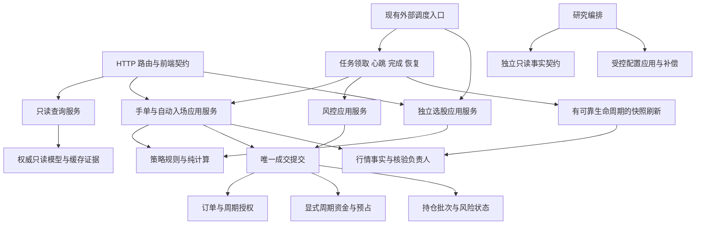
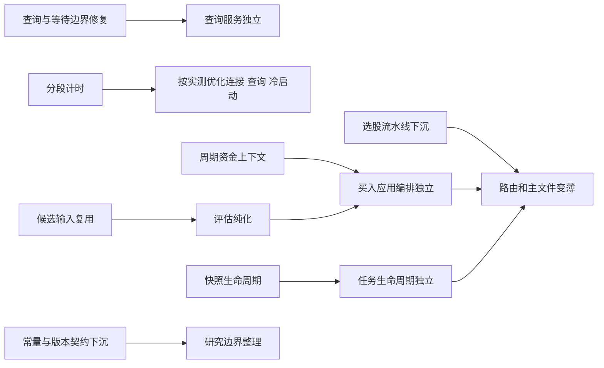

# 模拟盘当前架构全面审计

审计日期：2026-10-13。对象：当前工作区，包含此前尚未提交的性能优化和两类业务解耦；不是仅分析 Git HEAD。

## 1. 结论与完成标准

整体适合继续采用**模块化单体**：仍部署一个应用，但按业务职责明确谁负责事实、规则、写入和任务执行。现有权威事实、交易安全和只读模型已经比较完整；主要欠缺是应用编排仍集中在主文件，旧接口会把下层服务重新连回主文件，部分“只读、异步、有界等待”的承诺没有在能力接口上真正封住。

建议同时推进两条线：先修复可以独立验证的等待和只读边界问题；再按资金、决策、任务生命周期逐步迁移真正实现。大文件缩短、消除导入循环、降低请求耗时是三个不同目标，要分别验收。

本轮完成标准：重新生成当前依赖及职责清单；核对关键交易、查询、行情、研究、存储、调度和前端请求边界；对关键可疑路径给出可复跑证据；输出有依赖顺序和验收标准的优化路线。本轮不修改业务代码、不运行真实行情、不读写真实账本。

## 2. 当前规模与剩余依赖

静态扫描使用 Python AST（把源码解析成语法结构），不导入应用。范围为 backend 顶层非 test_ 开头的 Python 文件，包括函数内及相对的字面导入；不含动态 importlib 导入、回调调用边、嵌套包和前端依赖。SQL 仅扫描常量和格式化字符串的字面部分，所以不能作为全部写入点的证明。

| 指标 | 当前值 | 含义 |
|---|---:|---|
| 后端扫描模块 | 246 | 模块已经很多，不应把每个辅助函数都新建成服务 |
| paper_trading | 15,357 行 | 仍混合建库、周期维护、资金、候选、决策、任务和查询 |
| paper_trading 直接项目依赖 / 导入它的模块 | 76 / 14 | 已迁移实现，但主文件仍是组装和业务中心 |
| adaptive_engine | 4,583 行 / 34 个项目依赖 | 研究编排、数据库初始化、展示和补偿恢复仍集中 |
| _buy_order / _candidate_rows | 1,142 / 716 行 | 分别混合多阶段执行编排、候选数据加载和选择规则 |
| _strategy_entry_assessment / init_db | 452 / 393 行 | 多策略评估分支、初始化与维护职责仍集中 |

执行、手单、查询的声明清单分别有 22、55、25 个字段。当前直接绑定订单/lot 下层负责人的字段分别为 6、2、1；其余 16、53、24 个字段仍从主文件 globals 获取，包含函数、常量、模块和状态，不能全部称为业务函数。`Any` 类型也无法表达“只读”“不得联网”“必须使用指定周期”。证据：execution_planner.py:1005、manual_orders.py:26、dashboard_queries.py:19、paper_trading.py:15323。

此前两组五模块的交易/研究导入闭环已经解除，但**全项目仍有四组字面导入循环**。下表都是函数内的回边，不等同于已经发生启动失败。

| 循环 | 实际回边 | 最小处理方式 |
|---|---|---|
| main ↔ paper_selection | paper_selection._run_one 调 main._select_uncached（415） | 将选股应用流水线移到 HTTP 下层；API 和 runner 都调用它 |
| strategies ↔ strategy_plugins | 插件默认 runner 调 strategies._run_strategy_legacy（97）；策略入口调插件（1748/1768） | 让旧算法实现独立于插件分派，或在组装处绑定默认 runner；保留注册表版本语义 |
| self_evolution ↔ evolution_activation | 激活校验读取 BOUNDS 和 EVOLUTION_VERSION（590/832） | 将边界常量与版本契约放到下层；保持激活唯一入口和版本条件更新 |
| tradability_ingestion ↔ tradability_observation_ledger | ledger 从摄取层读 OBSERVED_UNPROVABLE（82） | 将唯一常量归到事实契约；不复制字符串，不改变同事务来源链接 |

这些循环不必全部先解除才能继续其他优化；资金、等待边界与常量归属可以独立推进。导入循环是维护信号，不是已测得的性能热点。

## 3. 需要先处理的三个具体问题

### A. dashboard 的“只读不联网”依赖默认参数，存在穿透路径

dashboard_queries.py:180 调用 `_account_metrics` 时没有传 `allow_network=False`。paper_trading.py:13276 的该参数默认 True，缺失当日已卖股票的价格时会调用 `_quotes(missing_sell_codes)`。即使 dashboard 先尝试补齐缓存，缓存本来缺失时仍会进入网络路径，且调用发生在 dashboard 的数据库连接上下文内。

隔离实验使用源码提取的真实 `_account_metrics` 函数，输入“无当前持仓、有一笔今日卖出、缓存没有该股票”，捕获到 `_quotes(['000001'])`。没有发起真实网络请求。这证明指标 helper 的穿透能力，以及 dashboard 未关闭此能力；不是线上耗时测量。

最小修复是该调用显式禁止联网并增加缺失缓存的行为回归。随后把“账本读取 + 价格证据获取 + 指标纯计算”拆开，让查询获得只读价格能力，而不是依赖默认布尔参数。缺价格要表达估值质量，不为查询偷偷刷新源。

dashboard 还使用 `_db()` 与可补建周期的 `_active_cycle()`（paper_trading.py:2642），而不是强制只读连接。正常已初始化账本不一定写入，但接口并未保证无法写。迁移时应使用已有 paper_storage.db_readonly 和明确的周期读取；无周期显示不可用，不在 GET 中补周期。

验收：缺失价格和缺失周期的 GET 路径均零 provider 请求、零写入；已初始化数据下原输出口径保持；成本兜底仅保留展示语义，不成为交易可执行证据。

### B. 缓存等待的 180 秒不是整个请求的上限

api_paper.py:216 的 `_cache_load` 在等待事件 180 秒后没有结果，会递归调用自己。但原 `_cache_inflight[key]` 没有被移除，下一层仍看到同一个任务，继续等待。注释中的“重试一次成为新 owner”没有实现。single-flight 指多个同类请求只让一个负责计算，其他请求等待其结果。

隔离实验让真实函数面对同一个未完成任务，模拟三次事件超时：等待参数为 [180, 180, 180]，loader 调用为 0，原任务仍登记。没有真实等待 540 秒。正常 owner 最终完成时可退出；问题是超时路径没有总期限，遇到长期挂起可能持续等待并增加递归深度。

最小修复建议到期限后返回明确的暂时不可用状态；只有经过身份检查和代际设计后才考虑替换 owner，不能直接删除共享项启动第二个计算，否则旧任务完成时可能覆盖新结果。先保证有界，不必先建设通用任务平台。

验收：永不完成的 loader 也能在一次总期限内结束等待；异常被共享；正常并发只计算一次；旧任务不能清除或发布到新一代任务。

### C. 一次性任务和后台风控快照的生命周期不匹配

paper_runner.py:25 是单次进程。paper_trading.py:13197 启动 daemon 刷新线程并最多等待 20 秒，超时后继续完成 slot；13969 的线程会随进程退出终止。20 秒是等待上限，不是刷新完成保证。代码自己说明刷新可能需要数分钟。若刷新超过期限，存在本轮快照未落地的风险；本轮没有真实慢源实验，不能声称生产每次都丢失。

同时这一等待位于全局租约释放之前，会延长其他任务的排队时间。不要直接删除等待或租约：应让快照刷新有自己的可靠生命周期。最小第一步是同进程内明确完成/超时状态和退出策略；需要独立运行时，可利用现有外部调度增加独立快照任务，并持久化去重身份和完成状态。常驻 worker 只有测得冷启动和线程重建成本显著后再考虑。

验收：模拟超过 20 秒、进程退出、重复启动和源失败，快照任务状态可追踪，未完成不能显示为已刷新；交易 slot 与展示快照的完成状态分别表达；成交租约、心跳和防旧进程写入的代际校验保持。

## 4. 业务解耦：优先迁移什么

### 资金与预占：复用现有负责人，统一周期输入

paper_shared_cash 已负责实际现金算术和写入；paper_capital_reservations 已负责预占。因此不需要另写一套资金算法。真正剩余的耦合是 `_shared_account_rows`、周期选择和成员归属仍由主文件负责，预占还注入 `_shared_cash` 与 `_active_cycle`。paper_trading.py:2894 的扣款包装也默认选当前成员。

PCR.reserve_shared_capital:195 已接受 expected_cycle_id，但它同时保留隐式当前周期和全池读取路径。该事实不是本轮发现的资损 bug：commit_fill 仍在原事务内重查租约、订单、账户和周期。优化目标是让同一笔经济事实的周期在接口上贯穿读取、预占和扣款，使下层脱离主文件仍可以独立运行。

建议复用 PortfolioReadContext / paper_cycle_ownership 和现有资金模块：上层显式解析本次订单周期与经济成员，下层读写使用该上下文；旧无订单创建路径保留兼容适配。执行层直接绑定实际资金负责人。保留卖出历史经济成员的既有授权规则，不用“当前参与策略”代替经济所有者。

验收：旧周期待成交订单、账户换周期、未知归属、预占与订单错配、部分成交、手续费、重复提交、事务回滚都通过；现金与预占合计保持；下层独立导入和运行不依赖 paper_trading。对执行这 16 个剩余字段逐项归属，不能仅把它们包装成另一个万能对象。

### 入场与候选：先分取数、评估、写入，再按策略划分

`_strategy_entry_assessment` 先通过主文件取策略规格，再按策略身份分支；手单也依赖它。先显式传入周期固定的规格、行情事实、因子和规则参数，使评估成为可重复计算，再用已有策略插件承接策略差异。纯计算指同样输入始终给同样输出，且不读数据库、网络或当前时钟。

`_buy_order` 已有强门禁并最终委托唯一 commit_fill，但仍同时负责租约和周期重读、冻结等待池、风险与席位计划、订单生命周期、预占和审计。按“读取事实 → 提案/阻断结果 → 事务内重验并应用”三段拆，不让纯评估返回可直接成交的授权。写入时的最终重查必须保留。

`_candidate_rows` 不只是排序：它加载 universe、规格、历史因子、校验时效并做筛选。先复用一轮的明确历史输入，再按策略计算。缓存键至少区分因子版本、历史截止日、实时证据身份、策略固定版本和参数；不能仅按股票代码或当天日期缓存。

验收：旧新实现逐策略输出数量、顺序、评分、阻断理由、等待/拒绝状态一致；策略版本固定、T+1、涨跌停、席位占用均保持；纯函数不调用 provider 或 execute；网络证据在写事务前取得，最终执行仍重验。

### 任务与初始化：把维护移出业务入口，而非简单跳过

run_slot:12914 每次 init_db；open/risk 等被调用入口及手单也调用初始化。init_db 已有“已建库”分支，但仍做多项 schema 确认、账户/周期维护、恢复和状态对账。存在重复工作机会，本轮未计时，不能认定它占主要耗时。

建议分为数据库版本升级、进程启动恢复、日常业务前置检查三项。升级路径使用现有迁移负责人；只有验证迁移版本和配置身份后才能跳过，不能用一个永远 True 的进程标记跳过新策略登记、数据库替换或版本更新。恢复逻辑必须证明幂等及活租约保护。

paper_slot_service 当前仅负责参数校验和前置清扫，不是完整调度负责人。后续把领取任务、心跳、完成/失败条件更新、清理租约迁到任务应用服务。主文件保留业务入口适配。先迁生命周期再迁业务分派，不改全局串行规则来追求表面速度。

验收：同一任务不重复成交；死亡后可回收，活任务不会被抢；旧代际无法写入；暂停/重置期间在途任务拒绝不合法写入；初始化调用次数和实际 SQL 时间可测，版本变化仍可靠迁移。

## 5. 账本写入与研究边界

静态扫描见 `paper_fills` 的字面写入仅在 execution_planner，`paper_positions` 仅在 paper_lot_ledger。这是现有边界的优点，应保持。paper_orders 出现在 11 个模块，paper_accounts 在 10 个，paper_capital_reservations 在 4 个；它们包含合法的维护、迁移、生命周期和补偿，**不能仅凭数量判定写入权威冲突**。

建议按“表 + 字段 + 动作”列负责人，而不是规定整张表只能一处写。例如账户 cash 属资金账务，周期挂接属周期服务，params/version 属受控配置应用；订单成交数量属执行权威，失效状态属生命周期。已有 source_fill_id 关联回写（execution_planner.py:2149）也应注明，不为消灭跨模块 SQL 随意转移提交顺序。

研究运行的只读事实已从 adaptive_engine 分离，但 ai_research_runtime_adapter.py:123 仍导入 paper_trading，主要为了 PaperJobRunFactProjection 类型和状态常量。可以沿用 adaptive_runtime_facts 的范式把任务事实读取及类型契约独立，旧入口别名保留同一个类身份，减少只读研究消费者加载交易主文件。

adaptive_engine._connect 每次调用 _init_schema（274/288）；run_learning_cycle 已分多个事务并复用数据集，不应退回一个大事务。该文件还保留 paper 侧配置补偿（720 起），evolution_apply 等也会改账户配置。下一步是统一受控应用/补偿的接口归属，保留已有 outbox 和版本检查。outbox 是先记下待完成动作、再可靠应用并记录结果的台账；不要另起第二套补偿机制。

验收：研究事实读取不导入交易编排；未知/未证实状态不升级；跨账本应用在提交前后中断均可恢复或明确报警；版本不符不覆盖更新；研究仍不产生交易订单、不自动启用配置。

## 6. 性能与前端：用分段证据决定投入

已有 marketdata_transport._session:25 按线程复用 requests.Session。SSL 关闭多不直接证明缺少连接池；线程池短命、进程短命、源主动断连都可能影响复用。先记录每轮线程池创建、请求数、重试、连接重建，再考虑调整。保持独立行情交叉验证，缓存命中不能代替事实新鲜度和核验。

建议在现有日志/任务 detail 中记录各阶段耗时，不建设额外监控平台：导入与启动、初始化、外部证据、候选/策略计算、数据库锁等待、写事务持有时间、快照尾部。至少分冷/热、成功/失败源、少/多持仓、正常/历史增长账本，统计中位数和第 95 百分位（95% 样本不超过的耗时），不可只测一轮。

前轮隔离空账本启动就绪中位数 6.139s → 5.575s，首次研究设置请求承担约半秒延迟加载；争用情况下导入收益不稳定。它不证明 close/risk/intraday 加速，也不支持 300ms 启动目标。当前更可靠的性能依据仍是增量 manifest 减少文件读取。完整交易链时效需要后续在受控数据上重新测量。

前端已经有 core/api.js 的统一 request、凭据方法边界、超时与只读重试，features 也按页面拆分，package.json 使用 esbuild；无需为本问题更换框架。可以在后端上述边界修复后核对风险页轮询和导航取消行为，减少隐藏页/重复刷新；避免客户端自己判断可成交、拼装另一套资金口径。本轮只审阅请求与模块组织，未做浏览器交互、样式或全前端调用图验证。

查询规模优化应基于现有 account_metric_inputs 批量读取与缓存机制，按真实慢 SQL 的执行计划补索引/限定历史范围；不要重复引入另一个全局缓存，或为了加速删除权威历史证据。

## 7. 推荐目标结构



组装入口只创建连接、上下文和能力绑定，不拥有资金/策略规则。下层可以导入真正的下层业务模块；“所有新模块必须零项目 import”只适用于纯契约或纯算法，不应变成所有服务都依靠大规模回调注入的理由。

## 8. 实施路线与顺序仿真

这是源码依赖顺序推演，不是运行耗时仿真；不作未经实现的工期或百分比承诺。

| 顺序 | 交付范围 | 可独立推进 | 完成判据 |
|---|---|---|---|
| 1 | dashboard 禁止网络、缓存总期限与代际安全 | 是，两个小改动分别回归 | 隔离反例变为通过，正常查询与并发行为保持 |
| 2 | 风控快照可靠生命周期；增加分段计时 | 与资金线独立 | 慢刷新/进程退出有可核验状态；能区分等待与计算 |
| 3 | 显式周期资金读取、预占、扣款，真实负责人直连 | 不要求先拆策略 | 执行资金能力脱离主文件，周期错配及回滚回归通过 |
| 4 | 入场评估纯化；候选输入按本轮复用 | 资金接口稳定后拆买入应用最顺 | 新旧逐策略结果一致；纯计算无隐式取数 |
| 5 | 买入应用编排、任务生命周期与初始化职责迁移 | 分开提交，不同时迁事务和规则 | 根模块只转发这些入口；租约及原子成交行为保持 |
| 6 | 独立选股流水线、其余三组循环、任务只读事实、研究补偿归属 | 常量循环可提前；其他依具体负责人 | 本轮列出的回边消失，配置应用恢复契约保持 |
| 7 | 根据实测优化查询规模、连接/进程复用；整理架构索引 | 贯穿全过程 | 相同数据与行为下耗时改善；每项规则可追踪到负责人和行为测试 |



每批只迁一个完整职责，保留兼容入口，先跑针对行为和失败路径的回归，再在交易/资金/生命周期变更后跑全量。不能用纯源码“函数名还存在”替代行为验证，也不能在实现搬出后继续只扫描旧文件。346,457 字节的 ARCHITECTURE.md 建议增加简短负责人索引和不变量到测试映射，历史记录分章节可查；不删除旧安全规则来缩短文档。

## 9. 证据与局限

本轮新生成：

- work/audit_current_architecture.py → work/current_architecture_inventory.json：246 模块语法解析、导入图、函数长度、能力字段、字面 SQL 写入位置。
- work/probe_architecture_boundaries.py → work/architecture_boundary_probe_result.json：真实函数源码提取后的缺价格/事件超时实验；均无应用导入、真实网络、数据库及长等待。

复跑命令：

```powershell
python work/audit_current_architecture.py
python work/probe_architecture_boundaries.py
```

前轮全量 5663 项、0 失败、0 错误、5 跳过是此前业务解耦的验证，不是本轮重新运行。本轮没有修改业务实现；两份脚本复跑、246 模块源码解析、隔离实验断言、ruff、compileall 和 git diff --check 通过。未获得当前生产数据库规模、完整 slot 性能追踪、多进程长期运行数据，相关收益和运行故障频率仍需实测。本报告的三个具体边界问题和结构性建议应分别处理，不能把静态规模指标直接换算成速度。

## 10. 审计后修复：查询、等待与刷新生命周期

用户授权“开始修吧”后，首先修复第 3 节三个具体问题；前文规模、行号与漏洞实验是修复前审计快照。资金、入场与完整任务职责迁移仍按第 8 节推进，不把本轮修复等同于全部架构优化完成。

### 可直接使用的行为

- dashboard 通过 paper_storage 的只读连接读取账本，周期读取不再调用可补建周期的旧入口；缺周期返回 503。账户指标调用显式 `allow_network=False`，缺当日卖出票价保留未知/缺失口径，不为页面联网补齐。schedule_status 同样只读。
- `_cache_load` 等待既有计算者最多一次 25 秒，超时返回 503；原计算者保留，完成后仍可发布结果。相关路由不再把这一 503 包装成 500。它限制的是等待者，不会强行终止原计算者，也不保证全部 HTTP 请求都在 25 秒内结束。
- `run_slot` 先让交易任务完成并释放租约，再刷新展示快照。网页调用默认后台方式；paper_runner 显式选择同步方式，等待实际刷新函数返回后退出，不创建可能被退出截断的 daemon 刷新线程。同步路径沿用行情请求自身的超时规则，没有人为宣称 20 秒内完成。
- 刷新失败保留已完成交易的状态，单独返回 `risk_snapshot_refresh=failed` 和错误；runner 返回非零退出码。再次调用已完成的任务时只重试刷新，不再运行交易。刷新完成表示刷新操作完成，行情是否可信继续由原数据质量与核验口径决定。
- 同进程去重状态在刷新及回调都结束后才释放，记录 status/finished_at；API 仍可后台刷新。没有新增服务、系统任务或第二套资金/快照权威。

进程强制终止不能保证本轮刷新完成，但没有正常成功退出；已完成交易保持幂等，后续调度可重新刷新。新 status 是进程内状态，不宣称新增了跨进程的持久化快照任务台账；已有交易任务记录和快照文件继续持久化。本轮也未新增跨进程全局刷新去重机制。

### 证据

新增 backend/test_dashboard_refresh_semantics.py 的 13 项行为回归，覆盖缺价格禁联网、只读连接、缺周期不补写、缓存超时/异常、同步与后台去重、失败退出、真实临时账本租约释放，以及重试不重复运行交易。连同既有相关测试共 77 项通过，0 失败、0 错误、0 跳过；结果 work/architecture_boundary_tests_scoped_result.json。

`work/probe_architecture_boundaries.py` 已改为验证修复后行为：只模拟一次 25 秒等待、返回 503、保留原计算者，并核对 dashboard 禁联网调用契约；输出 work/architecture_boundary_fix_probe_result.json。原审计漏洞实验结果 work/architecture_boundary_probe_result.json 保留。完整行为验证以新增后端测试为准。

复跑：`python work/run_architecture_boundary_tests.py`；全量：`python work/run_architecture_boundary_tests.py --full`。

首轮全量 5676 项中有 1 项新增测试失败、0 错误、5 跳过：既有 test_operator_boundary 在发现阶段将 schedule_status 全局替换成静态测试值，导致新测试没有调用真实函数。新测试改为执行实际源码函数体、注入当前只读连接和假调度传输，保持“不能打开写连接”的行为断言。没有修改业务实现来迁就测试。首轮日志与结果保留在 work/architecture_boundary_tests_full_first.log 和对应 JSON。

修正后 77 项相关回归再次通过；最终全量 **5676 项，0 失败、0 错误、5 跳过**，测试本体 563.489 秒，含发现与汇总 565.174 秒，结果 work/architecture_boundary_tests_full_result.json。真实 HTTP 测试核对 overview、risk-overview、risk-audit、strategy-center、reviews 五个缓存消费路由均保留 503，结果 work/architecture_boundary_http_result.json。ruff backend/本轮脚本、compileall、diffcheck 均通过。源码在当前工作区可通过原入口使用，无需新增配置，未提交或部署。未测真实行情完整任务的耗时改善。
