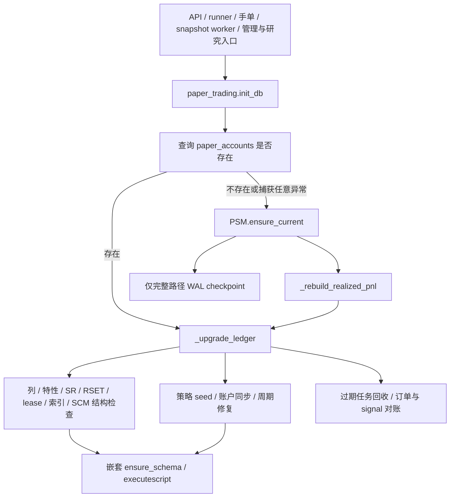

# PR-6 账本初始化生命周期审计与验收

审计基线 commit：`acaa7972862eaf5078daf7bb531ec4a1ce48c34e`（PR302 squash 合并）。
独立 worktree 从最新 master 拉取，`git status --short` 为空后创建 `codex/ledger-bootstrap-lifecycle`。
以下审计先于生产修改；原检出目录的未跟踪 `.agents/` 保持原样。

## 原初始化调用链



直接入口审计（包含各自再调用的包装）：

- `paper_trading`：generate_signals、backfill_research_shadow、execution_dispatch_overview、execution_profile_center、
  strategy_champion_overview/open/promote/rollback、strategy_allocation_explain、resolve_execution_verification、
  process_pending_execution_orders、execute_open、monitor_risk、run_auction_preselection、monitor_opening_events、
  monitor_fast_entries、monitor_intraday、run_slot、configure_capital、start_new_cycle、reset_cycle、set_account_style、
  set_accounts_status、latest_reviews。
- `manual_orders`：preview/submit/cancel/process_pending_manual_orders，通过依赖端口调用同一 init_db。
- `main._lifespan`、`api_settings` 快照/设置提交/通知测试/审计入口、`paper_snapshot_worker.main`。
- `demo_seed.ensure_demo_data`、`push_report.main`、strategy_candidate/health/retirement/retirement_workflow/
  strategy_service 的账本连接包装。
- 间接链：`paper_runner → run_slot → monitor_intraday → monitor_risk / execute_open / 手单处理`，
  以及 API handler/worker 对上述公开函数的调用。保留 init_db 契约使所有包装继续生效。
- snapshot worker 先用 storage/job owner 只读到期检查；空闲时不导入完整引擎。此顺序不能破坏。
  已改为只读的历史/看板 GET 不应重新引入 init_db。

## 原步骤分类

“写锁”指可能取得/持有 SQLite writer，原 executescript 会隐式提交，因此原外层事务并非覆盖整条链。

| 原步骤 / owner | DDL | 行情/CSV | 账户/周期/订单状态 | 执行频率 / 升级范围 | 进程依赖 | 并发要求 | 写锁 |
| --- | --- | --- | --- | --- | --- | --- | --- |
| storage._db 连接/PRAGMA | 无业务DDL | 无 | 无 | 每连接 | 无初始化记忆 | 既有busy timeout | 可等待 |
| PSM.ensure_core_tables | 表/索引 | 无 | 无 | 首次/结构修复 | 无 | 必须序列化结构写入 | 是 |
| PSM.ensure_current | 表/列并夹杂历史修补 | 无 | lot费用、reservation、旧waitlist | 原完整路径 | 无 | 不能半提交 | 是 |
| PSM.ensure_paper_columns / feature / lease | 列/表/索引/guard | 无 | 部分旧行归属回填 | 结构升级/损坏修复 | 无 | 必须串行升级 | 是 |
| SR.ensure_schema | 表/列/触发器及版本seed | 无 | 定义/不可变v1/head/legacy绑定 | 结构升级与幂等业务seed混合 | 无 | 相同连接事务内 | 是 |
| SL.ensure_schema | 表/索引/事件guard | 无 | head与精确cycle pin的旧生命周期导入 | 缺失时修复 | 无 | 不越过有效cycle | 是 |
| RSET.ensure_schema | 设置表/列/索引 | 无 | 缺省设置seed | 缺失设置仍需恢复 | 无 | API/worker共同使用 | 是 |
| _ensure_accounts | 无 | 原每次benchmark CSV | 同步内置配置/补账户NAV | 每次保持配置语义，CSV只在确需新行时 | 无 | 与cycle修复同事务 | 是 |
| _ensure_user_strategy_accounts | 间接registry ensure | 无 | 用户账户主体，保持零资金/暂停 | 每次检查缺失 | 无 | 不自行分配资金 | 是 |
| _ensure_cycle | 间接settings/registry ensure | 特定新建/激活分支benchmark | legacy周期/挂接/样式/资金一致性 | 每次，保持原分支 | 无 | 保留cycle pin与现金权威 | 是 |
| _recover_stale_runtime_state / PJL | 无DDL | 无 | 过期job/lease、重复waitlist | 每次合法恢复 | boot参数已被忽略 | 不回收有效lease | 是 |
| _reconcile_signal_order_states | 重复unique index | 无 | retry去重、signal/order/reservation | 每次必要对账 | 无 | 保留正成交与partial | 是 |
| _ensure_performance_indexes | 六个索引 | 无 | 无 | 原进程布尔控制，换DB有污染风险 | 是，需解除 | 不能认另一个DB已完成 | 是 |
| SCM.ensure_schema | 表/索引/列 | 无 | 无业务迁移 | 结构升级 | 无 | 必须保留owner | 是 |
| _rebuild_realized_pnl | 无 | 无 | lot已实现损益重建 | 原完整路径 | 无 | 不覆盖新成交 | 是 |
| WAL checkpoint | 无 | 无 | 无 | 原完整路径之后 | 无 | 必须在写事务外 | 是/可退PASSIVE |

结论：不能删业务seed、周期修复或恢复/对账。结构完成不代表运行状态正常；新进程也不代表旧进程已死亡。
必须先解决 executescript 隐式提交、进程级索引布尔、无条件 CSV、宽异常降级，再提供真实数据库的结构低成本路径。

## 实施后的职责拆分

```
init_db()                                   ← 唯一公开契约，未变
├── paper_ledger_bootstrap.bootstrap_schema(conn, fresh=…)
│   ├── 读 ledger_schema_receipt + 现场重算 structure_fingerprint + owner 源码指纹
│   ├─ 命中 → verify_required_structure() → "verified"（不跑 DDL）
│   └─ 未命中 → paper_ledger_bootstrap.ensure_ledger_structure(conn)
│                （PSM 核心表/列/特性/lease/影子/索引 → RSET/SR/SL 结构 → SCM）
│                → verify_required_structure() → "cold"
├── fresh 库的一次性行修补（PSM.repair_legacy_ledger_rows + _rebuild_realized_pnl）
├── paper_trading._recover_ledger_runtime(conn)      ← 每次都跑，结构 ready 也跑
│   ├── RSET.ensure_schema（设置默认值 seed）
│   ├── SR.ensure_schema（策略定义 seed / legacy 绑定）
│   ├── _ensure_accounts / _ensure_user_strategy_accounts / _ensure_cycle
│   ├── _recover_stale_runtime_state（过期租约、等待池、signal 状态）
│   └── _reconcile_signal_order_states（retry 去重、signal/order/reservation 对账）
└── 仅 "cold" 时写 ledger_schema_receipt（与前面所有工作同一个事务）
```

`PST.schema_ready_scope(conn)` 只在 `_recover_ledger_runtime` 内部有效：它让嵌套 owner
（`RSET/SR/SL` 的 `ensure_schema`）跳过重复 DDL，**不跳过任何业务步骤**。作用域是
"这一条连接 + 这一个 with 块"，不写库、不做进程缓存。

### 收据语义（为什么"版本相同"不会掩盖损坏）

| 保障 | 机制 |
| --- | --- |
| 迁移中断不得误标完成 | 收据与 DDL/校验/业务恢复同处一个 `BEGIN IMMEDIATE` 事务，失败整体回滚；失败时库里既没有半成品结构也没有收据 |
| 只有真正成功才确认 | 收据在 `init_db` 末尾写入，写的是**恢复之后**的结构摘要（例如对账阶段建的唯一索引也在内） |
| 明显损坏不得被"版本相同"掩盖 | 每次初始化都重算 `structure_fingerprint`（全部非 `sqlite_%` 对象的 name+DDL 原文），与收据比对；缺表/缺列/被重建都会失配 → 重新 bootstrap |
| 代码新增表/列 | 结构 owner 源码指纹进收据身份，owner 改动一次就失效一次，强制重建 |
| 跨 DB_PATH 不得复用结论 | 收据存在库里、摘要现算，进程内**没有任何** ready 缓存（`_PERFORMANCE_INDEXES_READY` 已删除） |
| 不与 db_migrate 冲突 | 不写 `schema_version`、不改版本号语义；`db_migrate` 只是复用 `PST.execute_script` 的语句切分，收据表独立 |
| 失败必须 fail closed | `init_db` 不再 `except Exception: pass`；结构校验失败抛 `LedgerSchemaBootstrapError`，调用方放弃本次初始化 |

### 其余改动（都是审计发现的真实缺陷）

1. **`executescript` 隐式提交**：`paper_storage.execute_script` 扩成公开的语句切分执行器
   （原 `db_migrate._run_operation` 的逻辑），`PSM.ensure_core_tables` /
   `runtime_settings` / `strategy_lifecycle` / `strategy_champion` / `db_migrate` 全部改用它。
   外层事务现在真的覆盖整条链。
2. **进程级索引布尔**：`_PERFORMANCE_INDEXES_READY` 删除。它无法区分两个数据库文件，
   第二个 `DB_PATH` 会继承第一个的结论而**没有索引**。索引 DDL 归结构 bootstrap。
3. **无条件 CSV**：`_ensure_accounts` 的 `_benchmark_close()` 改为惰性——只有真的要插入
   新账户时才读基准 K 线。
4. **对账索引每次启动发 DDL**：`_reconcile_signal_order_states` 先查 `sqlite_schema`，
   索引已存在就不再发 `CREATE INDEX`。
5. **宽异常降级**：`init_db` 原先"探测失败就吞掉异常走完整重建"的分支删除。

## 专项测试（`backend/test_ledger_bootstrap_lifecycle.py`，12 项）

| # | 场景 | 用例 |
| --- | --- | --- |
| 1 | 全新空数据库初始化 | `test_fresh_database_bootstraps_full_structure` |
| 2 | 已完成迁移的库重复初始化（不重复 DDL、恢复照跑） | `test_repeat_init_takes_verified_path_without_ddl_but_keeps_recovery` |
| 3 | 缺表/缺列的旧库 | `test_legacy_database_missing_feature_table_and_column_is_repaired` |
| 4 | 中途迁移失败，下次正常恢复 | `test_interrupted_bootstrap_leaves_no_receipt_and_recovers_next_run` |
| 5 | 两个进程同时初始化 | `test_two_processes_initializing_the_same_ledger` |
| 6 | API 只读与 worker 初始化并发 | `test_readonly_api_access_survives_concurrent_initialization` |
| 7 | 有效 lease 不被重置 | `test_valid_lease_is_not_reset_by_a_new_process` |
| 8 | 过期 lease 按原规则恢复 | `test_expired_lease_is_recovered_by_the_existing_rule` |
| 9 | 订单与 signal 不一致仍被修复（结构已 ready） | `test_signal_order_drift_is_still_reconciled_when_schema_is_ready` |
| 10 | 不同 DB_PATH 不继承初始化状态 | `test_switching_db_path_does_not_inherit_readiness` |
| 11 | 初始化失败禁止进入不安全状态 | `test_verification_failure_aborts_initialization` |
| 12 | 重复执行不改变已验证成交事实 | `test_repeated_initialization_preserves_verified_fills` |

## 性能对照（同机、同输入、脚本可复现）

`scripts/pr6_bootstrap_probe.py`，本机 Windows / Python 3.14 / SQLite（stdlib 自带），
15 次重复；master = `acaa797`，PR-6 = 本分支。**不含**真实行情缓存，`_benchmark_close`
被计数但不联网。

| 指标 | master | PR-6 | 变化 |
| --- | --- | --- | --- |
| 日常启动 `init_db` P50 / P95 | 15.44 / 16.43 ms | **10.68 / 11.26 ms** | −31% / −31% |
| 空库首次初始化 | 86.9 ms | **63.8 ms** | −27% |
| 旧库（master 生成）稳态 P50 / P95 | 16.01 / 17.68 ms | **10.63 / 11.07 ms** | −34% / −37% |
| 旧库首次升级（一次性） | 15.8 ms | 17.3 ms | +1.5 ms（只发生一次，之后进低成本路径） |
| 单次初始化 SQL 条数（日常） | 516 | **194** | −62% |
| 单次初始化 DDL 条数（日常） | 204 | **0** | −100% |
| 单次 schema 检查次数（日常） | 133 | **38** | −71% |
| 单次初始化基准 K 线读取（日常） | 1 | **0** | −100% |
| 空库首次：SQL / DDL / schema 检查 | 3063 / 1099 / 805 | **1858 / 248 / 557** | −39% / −77% / −31% |
| 连接 + `BEGIN IMMEDIATE` 耗时 P50 | 2.01 ms | 1.97 ms | 持平 |

**测量限制**：单机单进程、SQLite 单写者、无并发写入压力，因此"写锁等待"这一项在两种
实现下都接近 0，**不能**用它推断生产锁竞争；也不要拿这些离线数字宣称生产已提速。
本表能证明的是**机械事实**：日常启动不再执行任何 DDL、不再读基准 CSV、SQL 条数降到
原来的 38%，且结构校验仍然每次执行。

## 与 master 的账本逐字段对照

`scripts/pr6_ledger_compare.py`：用 master 建库 → 写入固定样本（两笔委托、两条成交、
一条 lot、一条 signal、一条风险决策、一条资金预留、一条租约行、一条 running job，
时间/金额/主键全写死）→ 各分支跑一次 `init_db` → 逐表逐字段比对。

结果：**63 张表严格相等（`strict_equal: true`）**，列结构完全一致
（`structure_equal: true`），PR-6 只多一张 `ledger_schema_receipt`；仅
`paper_accounts` / `paper_audit` 的 `updated_at` / `created_at` 因两个分支运行时刻不同
而不同（时间戳列单独列出，不计入严格差异）。`paper_jobs` / `paper_runtime_locks` 的
固定租约行、`paper_position_lots` 的剩余量与成本、`paper_risk_decisions` 的字段值均逐字
一致——**有效租约没有被重置，成交事实没有被改写**。

## 验证结果

L0：`ruff check backend scripts` → 仅剩 2 条**既有**问题（`scripts/security/scan-sensitive-data.py`，
本分支未触碰）；`compileall` 全部通过；`git diff --check` 无空白错误。

L1：`backend/test_ledger_bootstrap_lifecycle.py` 12 项全绿。

L2（局部回归）：`test_db_migrate`、`test_paper_storage`、`test_execution_evidence`、
`test_execution_verification_probe`、`test_execution_verification_wiring`、
`test_paper_job_lifecycle`、`test_paper_risk_scan_state`、`test_paper_snapshot_jobs`、
`test_paper_timing`、`test_replacement_asof_provenance`、`test_ignition_entry`、
`test_adaptive_schema_ownership`、`test_strategy_registry*`、`test_paper_schema_migrations`、
`test_schema_ownership`、`test_cycle_ledger_ownership`、`test_paper_cycle_ownership`、
`test_rebalance_db_ownership`、`test_r32_final_ownership_boundary` 全绿。

L3（架构 / cycle / lease / fencing 守卫）：`test_paper_trading_architecture_guard`、
`test_architecture_boundary_audit` 全绿（耦合预算见下）。

L4：`python scripts/run_tests_parallel.py --shards 8 --timeout 900` → **7513 项全绿**
（exit=0，墙钟 231.3 s，最慢分片 198.9 s，并行度 8）。master 基线为 7501 项，
本分支 = master + 新增 12 项专项（其余模块未减少）。

**测试改动说明**：`test_paper_timing` / `test_replacement_asof_provenance` 里对
`_PERFORMANCE_INDEXES_READY` 的重置已删除（该全局量按要求移除）；
`test_r35c_ai_candidate_generation` 的 `setUp` 补了一次显式 `conn.commit()`——它此前一直
依赖 `ensure_schema` 里 `executescript` 的**隐式提交**把自己打开的 `BEGIN` 提交掉，
而这正是本 PR 要移除的行为。覆盖没有降低，依赖变得更诚实。

## 状态

MERGE: NOT MERGED（等待人工审核）
DEPLOY: NOT DEPLOYED
