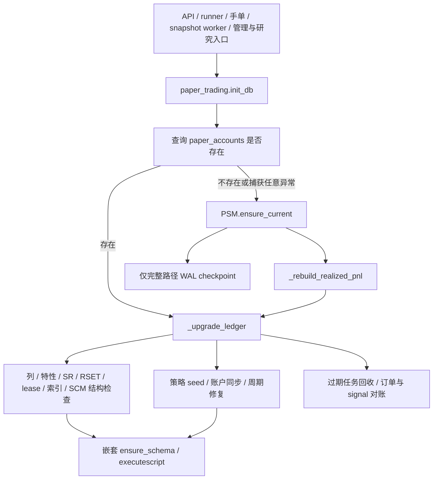

# PR-6 账本初始化生命周期审计与验收

审计基线 commit：`acaa7972862eaf5078daf7bb531ec4a1ce48c34e`（PR302 squash 合并）。
独立 worktree 从最新 master 拉取，`git status --short` 为空后创建 `codex/ledger-bootstrap-lifecycle`。
以下审计先于生产修改；原检出目录的未跟踪 `.agents/` 保持原样。

## 原初始化调用链



直接入口审计（包含各自再调用的包装）：

- `paper_trading`：generate_signals、backfill_research_shadow、execution_dispatch_overview、execution_profile_center、
  strategy_champion_overview/open/promote/rollback、strategy_allocation_explain、resolve_execution_verification、
  process_pending_execution_orders、execute_open、monitor_risk、run_auction_preselection、monitor_opening_events、
  monitor_fast_entries、monitor_intraday、run_slot、configure_capital、start_new_cycle、reset_cycle、set_account_style、
  set_accounts_status、latest_reviews。
- `manual_orders`：preview/submit/cancel/process_pending_manual_orders，通过依赖端口调用同一 init_db。
- `main._lifespan`、`api_settings` 快照/设置提交/通知测试/审计入口、`paper_snapshot_worker.main`。
- `demo_seed.ensure_demo_data`、`push_report.main`、strategy_candidate/health/retirement/retirement_workflow/
  strategy_service 的账本连接包装。
- 间接链：`paper_runner → run_slot → monitor_intraday → monitor_risk / execute_open / 手单处理`，
  以及 API handler/worker 对上述公开函数的调用。保留 init_db 契约使所有包装继续生效。
- snapshot worker 先用 storage/job owner 只读到期检查；空闲时不导入完整引擎。此顺序不能破坏。
  已改为只读的历史/看板 GET 不应重新引入 init_db。

## 原步骤分类

“写锁”指可能取得/持有 SQLite writer，原 executescript 会隐式提交，因此原外层事务并非覆盖整条链。

| 原步骤 / owner | DDL | 行情/CSV | 账户/周期/订单状态 | 执行频率 / 升级范围 | 进程依赖 | 并发要求 | 写锁 |
| --- | --- | --- | --- | --- | --- | --- | --- |
| storage._db 连接/PRAGMA | 无业务DDL | 无 | 无 | 每连接 | 无初始化记忆 | 既有busy timeout | 可等待 |
| PSM.ensure_core_tables | 表/索引 | 无 | 无 | 首次/结构修复 | 无 | 必须序列化结构写入 | 是 |
| PSM.ensure_current | 表/列并夹杂历史修补 | 无 | lot费用、reservation、旧waitlist | 原完整路径 | 无 | 不能半提交 | 是 |
| PSM.ensure_paper_columns / feature / lease | 列/表/索引/guard | 无 | 部分旧行归属回填 | 结构升级/损坏修复 | 无 | 必须串行升级 | 是 |
| SR.ensure_schema | 表/列/触发器及版本seed | 无 | 定义/不可变v1/head/legacy绑定 | 结构升级与幂等业务seed混合 | 无 | 相同连接事务内 | 是 |
| SL.ensure_schema | 表/索引/事件guard | 无 | head与精确cycle pin的旧生命周期导入 | 缺失时修复 | 无 | 不越过有效cycle | 是 |
| RSET.ensure_schema | 设置表/列/索引 | 无 | 缺省设置seed | 缺失设置仍需恢复 | 无 | API/worker共同使用 | 是 |
| _ensure_accounts | 无 | 原每次benchmark CSV | 同步内置配置/补账户NAV | 每次保持配置语义，CSV只在确需新行时 | 无 | 与cycle修复同事务 | 是 |
| _ensure_user_strategy_accounts | 间接registry ensure | 无 | 用户账户主体，保持零资金/暂停 | 每次检查缺失 | 无 | 不自行分配资金 | 是 |
| _ensure_cycle | 间接settings/registry ensure | 特定新建/激活分支benchmark | legacy周期/挂接/样式/资金一致性 | 每次，保持原分支 | 无 | 保留cycle pin与现金权威 | 是 |
| _recover_stale_runtime_state / PJL | 无DDL | 无 | 过期job/lease、重复waitlist | 每次合法恢复 | boot参数已被忽略 | 不回收有效lease | 是 |
| _reconcile_signal_order_states | 重复unique index | 无 | retry去重、signal/order/reservation | 每次必要对账 | 无 | 保留正成交与partial | 是 |
| _ensure_performance_indexes | 六个索引 | 无 | 无 | 原进程布尔控制，换DB有污染风险 | 是，需解除 | 不能认另一个DB已完成 | 是 |
| SCM.ensure_schema | 表/索引/列 | 无 | 无业务迁移 | 结构升级 | 无 | 必须保留owner | 是 |
| _rebuild_realized_pnl | 无 | 无 | lot已实现损益重建 | 原完整路径 | 无 | 不覆盖新成交 | 是 |
| WAL checkpoint | 无 | 无 | 无 | 原完整路径之后 | 无 | 必须在写事务外 | 是/可退PASSIVE |

结论：不能删业务seed、周期修复或恢复/对账。结构完成不代表运行状态正常；新进程也不代表旧进程已死亡。
必须先解决 executescript 隐式提交、进程级索引布尔、无条件 CSV、宽异常降级，再提供真实数据库的结构低成本路径。

## 实施后的职责拆分

```
init_db()                                   ← 唯一公开契约，未变
├── paper_ledger_bootstrap.bootstrap_schema(conn, fresh=…)
│   ├── 读 ledger_schema_receipt + 现场重算 structure_fingerprint + owner 源码指纹
│   ├─ 命中 → verify_required_structure() → "verified"（不跑 DDL）
│   └─ 未命中 → paper_ledger_bootstrap.ensure_ledger_structure(conn)
│                （PSM 核心表/列/特性/lease/影子/索引 → RSET/SR/SL 结构 → SCM）
│                → verify_required_structure() → "cold"
├── fresh 库的一次性行修补（PSM.repair_legacy_ledger_rows + _rebuild_realized_pnl）
├── paper_trading._recover_ledger_runtime(conn)      ← 每次都跑，结构 ready 也跑
│   ├── RSET.ensure_schema（设置默认值 seed）
│   ├── SR.ensure_schema（策略定义 seed / legacy 绑定）
│   ├── _ensure_accounts / _ensure_user_strategy_accounts / _ensure_cycle
│   ├── _recover_stale_runtime_state（过期租约、等待池、signal 状态）
│   └── _reconcile_signal_order_states（retry 去重、signal/order/reservation 对账）
└── 仅 "cold" 时写 ledger_schema_receipt（与前面所有工作同一个事务）
```

`PST.schema_ready_scope(conn)` 只在 `_recover_ledger_runtime` 内部有效：它让嵌套 owner
（`RSET/SR/SL` 的 `ensure_schema`）跳过重复 DDL，**不跳过任何业务步骤**。作用域是
"这一条连接 + 这一个 with 块"，不写库、不做进程缓存。

### 收据语义（为什么"版本相同"不会掩盖损坏）

| 保障 | 机制 |
| --- | --- |
| 迁移中断不得误标完成 | 收据与 DDL/校验/业务恢复同处一个 `BEGIN IMMEDIATE` 事务，失败整体回滚；失败时库里既没有半成品结构也没有收据 |
| 只有真正成功才确认 | 收据在 `init_db` 末尾写入，写的是**恢复之后**的结构摘要（例如对账阶段建的唯一索引也在内） |
| 明显损坏不得被"版本相同"掩盖 | 每次初始化都重算 `structure_fingerprint`（全部非 `sqlite_%` 对象的 name+DDL 原文），与收据比对；缺表/缺列/被重建都会失配 → 重新 bootstrap |
| 代码新增表/列 | 结构 owner 源码指纹进收据身份，owner 改动一次就失效一次，强制重建 |
| 跨 DB_PATH 不得复用结论 | 收据存在库里、摘要现算，进程内**没有任何** ready 缓存（`_PERFORMANCE_INDEXES_READY` 已删除） |
| 不与 db_migrate 冲突 | 不写 `schema_version`、不改版本号语义；`db_migrate` 只是复用 `PST.execute_script` 的语句切分，收据表独立 |
| 失败必须 fail closed | `init_db` 不再 `except Exception: pass`；结构校验失败抛 `LedgerSchemaBootstrapError`，调用方放弃本次初始化 |

### 其余改动（都是审计发现的真实缺陷）

1. **`executescript` 隐式提交**：`paper_storage.execute_script` 扩成公开的语句切分执行器
   （原 `db_migrate._run_operation` 的逻辑），`PSM.ensure_core_tables` /
   `runtime_settings` / `strategy_lifecycle` / `strategy_champion` / `db_migrate` 全部改用它。
   外层事务现在真的覆盖整条链。
2. **进程级索引布尔**：`_PERFORMANCE_INDEXES_READY` 删除。它无法区分两个数据库文件，
   第二个 `DB_PATH` 会继承第一个的结论而**没有索引**。索引 DDL 归结构 bootstrap。
3. **无条件 CSV**：`_ensure_accounts` 的 `_benchmark_close()` 改为惰性——只有真的要插入
   新账户时才读基准 K 线。
4. **对账索引每次启动发 DDL**：`_reconcile_signal_order_states` 先查 `sqlite_schema`，
   索引已存在就不再发 `CREATE INDEX`。
5. **宽异常降级**：`init_db` 原先"探测失败就吞掉异常走完整重建"的分支删除。

## 专项测试（`backend/test_ledger_bootstrap_lifecycle.py`，25 项）

| # | 场景 | 用例 |
| --- | --- | --- |
| 1 | 全新空数据库初始化 | `test_fresh_database_bootstraps_full_structure` |
| 2 | 已完成迁移的库重复初始化（不重复 DDL、恢复照跑） | `test_repeat_init_takes_verified_path_without_ddl_but_keeps_recovery` |
| 3 | 缺表/缺列的旧库 | `test_legacy_database_missing_feature_table_and_column_is_repaired` |
| 4 | 中途迁移失败，下次正常恢复 | `test_interrupted_bootstrap_leaves_no_receipt_and_recovers_next_run` |
| 5 | 两个进程同时初始化 | `test_two_processes_initializing_the_same_ledger` |
| 6 | API 只读与 worker 初始化并发 | `test_readonly_api_access_survives_concurrent_initialization` |
| 7 | 有效 lease 不被重置 | `test_valid_lease_is_not_reset_by_a_new_process` |
| 8 | 过期 lease 按原规则恢复 | `test_expired_lease_is_recovered_by_the_existing_rule` |
| 9 | 订单与 signal 不一致仍被修复（结构已 ready） | `test_signal_order_drift_is_still_reconciled_when_schema_is_ready` |
| 10 | 不同 DB_PATH 不继承初始化状态 | `test_switching_db_path_does_not_inherit_readiness` |
| 11 | 初始化失败禁止进入不安全状态 | `test_verification_failure_aborts_initialization` |
| 12 | 重复执行不改变已验证成交事实 | `test_repeated_initialization_preserves_verified_fills` |
| R1-1 | fresh 初始化触发一次 checkpoint | `WalCheckpointScopeTests.test_fresh_initialization_triggers_checkpoint_once` |
| R1-2 | cold 升级触发一次 checkpoint | `test_cold_upgrade_triggers_checkpoint_once` |
| R1-3 | verified 重复初始化不触发 checkpoint | `test_verified_repeat_does_not_trigger_checkpoint` |
| R1-4 | 持续只读事务下 verified 不被 checkpoint 拖住 | `test_verified_init_does_not_wait_on_an_open_read_transaction` |
| R2-1 | 缺失 owner 源码 → 抛错并给出原因 | `test_missing_owner_source_raises_with_reason` |
| R2-2 | owner 源码路径无效 → 抛错 | `test_invalid_owner_source_path_raises` |
| R2-3 | 指纹不可用失败时不产生收据 | `test_unavailable_fingerprint_fails_closed_without_receipt` |
| R2-4 | 既有收据不被"确认" | `test_existing_receipt_is_not_confirmed_when_fingerprint_unavailable` |
| R2-5 | 旧式 `unavailable:` 收据不得被接受 | `test_legacy_unavailable_sentinel_receipt_is_rejected` |
| R2-6 | owner 指纹变化必须重新 cold | `test_owner_fingerprint_change_forces_cold` |
| R2-7 | 非 sha256 值一律判为无效 | `test_fingerprint_guard_rejects_non_sha256_values` |
| R3-1 | `init_db()` 两条路径都返回 `None` | `PublicReturnContractTests.test_init_db_returns_none_on_both_paths` |
| R3-2 | 没有进程级 schema ready 布尔量 | `test_no_process_wide_schema_ready_flag` |

## 性能对照（同机、同输入、脚本可复现）

`scripts/pr6_bootstrap_probe.py`，本机 Windows / Python 3.14 / SQLite（stdlib 自带），
15 次重复；master = `acaa797`，PR-6 = 本分支。**不含**真实行情缓存，`_benchmark_close`
被计数但不联网。

| 指标 | master | PR-6 | 变化 |
| --- | --- | --- | --- |
| 日常启动（verified）P50 / P95 | 16.28 / 17.26 ms | **8.18 / 9.07 ms** | −50% / −47% |
| 空库首次（fresh/cold） | 91.81 ms | **64.15 ms** | −30% |
| 旧库（master 生成）稳态 P50 | 16.30 ms | **8.19 ms** | −50% |
| 旧库首次升级（一次性） | 15.6–17.0 ms | 16.99 ms | +0～1 ms（只发生一次，之后进低成本路径） |
| verified + 持续只读事务 P50 / P95 | 12.04 / 12.84 ms | **6.91 / 7.76 ms** | −43% / −40% |
| `wal_checkpoint` 次数 fresh / cold / verified | 1 / 1 / 0 | 1 / 1 / **0** | 与 master 一致 |
| 单次初始化 SQL 条数（日常） | 516 | **194** | −62% |
| 单次初始化 DDL 条数（日常） | 204 | **0** | −100% |
| 单次 schema 检查次数（日常） | 133 | **38** | −71% |
| 单次初始化基准 K 线读取（日常） | 1 | **0** | −100% |
| 空库首次：SQL / DDL / schema 检查 | 3063 / 1099 / 805 | **1858 / 248 / 557** | −39% / −77% / −31% |
| 连接 + `BEGIN IMMEDIATE` 耗时 P50 | 2.01 ms | 1.97 ms | 持平 |

> reviewed 修复后重测：`wal_checkpoint` 不再跟在 verified 路径后面，日常启动因此从
> 10.68 ms 再降到 8.18 ms；三种路径的 checkpoint 次数与 master 完全一致（1/1/0）。

**测量限制**：单机单进程、SQLite 单写者、无并发写入压力，因此"写锁等待"这一项在两种
实现下都接近 0，**不能**用它推断生产锁竞争；也不要拿这些离线数字宣称生产已提速。
本表能证明的是**机械事实**：日常启动不再执行任何 DDL、不再读基准 CSV、SQL 条数降到
原来的 38%，且结构校验仍然每次执行。

## 人工审核后的定向修复（R1–R3）

### R1：WAL checkpoint 只跟随真正的结构初始化/升级

`init_db()` 现在只在 ``bootstrap_schema`` 返回 ``cold``（fresh 建库或结构升级）时，
在事务**之外**、上述事务已提交并关闭连接之后调用 `_wal_checkpoint()`。verified 路径
与 master 的快路径一样，不发起 `PRAGMA wal_checkpoint(TRUNCATE)`。
`paper_storage.wal_checkpoint` 本体、retention 等独立 WAL 维护与清理路径未改。

实测 checkpoint 次数（`scripts/pr6_bootstrap_probe.py --label …`，每场景 6–15 次）：

| 路径 | master | PR-6 |
| --- | --- | --- |
| fresh（空库首次） | 1 | **1** |
| cold（旧库首次升级） | 1（master 无收据概念，走完整路径） | **1**（其余 5 次为 0） |
| verified（日常启动） | 0 | **0** |

持续只读事务竞争下（另一个连接持有 `BEGIN` + `SELECT`）的 verified 初始化：
master 12.04 / 12.84 ms，PR-6 **6.91 / 7.76 ms**，两者都不发起 checkpoint。

关联修复：因为初始化现在**整条链持有一个写事务**（收据与 DDL 必须原子），两个进程同时
首次启动时，后者的 `PRAGMA journal_mode=WAL` 会瞬时拿到 SQLITE_BUSY（SQLite 对
journal-mode 变更不做无限等待）。`paper_storage.apply_journal_mode` 用存储层既有的
busy 判定与退避做**有界重试**；连接超时（1s/120s）、`busy_timeout`、事务隔离与
fencing 语义全部不变。

### R2：源码指纹不可用改为 fail closed

`schema_owner_fingerprint()` 不再返回 `unavailable:<module>` 哨兵，而是抛
`LedgerSchemaBootstrapError`，消息里带 owner 名、路径与具体原因（找不到模块 /
没有源码路径 / 路径不是可读文件 / 读取失败）。因此：

- 不可能把哨兵写进收据（抛错发生在写收据之前，事务整体回滚）；
- 不可能"两个哨兵相等"就进 verified —— 比较根本不会发生；
- 历史遗留的哨兵收据由 `is_valid_owner_fingerprint()`（必须 64 位小写十六进制
  sha256）判为无效，一律走 cold 并重写；
- 源码完整可用时仍是原来的快速路径。

### R3：`init_db()` 公开返回值恢复为 `None`

`init_db()` 正常返回 `None`（与拆分前一致）；`cold` / `verified` 只是
`paper_ledger_bootstrap.bootstrap_schema()` 的内部编排结果。专项测试改用 spy 捕获该
结果或观察真实结构状态，不依赖公开返回值。没有新增任何进程级 schema ready 布尔量。


## 与 master 的账本逐字段对照

`scripts/pr6_ledger_compare.py`：用 master 建库 → 写入固定样本（两笔委托、两条成交、
一条 lot、一条 signal、一条风险决策、一条资金预留、一条租约行、一条 running job，
时间/金额/主键全写死）→ 各分支跑一次 `init_db` → 逐表逐字段比对。

结果：**63 张表严格相等（`strict_equal: true`）**，列结构完全一致
（`structure_equal: true`），PR-6 只多一张 `ledger_schema_receipt`；仅
`paper_accounts` / `paper_audit` 的 `updated_at` / `created_at` 因两个分支运行时刻不同
而不同（时间戳列单独列出，不计入严格差异）。`paper_jobs` / `paper_runtime_locks` 的
固定租约行、`paper_position_lots` 的剩余量与成本、`paper_risk_decisions` 的字段值均逐字
一致——**有效租约没有被重置，成交事实没有被改写**。

## 验证结果（按提交版本记录，历史数据保留）

| 轮次 | HEAD | 本地全量（`run_tests_parallel.py --shards 8`） | GitHub CI（8 项） | 本文件对应章节 |
| --- | --- | --- | --- | --- |
| v1 初始交付 | `444f686` | 7513 项 / 231.3 s | 全绿 | 审计 + 12 项专项 |
| v2 审核修复 R1–R3 | `afe837f` | 7526 项 / 245.4 s | 全绿 | R1–R3 章节 |
| **v3 复核修复 R4–R6** | 本轮 HEAD | **7541 项 / 249.5 s** | 全绿 | R4、R5 章节 |

> 本地耗时是**单机 8 分片并行**的墙钟；GitHub CI 的 `tests` job 是另一套串行执行环境
> （约 5 分钟），两者**不可直接比较**，也不代表生产耗时。每轮 CI 的具体耗时见对应 PR 评论。

### v3（本轮）分层结果

- **L0**：`ruff check backend` + 两个 PR-6 验收脚本（已在 CI lint 步骤内）全绿；
  `compileall` 通过；`git diff --check` 无空白错误。
- **L1**：`test_ledger_bootstrap_lifecycle.py` **32 项**（12 主场景 + 13 项 R1–R3 + 7 项 R5）、
  `test_paper_storage.py` **12 项**（5 原有 + 7 项 R4）全绿。
- **L2**：`test_db_migrate`、`test_paper_schema_migrations`、`test_schema_ownership`、
  `test_paper_job_lifecycle`、`test_execution_*`、`test_paper_snapshot_jobs`、
  `test_paper_risk_scan_state`、`test_ignition_entry`、`test_paper_timing`、
  `test_replacement_asof_provenance`、`test_r35c_ai_candidate_generation`、
  `test_adaptive_schema_ownership` 共 **309 项**全绿。
- **L3**：`test_paper_trading_architecture_guard`、`test_architecture_boundary_audit`、
  `test_cycle_ledger_ownership`、`test_paper_cycle_ownership`、`test_rebalance_db_ownership`、
  `test_r32_final_ownership_boundary` 共 **192 项**全绿；耦合预算未放宽
  （`max_file_lines` 14586 → **14574**，`duplicate_helpers` 296，`dynamic_name_bridges` 80，
  `cross_domain_edges` 628 = 基线 618 + 已登记额度 10）。
- **L4**：`python scripts/run_tests_parallel.py --shards 8 --timeout 900` → **7541 项全绿**
  （exit=0，墙钟 249.5 s，最慢分片 214.0 s，并行度 8）。7526 → 7541 = 新增 15 项
  （R4 7 + R5 7 + 既有模块 +1），既有模块用例数未减少。

### 历史轮次（保留）

- **v1**（`444f686`）：L4 **7513 项全绿**，墙钟 231.3 s，最慢分片 198.9 s；master 基线
  7501 项，本分支 = master + 12 项专项。
- **v2**（`afe837f`）：L4 **7526 项全绿**，墙钟 245.4 s，最慢分片 214.1 s；较 v1 新增
  13 项 R1–R3 专项；L1 25 项、L2 262 项、L3 180 项全绿。

**测试改动说明**：`test_paper_timing` / `test_replacement_asof_provenance` 里对
`_PERFORMANCE_INDEXES_READY` 的重置已删除（该全局量按要求移除）；
`test_r35c_ai_candidate_generation` 的 `setUp` 补了一次显式 `conn.commit()`——它此前一直
依赖 `ensure_schema` 里 `executescript` 的**隐式提交**把自己打开的 `BEGIN` 提交掉，
而这正是本 PR 要移除的行为。覆盖没有降低，依赖变得更诚实。

## 状态

MERGE: NOT MERGED（等待人工审核）
DEPLOY: NOT DEPLOYED

## 复核修复（R4–R6）

### R4：journal_mode 重试按热/冷路径分档

`apply_journal_mode(conn, hot_path=False)` 现在接收 `hot_path`，重试预算集中定义在**唯一**的
`JOURNAL_MODE_MAX_ATTEMPTS = {"cold": 6, "hot": 3}` + `journal_mode_attempts(hot_path)`：

| 路径 | 次数 | 退避 | 最坏累计等待 |
| --- | --- | --- | --- |
| cold（初始化/维护） | 6 | `sqlite_busy_backoff(attempt, hot_path=False)`：0.1/0.2/0.4/0.8/1.0 s + 抖动 | **2.6 – 3.5 s**（有界） |
| hot（交易槽位） | 3 | `sqlite_busy_backoff(attempt, hot_path=True)`：0.02/0.04 s + 抖动 | **≤ 0.12 s**（远小于 1 s 连接超时） |

- 只对 `is_sqlite_busy_error()` 认定的锁竞争重试；其他异常第一次就上抛。
- `db()` 把 `hot_path` 透传给 `apply_journal_mode()`，热路径不会再累计冷路径的秒级等待。
- 连接 `timeout`（1 s / 120 s）、`busy_timeout`、SQLite 事务隔离、订单执行与 fencing 语义未改。
- 冷路径**保留**有界重试（没有为了热路径把它一起取消），两进程同时首次初始化的专项测试继续通过。

新增测试（`backend/test_paper_storage.py::JournalModeRetryTests`，7 项，确定性脚本化锁竞争，
不依赖随机调度）：`test_cold_path_retries_through_a_transient_lock`、
`test_cold_path_raises_after_the_attempt_budget`、`test_non_busy_errors_are_not_retried`、
`test_hot_path_uses_the_short_budget`、`test_hot_path_never_uses_cold_backoff`
（断言每次退避都带 `hot_path=True` 且累计 < 0.5 s）、`test_cold_budget_is_materially_larger_than_hot`、
`test_db_passes_hot_path_into_journal_mode`、`test_attempt_budget_is_defined_in_one_place`。

### R5：执行重试唯一索引的 DDL 归结构 owner

`idx_paper_orders_signal_retry` 的 `CREATE UNIQUE INDEX` 从
`paper_trading._reconcile_signal_order_states` 下沉到
`paper_schema_migrations.ensure_signal_retry_unique_index`（名称、`UNIQUE`、过滤谓词逐字保留）。

**schema owner 与它拥有的 DDL**（各模块顶层 `CREATE` / `ALTER` 语句计数，机械核对）：

| owner | CREATE TABLE | CREATE INDEX | CREATE TRIGGER | ALTER TABLE | 覆盖结构 |
| --- | --- | --- | --- | --- | --- |
| `paper_schema_migrations` | 48 | 50 | 34 | 10 | 核心账本表、增量列、逐特性表、租约列、点火影子表、读路径索引、**执行重试唯一索引**、收据表 |
| `runtime_settings` | 2 | 1 | 0 | 2 | 运行时设置表 + 设置审计 + `paper_cycles` 的 `duration_days`/`enabled_strategies` |
| `strategy_registry` | 7 | 2 | 5 | 1 | 策略定义/版本/head/legacy 绑定及其不可变触发器 |
| `strategy_lifecycle` | 2 | 1 | 2 | 0 | 生命周期状态 + append-only 事件表与守卫 |
| `strategy_champion` | 7 | 3 | 2 | 2 | champion 版本、shadow 参数/上下文、影子信号/委托/成交/NAV |
| `paper_ledger_bootstrap` | 0 | 0 | 0 | 0 | 只做编排（调上面这些 owner），自身不含 DDL |
| `paper_storage` | 0 | 0 | 0 | 0 | 只做连接/事务/语句切分 |
| `paper_trading` | 0 | 0 | 0 | 0 | **零 DDL**（R5 之后） |

前 5 个 owner 全部在 `BOOTSTRAP_OWNER_MODULES` 里参与 `schema_owner_fingerprint`；`paper_trading`
**不**在清单内（避免无关业务改动触发结构重建），因此它的 DDL 必须清零 —— 现在就是 0。

**调用顺序**（`_reconcile_signal_order_states` 内，顺序是契约）：

1. 取 `paper_signals` / `paper_orders` / `paper_capital_reservations` 是否齐全（否则跳过）；
2. **去重清理**：同一 `signal_id` 只保留最新一条 `execution_retry`，其余置 `superseded` 并释放预留；
3. **`PSM.ensure_signal_retry_unique_index(conn)`**：索引已存在 → 返回 `False`、不发 DDL；
   缺失 → 建索引并返回 `True`；历史重复行未清理干净 → 捕 `IntegrityError` 返回 `False`，
   下次初始化再试（不让健康账本因索引不可用）；
4. 终态 signal → 回收遗留活动委托 / 释放预留；
5. 活动委托 → signal 状态对账（`partially_filled` 不降级）。

新增测试（`backend/test_ledger_bootstrap_lifecycle.py::SignalRetryIndexOwnershipTests`，7 项）：
`test_index_exists_after_initialization`、`test_repeat_initialization_does_not_reissue_index_ddl`
（trace 断言第二次初始化没有任何针对该索引的 DDL）、`test_missing_index_is_recreated`、
`test_index_definition_lives_in_the_schema_owner`（源码级断言：DDL 在 PSM、不在 paper_trading）、
`test_index_definition_change_changes_the_owner_fingerprint`（改副本源码 → 指纹变化）、
`test_duplicate_retry_rows_are_cleaned_before_index_creation`（先清理后建索引，旧行 `superseded`
且理由保留）、`test_index_helper_is_idempotent_and_reports_creation`。

### R6：本文件

验证章节改为**按提交版本记录**：v1 `444f686`（7513）、v2 `afe837f`（7526）、v3 本轮（7541），
并区分本地 8 分片墙钟与 GitHub CI 的串行 `tests` job 耗时。R1–R3 的验收记录原样保留。
