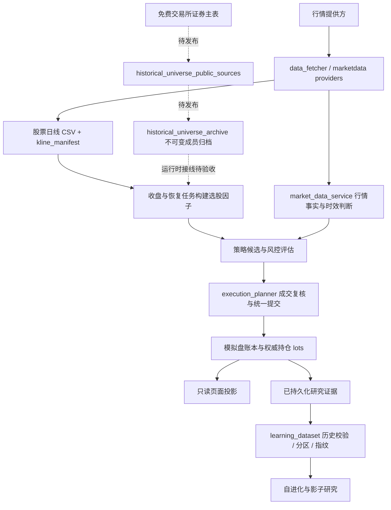

# 运行架构核对与下一步边界

核对日期：2026-10-14（UTC+08:00）。核对对象是本地 `389687e` 工作树及服务器 `606addfa`；本轮独立修复只发布研究数据集改动，四个本地后续提交仍待各自验收。性能数字是当次观测，不是固定承诺。系统仅使用模拟资金。

## 完成标准

1. 明确数据、历史成员、因子、研究数据集、交易账本和页面投影各自的权威来源。
2. 将服务器的实际阻断、内存退出和本地未部署修改定位到代码路径。
3. 修复本次已证明的研究数据集内存问题；原有样本、排除原因、分区与内容指纹必须保持一致。
4. 用真实证据的隔离副本验证峰值内存；测试与部署分别记录。

## 数据流与所有权

| 数据或行为 | 当前权威边界 | 必须保留的约束 |
| --- | --- | --- |
| 历史上市与退市成员 | `historical_universe_archive`；免费源只负责采集和归一化 | 当前行情快照不能证明历史股票池完整；交易所身份到六位市场代码的转换须查重 |
| 行情时间、有效性与核验 | `market_data_contract` / `market_data_service` | 来源时间 `quote_at` 与文件保存时间不能混用；展示缓存不代替交易时效校验 |
| 已缓存日线 | `universe.refresh_history` 写入；`data_fetcher.load_shared_kline` 读取 | 保留逐票文件锁、清单合并锁和原子替换；来源及复权证据必须随缓存保留 |
| 因子文件 | 当前有 `paper_trading._rebuild_selection_factor_cache` 和 `main._load_selection_base` 两条构建路径 | 这是待收敛的双写边界，不能仅靠相同文件名视为同一校验规则 |
| 研究训练样本与分区 | `learning_dataset.build_dataset` | 保留全部证据；冲突标签拒绝；历史可用性、标签成熟度和重叠剔除规则保持一致 |
| 资金、订单和成交 | 资金各 owner + `execution_planner.commit_fill` | 研究结果不获得成交权限；统一提交者拥有成交后的账本修改 |
| 前端显示 | dashboard / activity / risk 等只读投影 | 缺失不显示成零；刷新读投影不应重新扫描全市场或修改账本 |

这里的“权威”指同一事实由一个明确模块维护，其他模块读取其结果；“PIT”指按指定历史时刻判断当时可知、可用的数据。

## 服务器核对结果

下列为本轮修复前的现场，核对时间约 09:26；部署和验证结果单独报告。

- 四个应用服务运行同一镜像，环境中的代码提交为 `606addfa`；宿主源码工作区干净。它尚未包含本地 `3120d4e`、`04261b3`、`267ee32`、`389687e` 四个后续提交。
- `history-recovery.log` 最近的日线恢复已更新 85 只、还有 13 只未覆盖目标日；随后因子重建被“历史 universe 源未证明完整性”阻断。来源是服务器旧代码路径，不能归因于页面未刷新。
- 10 月 13 日收盘快照任务返回 0 行；10 月 14 日盘前选股仍报实时覆盖不足。需要按“收盘保存 → 恢复 → 因子 → 盘后/盘前消费”检查各阶段的目标日期和时效政策。
- 内核记录 `astock-task-worker` 在 10 月 13 日 16:03:41、16:23:37 两次发生内存限制退出。数据库中对应的研究运行都停在 `learning_dataset` 阶段；该容器上限 720 MiB，被杀进程匿名内存约 697 MiB，另有文件页占用。
- 当次证据表有 110,812 条特征样本、282,139 条收益标签，其中 83,042 条特征样本属于 `legacy_unproven`。旧代码先把完整 SQL 结果读入，再构造嵌套证据、规范样本、完整指纹 JSON，形成数份同时存活的副本。
- 证据关联的原查询计划只按收益表主键中的 `start_date` 找标签，再逐条过滤股票代码；没有匹配 `(start_date, code)` 的索引。为每只股票重复读取同日多只股票的标签，是独立的查询瓶颈。

容器的 `cgroup` 是给进程设置内存和 CPU 上限的资源隔离机制。容器主进程仍在运行、自动重启次数为零，不代表内部的一次性任务没有被内存限制杀掉。

## 本次修复：降低研究数据集构建峰值内存

复用 SQLite 组合索引（官方 Query Planning 文档的 Multi-Column Indices 章节）、游标和标准库 [JSONEncoder.iterencode](https://docs.python.org/3.14/library/json.html#json.JSONEncoder.iterencode)：

1. 在既有 `learning_dataset.ensure_schema` 入口幂等安装 `idx_alpha_returns_evidence(start_date, code, horizon, end_date, label_available_at, forward_return_pct)`，匹配关联条件和原有确定性排序；不改变表、查询条件或样本范围。
2. 第一遍游标只记录标签端点，识别冲突身份；不保存全部原始证据。
3. 第二遍在同一 SQLite 读快照中执行原有分类规则，只保留合格的规范样本。
4. 排序样本引用，编码时逐条生成规范字段，逐段更新 SHA-256；不同时保存完整规范字典列表和整块 JSON 文本。
5. 分区完成后释放中间样本副本。兼容的列表读取入口继续保留。

读快照通过嵌套 `SAVEPOINT` 实现：两遍读取期间其他连接的新提交不混入同一数据集，也不会提交或回滚调用者自己的事务。内容指纹仍使用原有 v1 字节序列与版本号。

验证包括旧 v1 完整 JSON 与新编码的逐字节哈希对照、原有历史校验回归、两遍之间新增冲突标签的并发测试、以及调用者事务保真。服务器全量证据验证使用仅包含两张研究证据表的隔离副本，断网、只读运行；不会执行研究调参或模拟订单。

当次隔离容器限制为 384 MiB、0.35 CPU。完整关联得到 287,721 条证据，构建耗时 78.49 秒，进程峰值 RSS 107.21 MiB，`oom` / `oom_kill` 均为 0；这是数据集构建阶段的实测，不代表完整学习周期已验证。旧未索引检查被主动停止，不能把该次时间当成完成耗时计算倍率。

第二次加入旧 v1 完整 JSON 的全量指纹对照，结果完全一致：80.10 秒、峰值 121.23 MiB、零内存退出。额外内存来自对照用的旧 JSON 构造；源码普通构建不会生成这份副本。

原有校验保留 11,093 条分区样本（train 5,540 / validation 0 / test 5,553）；248,871 条关联证据因旧历史不可证明被排除，5,582 条缺标签，22,175 条因跨分区标签重叠被剔除。validation 仍为空，性能修复不把它改成“科研就绪”。

## 后续优先级

| 顺序 | 待收敛问题 | 最小下一步 |
| --- | --- | --- |
| 1 | 历史成员、因子和实时快照分处不同阶段，失败原因目前容易混在“行情有问题”中 | 先验证免费成员源在服务器的完整名单与当前日线覆盖，再验证收盘消费日期；保留各自阻断原因 |
| 2 | 两条因子构建路径会分别持有全市场日线，且采用不同成员证明方式 | 明确唯一构建服务，API 读取其结果；逐票计算并释放日线，保留完整递归指标历史 |
| 3 | 日线清单重建的增量优化尚未部署，解析与数据加载口径需等价核对 | 对脏日期、重复日期、空 close、删除及并发替换做回归，再确认节省的读盘量 |
| 4 | 全市场强制请求复用只存在于一个进程的短时间窗口 | 分清进程内复用与跨进程锁；在同一输入上验证重复调用次数和来源时间，不能宣称所有服务已共享一次请求 |
| 5 | 资源准入检查只判断任务开始时的内存水位 | 保留现有租约和 `flock`；继续查每个重阶段的峰值，先减少数据副本，不直接扩大内存限额 |
| 6 | `data_paths` 支持数据目录配置，但 `data_fetcher` 仍把缓存目录固定在源码根目录 | 后续统一目录解析入口；本轮隔离镜像测试为这些默认目录挂载临时内存文件系统，不挂载生产数据 |

这轮不需要新增消息队列、数据库或通用缓存框架。先统一事实来源、减少同时存活的数据副本，再按实际调用和资源观测决定拆分。
