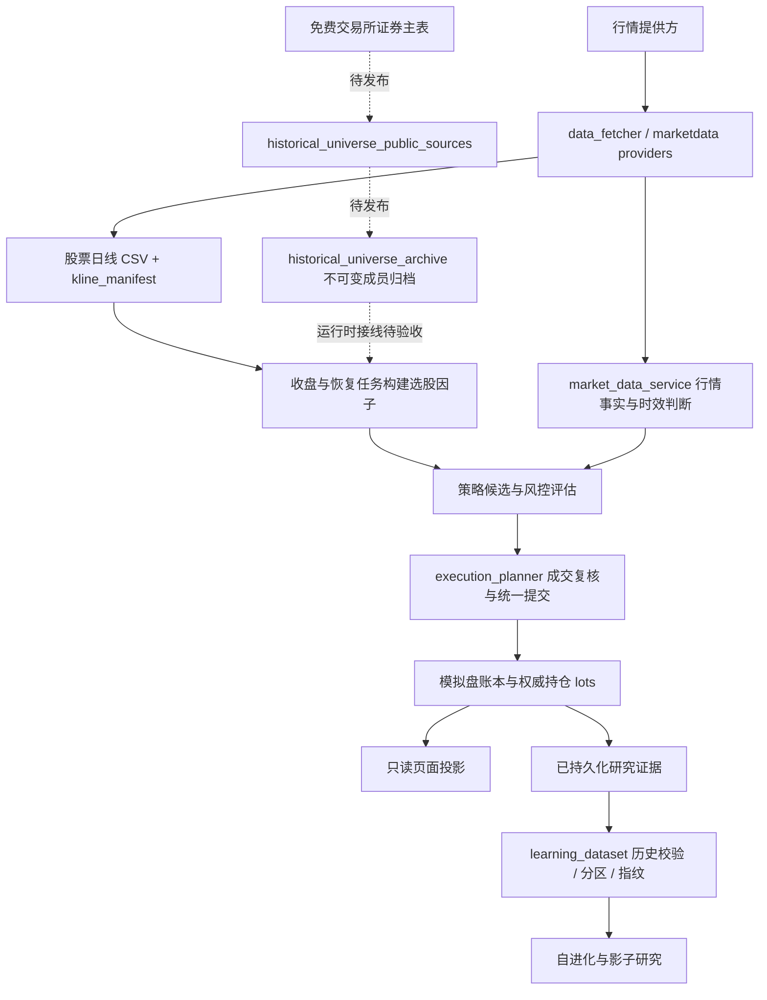
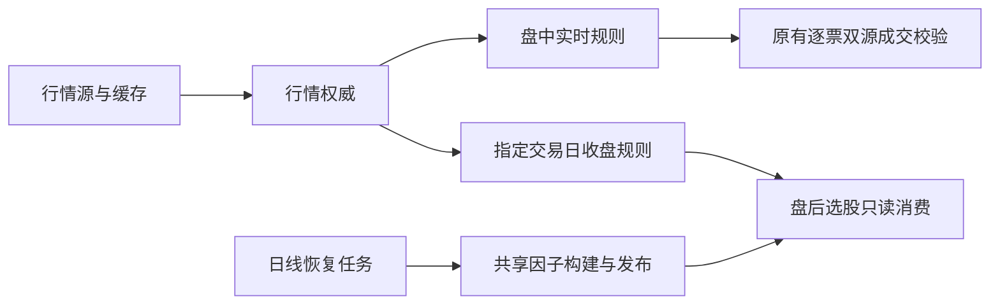

# 运行架构核对与下一步边界

核对日期：2026-10-14（UTC+08:00）。核对对象是本地 `389687e` 工作树及服务器 `606addfa`；本轮独立修复只发布研究数据集改动，四个本地后续提交仍待各自验收。性能数字是当次观测，不是固定承诺。系统仅使用模拟资金。

## 完成标准

1. 明确数据、历史成员、因子、研究数据集、交易账本和页面投影各自的权威来源。
2. 将服务器的实际阻断、内存退出和本地未部署修改定位到代码路径。
3. 修复本次已证明的研究数据集内存问题；原有样本、排除原因、分区与内容指纹必须保持一致。
4. 用真实证据的隔离副本验证峰值内存；测试与部署分别记录。

## 数据流与所有权

| 数据或行为 | 当前权威边界 | 必须保留的约束 |
| --- | --- | --- |
| 历史上市与退市成员 | `historical_universe_archive`；免费源只负责采集和归一化 | 当前行情快照不能证明历史股票池完整；交易所身份到六位市场代码的转换须查重 |
| 行情时间、有效性与核验 | `market_data_contract` / `market_data_service` | 来源时间 `quote_at` 与文件保存时间不能混用；展示缓存不代替交易时效校验 |
| 已缓存日线 | `universe.refresh_history` 写入；`data_fetcher.load_shared_kline` 读取 | 保留逐票文件锁、清单合并锁和原子替换；来源及复权证据必须随缓存保留 |
| 因子文件 | 当前有 `paper_trading._rebuild_selection_factor_cache` 和 `main._load_selection_base` 两条构建路径 | 这是待收敛的双写边界，不能仅靠相同文件名视为同一校验规则 |
| 研究训练样本与分区 | `learning_dataset.build_dataset` | 保留全部证据；冲突标签拒绝；历史可用性、标签成熟度和重叠剔除规则保持一致 |
| 资金、订单和成交 | 资金各 owner + `execution_planner.commit_fill` | 研究结果不获得成交权限；统一提交者拥有成交后的账本修改 |
| 前端显示 | dashboard / activity / risk 等只读投影 | 缺失不显示成零；刷新读投影不应重新扫描全市场或修改账本 |

这里的“权威”指同一事实由一个明确模块维护，其他模块读取其结果；“PIT”指按指定历史时刻判断当时可知、可用的数据。

## 服务器核对结果

下列为本轮修复前的现场，核对时间约 09:26；部署和验证结果单独报告。

- 四个应用服务运行同一镜像，环境中的代码提交为 `606addfa`；宿主源码工作区干净。它尚未包含本地 `3120d4e`、`04261b3`、`267ee32`、`389687e` 四个后续提交。
- `history-recovery.log` 最近的日线恢复已更新 85 只、还有 13 只未覆盖目标日；随后因子重建被“历史 universe 源未证明完整性”阻断。来源是服务器旧代码路径，不能归因于页面未刷新。
- 10 月 13 日收盘快照任务返回 0 行；10 月 14 日盘前选股仍报实时覆盖不足。需要按“收盘保存 → 恢复 → 因子 → 盘后/盘前消费”检查各阶段的目标日期和时效政策。
- 内核记录 `astock-task-worker` 在 10 月 13 日 16:03:41、16:23:37 两次发生内存限制退出。数据库中对应的研究运行都停在 `learning_dataset` 阶段；该容器上限 720 MiB，被杀进程匿名内存约 697 MiB，另有文件页占用。
- 当次证据表有 110,812 条特征样本、282,139 条收益标签，其中 83,042 条特征样本属于 `legacy_unproven`。旧代码先把完整 SQL 结果读入，再构造嵌套证据、规范样本、完整指纹 JSON，形成数份同时存活的副本。
- 证据关联的原查询计划只按收益表主键中的 `start_date` 找标签，再逐条过滤股票代码；没有匹配 `(start_date, code)` 的索引。为每只股票重复读取同日多只股票的标签，是独立的查询瓶颈。

容器的 `cgroup` 是给进程设置内存和 CPU 上限的资源隔离机制。容器主进程仍在运行、自动重启次数为零，不代表内部的一次性任务没有被内存限制杀掉。

## 本次修复：降低研究数据集构建峰值内存

复用 SQLite 组合索引（官方 Query Planning 文档的 Multi-Column Indices 章节）、游标和标准库 [JSONEncoder.iterencode](https://docs.python.org/3.14/library/json.html#json.JSONEncoder.iterencode)：

1. 在既有 `learning_dataset.ensure_schema` 入口幂等安装 `idx_alpha_returns_evidence(start_date, code, horizon, end_date, label_available_at, forward_return_pct)`，匹配关联条件和原有确定性排序；不改变表、查询条件或样本范围。
2. 第一遍游标只记录标签端点，识别冲突身份；不保存全部原始证据。
3. 第二遍在同一 SQLite 读快照中执行原有分类规则，只保留合格的规范样本。
4. 排序样本引用，编码时逐条生成规范字段，逐段更新 SHA-256；不同时保存完整规范字典列表和整块 JSON 文本。
5. 分区完成后释放中间样本副本。兼容的列表读取入口继续保留。

读快照通过嵌套 `SAVEPOINT` 实现：两遍读取期间其他连接的新提交不混入同一数据集，也不会提交或回滚调用者自己的事务。内容指纹仍使用原有 v1 字节序列与版本号。

验证包括旧 v1 完整 JSON 与新编码的逐字节哈希对照、原有历史校验回归、两遍之间新增冲突标签的并发测试、以及调用者事务保真。服务器全量证据验证使用仅包含两张研究证据表的隔离副本，断网、只读运行；不会执行研究调参或模拟订单。

当次隔离容器限制为 384 MiB、0.35 CPU。完整关联得到 287,721 条证据，构建耗时 78.49 秒，进程峰值 RSS 107.21 MiB，`oom` / `oom_kill` 均为 0；这是数据集构建阶段的实测，不代表完整学习周期已验证。旧未索引检查被主动停止，不能把该次时间当成完成耗时计算倍率。

第二次加入旧 v1 完整 JSON 的全量指纹对照，结果完全一致：80.10 秒、峰值 121.23 MiB、零内存退出。额外内存来自对照用的旧 JSON 构造；源码普通构建不会生成这份副本。

原有校验保留 11,093 条分区样本（train 5,540 / validation 0 / test 5,553）；248,871 条关联证据因旧历史不可证明被排除，5,582 条缺标签，22,175 条因跨分区标签重叠被剔除。validation 仍为空，性能修复不把它改成“科研就绪”。

## 后续优先级

| 顺序 | 待收敛问题 | 最小下一步 |
| --- | --- | --- |
| 1 | 历史成员、因子和实时快照分处不同阶段，失败原因目前容易混在“行情有问题”中 | 先验证免费成员源在服务器的完整名单与当前日线覆盖，再验证收盘消费日期；保留各自阻断原因 |
| 2 | 两条因子构建路径会分别持有全市场日线，且采用不同成员证明方式 | 明确唯一构建服务，API 读取其结果；逐票计算并释放日线，保留完整递归指标历史 |
| 3 | 日线清单重建的增量优化尚未部署，解析与数据加载口径需等价核对 | 对脏日期、重复日期、空 close、删除及并发替换做回归，再确认节省的读盘量 |
| 4 | 全市场强制请求复用只存在于一个进程的短时间窗口 | 分清进程内复用与跨进程锁；在同一输入上验证重复调用次数和来源时间，不能宣称所有服务已共享一次请求 |
| 5 | 资源准入检查只判断任务开始时的内存水位 | 保留现有租约和 `flock`；继续查每个重阶段的峰值，先减少数据副本，不直接扩大内存限额 |
| 6 | `data_paths` 支持数据目录配置，但 `data_fetcher` 仍把缓存目录固定在源码根目录 | 后续统一目录解析入口；本轮隔离镜像测试为这些默认目录挂载临时内存文件系统，不挂载生产数据 |

这轮不需要新增消息队列、数据库或通用缓存框架。先统一事实来源、减少同时存活的数据副本，再按实际调用和资源观测决定拆分。

## 下一步收敛：共享因子快照

- `paper_trading._rebuild_selection_factor_cache` 是唯一缓存构建入口；盘后任务、恢复任务及手动更新均使用它。网页 `_load_selection_base` 只读已验证文件，缺失或过期返回等待更新，不在请求线程中计算全市场。
- `factors.compute_price_factors` 兼容原有字典，也接受一次性的 `(code, DataFrame)` 迭代器。构建时每只股票只读一次完整日线；首板判断同次收集，RSI/MACD 保留完整递归历史。因子值及历史时点诊断与原字典输入保持一致。
- 复用标准库 `fcntl.flock` 和 `tempfile.mkstemp`：构建锁非阻塞，重复任务报告 deferred；短发布锁只保护 CSV/元数据的替换和读取，重建期间仍可读上一份快照。Windows 开发环境沿用数据层的线程锁；跨进程锁在 Linux 服务器验证。
- 新元数据保存 CSV 的 SHA-256。若替换两个文件之间进程中断，下次读取明确拒绝不匹配版本；旧无哈希元数据仍按原日期、覆盖率及日线清单规则校验。重建期间清单改变则不发布；因子文件本身更新也会使网页结果缓存失效。
- 免费证券主表使用沪深交易所在市及退市名单、北交所在市名单和新旧代码对应表。北交所已知退市公告用于核对映射缺口；尚不能把这份重建名单称为所有历史时点的完整行情或财务证据。证券上市/退市生效日也不代表本系统当日实际采集过该数据。
- 公共查询页偶发 500 时，复用 requests/urllib3 的有限重试，只重试失败页；失败仍阻断新因子发布。深交所表格严格解码并保留稀疏列位置、共享字符串，避免中文名称乱码或缺列错位。

本步没有部署另外两项待验证优化（日线清单增量解析、强制全市场查询复用）。历史研究验证集仍需补齐，模拟交易的订单、资金比例及风控阈值未由本步改变。

## 实时行情降级链：东财 clist 返回 0 行的处理

现场：服务器收盘快照与盘中扫描被东方财富全市场接口返回 0 行阻断，选股与候选扫描整轮 fail-closed。腾讯批量个股接口实测可用（5,574 只约 3.81 秒），因此接入为**价格-only 全市场回退**。

三条边界决定了它不能当成"换个主源"：

1. **只补价格，不补字段**。腾讯响应只提供代码/名称/价格/昨收/涨跌幅/时间；资金流、估值、量比、行业等东财 `clist` 独有字段一律保持 `None`。缺失字段不会被旧值或默认值填充——"不知道"不是"零"。
2. **门槛与主源同级，且更严**。正式名单规模、90% 代码覆盖、90% 行级新鲜度（容忍 120 秒未来漂移）任一不达标就不发布快照。残片绝不能变成正式横截面。
3. **永不冒充双源**。持久化 artifact 带 `source="tencent_public_quote_full_snapshot"`，契约据此判 `degraded` + `reason=price_only_coverage`，而不是 `fresh`。`verification_method` 为 `none`，`is_cross_source_verified` 恒为假。

成交路径另有一层护栏：主报价若来自腾讯（价格-only 回退），逐票核验源自动改走新浪。同一来源与自己比较只是"自己核验自己"，不构成双源证据。

缓存写入统一走全市场单飞锁，避免东财刷新与腾讯回退交错覆盖同一份 artifact；读取端按 `source` 区分两种事实，不会把价格-only 切片当成已验证的全市场横截面。

回归见 `backend/test_tencent_quote_fallback.py`：23 个测试覆盖名单、行数、覆盖率、新鲜度和时间漂移门禁，过期缓存及刷新失败判定，发布锁、并发来源绑定，以及新浪失败、空响应或错误来源时禁止同源自证。完整后端运行 5,735 项，仅两项缓存测试因进程内行情健康记录残留失败；旧基线在相同污染条件下也复现两项失败。只在这两项测试中隔离健康记录，生产缓存行为不变；修复后带污染记录的缓存测试及 106 项相关组合测试通过。

隔离联调使用服务器当时的正式名单 5,572 只，只读生产名单并把输出写入临时目录。在 384 MiB / 0.35 CPU 限制下，实际回退返回 5,557 只（99.73%），冷请求 3.72 秒、进程峰值 RSS 104.40 MiB，缓存复用 0.21 秒。经行情权威入口刷新（只模拟东财为空，腾讯请求真实联网）耗时 4.21 秒，结果为 `degraded / fresh / price_only_coverage`，不是双源事实。缺失资金流、行业和估值保持 `None`；本次未生成模拟订单。

全部使用真实接口的完整刷新链首次 6.89 秒、缓存复用 0.73 秒；当时部分股票时间戳停止更新，按原 240 秒窗口过滤后剩 5,210 只，仍满足正式名单的 90% 门槛。8 只真实样本经过模拟盘报价入口，腾讯主报价均改用新浪独立核验且通过；成交与账本写入没有执行。

腾讯在收盘后仍返回持续更新的源时间戳；本次验证没有回拨时钟，也没有放宽实时窗口。现有收盘政策 `CLOSE_SNAPSHOT_POLICY` 把 `max_age=0` 同时用于强制联网与源时间新鲜度，因此零秒窗口仍可能阻断收盘消费。这是独立的政策问题，本轮不把盘中回退通过宣称为收盘链路已恢复。

## 收敛数据生命周期：实时、收盘与因子等待分开

后续现场核对（2026-10-14 16:35）四个服务仍为 `bb29e6b`，5,574 条日线清单中有 4,239 条更新到当日；16:50 后后台发布了当日 5,121 行因子，记录的可交易范围覆盖率为 92.1%。这些是当时的观测，恢复任务仍继续更新数据。

本步复用现有行情契约与缓存入口，集中修复三处职责混淆：

- `force` 仅控制是否重新请求，报价能否消费由政策判断。盘中维持 240 秒、成交维持原双源与 1,200 秒门槛；收盘事实锚定指定交易日 15:00，沿用一分钟容忍、90% 行覆盖与 120 秒未来漂移限制。前一日、下一日、缺时间和盘中旧行不会被计为该日收盘证据。
- `market_data_contract.close_snapshot_window/close_snapshot_rows` 是唯一收盘时间规则。收盘任务复用权威结果并保留 4,000 条新鲜行的绝对门槛；模拟盘收盘扫描不再叠加另一套滚动 30 分钟窗口。价格回退仍只提供价格，不标为双源。
- 网页盘中读取实时政策，盘后读取指定交易日收盘事实；跨日的历史收盘查询只读缓存，不请求今天的价格填入过去。因子读取保留缺失、损坏、日期与覆盖门禁的原因，等待状态按文件签名复用；新日线、名单或因子文件会立即使其失效。请求不重建全市场因子，后台构建所有权不变。

回归见 `backend/test_market_session_boundary.py`：覆盖收盘时段、跨日查询、时间漂移、比例与绝对行数门槛、失败保留旧事实、指纹不随读取政策改变，以及因子等待状态缓存和文件更新失效。独立验证，不迁移账本，不补发历史信号，不改变资金分配。

用服务器同一份只读名单、因子和价格快照在隔离环境运行完整选股，发现名单有 15 个重复代码；按既有代码索引消费，避免重复展开后因子拼接报错。`cProfile` 进一步测得 9,980 次 pandas 单元格赋值占用约 8.8 秒（0.5 CPU 限额、带分析开销），因此报价覆盖改用 pandas 列级批量赋值。零值、未知值、占位符和显式 NaN 的行为保持原样，不改变评分或候选门槛。

## 资金流查询退出选股请求等待（2026-10-15）

复用原有资金流缓存、线程和文件发布锁：冷缓存也异步刷新，同一进程只保留一次在途查询，失败后从查询结束起退避 30 秒，成功缓存仍沿用 300 秒周期。空结果和异常不改写已有数据及其时间；过期/缺少时间的资金流继续由选股入口排除，缺失数据沿用已有未知值与质量门禁。

文件签名变化会重新读取其他进程发布的数据，并使选股结果缓存失效；本进程取得新数据后也清除旧选股结果。发布锁内绑定文件签名与内存数据，避免把旧行误记为新版本。回归覆盖慢接口不阻塞请求、并发合并、失败退避、异常保留原事实、文件更新失效和既有日期过滤。

## 财报与情绪冷缓存退出选股请求等待（2026-10-15）

公开选股的财报与情绪缓存为空时，复用现有后台线程按需查询，同一进程的每类数据只保留一次在途任务；空结果、异常和线程启动失败等待至少 30 秒后重试。缺失值沿用原有未知值和选股门槛，不生成默认财务数值或改写披露日期。非空上下文沿用原有使用规则，本轮不扩大定时刷新职责或改变正式模拟盘的选股调用方式。

有效数据返回后更新内存上下文并清除选股结果；结果缓存键加入上下文代次，防止后台任务在选股计算中途完成时，缺数据的旧结果仍被缓存 60 秒。财报提供方返回空数据时不再把仅含元数据的字典缓存六小时；有效财报仍沿用原六小时缓存。提供方合并同进程的并发缺失查询，空结果或异常从结束起等待 30 秒再试，避免多策略重复请求；不宣称跨进程共享。回归覆盖两个慢源、并发合并、失败退避、在途结果失效、冷缓存完整选股及原披露时间保真。

网页结果附带实际缺失的 `context_pending`，页面与策略对比据此显示“数据待补充”，并提示稍后再次选股；不把空上下文解释为没有合格股票。此类结果不会覆盖网页最近已完成的选股归档，不新增页面轮询或后台定时任务。

异步仅由 HTTP `/api/select` 显式启用；`_select_uncached` 默认保留同步上下文读取，供 `selection_runner` 和 `paper_selection._run_one` 等短生命周期任务使用，避免任务启动查询后立即退出而丢失有效数据。回归在同一真实选股路径中分别验证网页不等待源、默认任务先取得财报和情绪再计算。

## 财报、情绪上下文生命周期与风控历史查询

上下文沿用提供方既有时限：财报六小时、情绪五分钟。有效期扣除提供方缓存已有年龄，防止转存到上层时重新获得完整寿命；跨日重新核验。过期或没有有效期证据的数据保留在内存中，但不再进入本轮选股，网页沿用“数据待补充”状态并在后台刷新。空结果、异常和重试退避不会刷新旧数据的有效期，财报披露时间不变。选股结果键包含上下文有效性，旧结果的六十秒缓存不能掩盖上下文到期。短生命周期任务依旧同步取得有效上下文。

风控历史按账本 ID 严格递减推进，过滤与总数在数据库查询层处理，日期采用范围条件；读取额外一行判断是否还有下一页。保留旧 `时间|ID` 游标的读取兼容，但不再让事件时间与 ID 两套排序混用，补写历史时间也不会漏行或重复。前端按日期、策略、实际可展示等级请求全历史，并使用上一页/下一页按钮；首次加载等待预取结果，查询竞态只允许最后一次请求更新当前容器。此项只改读取和展示，不改变风险决策、委托与账本事实。

真实账本只读验收又发现：无匹配日期的查询约 49 秒，查询计划为按主键顺序扫描整张宽表。复用 SQLite 的物化公用表表达式，仅从现有覆盖索引筛选 ID、排序并限制页大小，再按主键读取本页大字段；不指定索引名、不新增索引、不迁移数据库。无过滤的最近记录保持原主键快路径。参考 [SQLite 覆盖索引](https://www.sqlite.org/queryplanner.html#covering_indexes) 与 [物化查询说明](https://www.sqlite.org/lang_with.html#materialization_hints)；回归验证查询计划以及缺少可选索引时的正确性。

## 全轮任务分段计时（2026-10-16）

复用标准库 `perf_counter`、`ContextVar` 和原有任务详情，不引入额外服务、数据库表或监控框架。`paper_runner` 在导入引擎前开始计时；直接调用 `run_slot` 则从该入口开始。每次调用生成诊断用 `attempt_id`，与现有业务日期、任务表和盘中 `run_key` 关联；这个标识不参与租约、幂等键或交易判断。

- `initialization` / `preflight`：初始化、过期清理与分发准备；`engine_import` 仅 runner 路径可见。
- `source_health` / `market_snapshot` 及各自的 `recovery`：主探活与主行情取数、失败后的第二次尝试。
- `candidate_bootstrap` / `open_execution` / `risk_pass` / `market_context` / `position_quotes`：各业务边界的耗时及调用次数。
- `risk_snapshot`：请求后台快照并有界等待落地的耗时；包含后台工作与等待，不能据此细分后台 SQL 或网络。
- `db_acquire`：连接、PRAGMA 准备及 `BEGIN IMMEDIATE` 等待，不等于纯锁等待；`db_transaction_body` 包含连接块内的 Python 与 SQL，不等于 SQL 执行耗时；`db_commit` 包含原有提交重试及退避。计时不改变连接、提交、回滚和重试规则。
- 主机脚本沿用相同的 `paper-scan.lock` 和原有 20 秒/不等待政策，记录其等待秒数（Bash 一秒精度）。未取得锁仍返回原退出码，并输出 `paper_host_lock` 诊断；成功后的锁一直保留到 Docker 命令结束。外层 cron 的时段锁等待、Docker 启动耗时不包含在这个数值内；手工调用缺此信息时保持未知。

成功或失败任务的原有 `detail.timing` 保存完成状态写入**之前**的快照，明确标记 `scope=before_job_finalize` 或 `before_failure_finalize`。最终的提交、释放租约及 runner 重试成本由调度日志中的一条 `event=paper_slot_timing / scope=finished` 记录，不为补写计时再开一个写事务。正常结果也附带计时；已完成任务再次调用生成新的诊断标识，同时保留原任务详情，仍不会重复执行。

所有阶段均为包含子阶段的累计耗时，**不能相加作为总耗时**；`calls` 是该函数边界的调用次数，不是假定的 HTTP 请求数量。未出现的阶段是未观测，不能自动解释为零耗时。后台线程不隐式继承调用者上下文，本轮不宣称已覆盖线程池中的逐次 HTTP/SQL。计时只收集固定阶段名、次数、耗时与任务标识，不增加 SQL、地址、行情正文或异常正文日志。输出故障不改变交易异常或调度退出码。

本步用于定位全轮瓶颈，不预先声称扫描已经提速。验收包括临时真实 SQLite 的提交/回滚、写锁等待、正常与失败任务的详情关联、重复任务不重跑，以及 Linux 下主机锁的并发与命令退出码。

## 单次组合快照与候选列读取提速（2026-10-16）

继续性能路线 A02/A12。分段计时确认候选生成约 72–77 秒、开仓阶段约 73 秒；`cProfile` 显示一次组合快照反复重建同一成交、持仓与现金事实，候选预处理则大量逐格调用 pandas。这里保留既有事实所有者和动态分配流程，只消除重复读取。

组合快照仅在内部纯读取 `_capture` 的一次同步调用中启用标准库 `functools.cache`，要求已有显式 SQLite 事务；限定连接、周期、截止日、账户及参数，退出即丢弃。缓存结果深拷贝后交付，防止 FIFO 或调用方修改污染事实；本连接发生写入就失效。无事务时绕过。资金重分配、订单写入、快照持久化均在作用域外，下一次计划及成交前重验重新读取，不复用上一笔决策。

候选从整列读取名称与行业，行业键每行只计算一次；异常重复轴保留原路径，空股票池保持为空。证券过滤、排序、新鲜度、披露证据和双源核验政策不变。

服务器隔离容器限定半核、384 MiB、禁网及只读账本；固定行情、因子、决策时刻，同一只读事务交错执行原版/新版/新版/原版，计时不启用分析器。参考 [Python 3.14 性能分析说明](https://docs.python.org/3.14/library/profile.html)。

| 范围 | 原版 | 新版 | 一致性检查 |
| --- | --- | --- | --- |
| 一次组合快照 | SQL 2,262 次；热读 6.228 秒，CPU 2.653 秒 | SQL 273 次；1.215–1.273 秒，CPU 0.623 秒 | 完整投影及指纹相同 |
| 板块策略候选预处理 | 热读 4.318 秒，CPU 1.871 秒 | 1.822–2.217 秒，CPU 0.922–0.924 秒 | 4,383 行、72 列逐值及类型相同 |

原版第一次组合读取 16.000 秒、候选预处理 4.550 秒，存在冷读成本，因此不用冷读差值宣称稳定增益。候选对照明确排除网络与真实财报加载，采用同一份财报不可用输入，并截在策略执行前；它不是完整五策略或全轮耗时，也不证明报价源加速。全轮是否达到路线图 120 秒目标仍需真实任务样本验证，少量任务不能当作 p95。

回归覆盖事实一致、重复查询下降、可变结果隔离、新调用看到新增事实、缺证据仍为 unknown、不同连接/周期/日期不串用、异常释放、无事务绕过及写后失效；候选覆盖 ST 过滤、缺名回退、缺行业与空池。

## 同轮公共财务计算与候选批量取证（2026-10-16）

继续 A02/A12，针对上一轮剩余约 65–70 秒的候选阶段。每次 bootstrap 建立局部 `CandidateScanInputs`，固定本轮实时截面截止时刻；只复用完整股票行、财务载荷、财务截止口径及截面时刻都相同的基础财务因子。财报突破的 live/shadow 口径与其他策略的严格历史口径分开，不缓存策略排名、审批、资金计划或账户状态。提供方仍逐账户执行原有 TTL/重试检查，新载荷、成员变化或字段变化会改变内容指纹；非 JSON 输入绕过复用。容量最多四份，下一轮重新创建，不跨轮延长数据寿命。

每策略取得独立表格副本，沿用 [pandas 的表格复制方法](https://pandas.pydata.org/docs/reference/api/pandas.DataFrame.copy.html)；这里复用的是既有因子函数产出的标量列，不把表格复制当作任意嵌套 Python 对象的递归复制。内容指纹使用 [Python 标准库 SHA-256](https://docs.python.org/3.14/library/hashlib.html)，只判输入是否相同，不签发行情验证或账本权威。

候选仍分别经过账户冷却过滤及新闻/公告取证；随后合并代码调用一次原有 `_quotes`，统一读取一次板块资金，最后才进入写事务。把报价放在新闻取证后，以缩短价格进入审批前的等待。每账户只得到自己的代码子集，报价及板块对象递归复制，避免跨账户修改污染；缺行情、取数失败或异常返回形状保持无证据。原有逐票独立源、新鲜度和成交前复核路径不变。

固定五策略输入的服务器只读、禁网、半核/384 MiB 对照中，基础财务计算从每轮五次减少到两次；五张各 4,383 行的表及其类型、属性逐值一致。预处理热读从 8.140 秒到 7.136–7.137 秒，CPU 从 3.633 秒到 3.095–3.116 秒；冷读原版 10.284 秒另计。此对照沿用同一财报不可用输入，截在策略执行前，不代表完整候选或真实 HTTP 耗时。报价和板块由五次高层调用合并为一次，实际 HTTP 请求数仍取决于原提供方的分批、重试及回退规则。

回归验证严格财务截止与 live 口径分离、未来截面仍不可用、变更输入失效、下一轮不复用、非 JSON 绕过、表格隔离，以及报价并集、账户分区、部分缺失、取数失败、新闻先于报价、写事务外取证和跨账户嵌套对象隔离。整轮收益必须继续以部署后的自然调度任务验证，少量样本不视为 p95。

## 候选内部耗时定位（2026-10-16）

继续 A02 的实际瓶颈诊断，复用 `paper_timing` 和原有任务日志，不调整策略、资金、缓存期限或调度。新增固定的 `candidate.*` 阶段：

| 范围 | 阶段 |
| --- | --- |
| 候选生成 | `rows`，其中拆出 `factor_inputs`、`universe_read`、`factor_gate`、`fundamentals`、`factor_table`、`strategy`、`evolution_read` |
| 提供方调用 | `finance_source`、`flow_source`、`disclosures`、`disclosure_prime`、`concept_source`、`reverse_concept_source`、`ths_lane`、`microstructure_source`、`news_source`、`quote_source`、`sector_source` |
| 本地读取与写入 | `history_read`、`kline_read`、`cooldown_read`、`watch_pool`、`shadow_write`、`learning_snapshot` |
| 写事务及审批 | `writer`，其中拆出 `provenance`、`approval`、`decision_snapshot`、`signal_write`、`risk_write` |

所有阶段新增 `thread_cpu_seconds`，使用标准库 [thread_time](https://docs.python.org/3.14/library/time.html#time.thread_time) 测量当前线程实际占用的 CPU；原 `seconds` 仍为经过的时间。二者差值可能包含网络、磁盘、锁、线程池等待和容器 CPU 配额等待，不能自动归为网络时间。线程 CPU 不包含其他工作线程的计算，短阶段也受系统时钟分辨率影响，不能据此强制 CPU 小于墙钟时间。

提供方阶段包括缓存检查、读取、解析及内部线程池等待，不等于纯 HTTP。共享行情传输层的 `http_get_attempt` / `http_post_attempt` 记录本线程实际请求尝试及 HTTP 状态检查，`http_retry_backoff` 单独记录既有重试退避；保持请求参数、连接池、重试次数、超时和返回值不变。错误计数表示该边界抛出过异常，外层既有回退仍可能使整个任务成功。线程池不隐式继承诊断上下文，这些 HTTP 次数不是所有源、所有线程的总请求数；没有观测到不能当作未请求。

父子阶段包含重叠，同名阶段跨五策略或多次调用累计，不能把它们全数相加。`rows` 扣除其直接子阶段后仍可能留下筛选、排序、表格覆盖及局部读写成本；未计时的余量保留为未细分，不用等待时间倒推出不存在的 SQL 或网络结论。此次只增加观测，是否提速及后续该优化哪一段，以服务器自然任务为准。

## 披露按代码增量存储与财务跨进程缓存（2026-10-16）

继续 A02/A12。前一轮自然任务定位到披露核验 20.823 秒（线程 CPU 15.657 秒）、财务获取 13.930 秒。披露 JSON 约 135 MB；隔离测量显示整文件解析、编码及内存占用较高。这里使用项目已有的 SQLite 与文件锁，不新增缓存服务或依赖。

披露源保留原始嵌套记录、取数时间、披露时间和历史截止规则。先在停写窗口运行 `python backend/disclosure_cache_migrate.py data_cache/disclosure_timeline.json`：只导入提供方缓存，不涉及模拟账本；逐条比较原始内容、检查行数和数据库完整性，再原子发布同路径的 `.sqlite3` 旁文件。旧 JSON 原样保留，已有旁文件拒绝覆盖，导入中源文件变化则不发布。导入只做一次，仍需读取完整旧文件，应限制资源并避开扫描/盘后重任务。

已激活旁文件时，只按代码主键读本次请求的记录；刷新只 UPSERT 本次成功获取的代码，使用 [SQLite 原有按键更新](https://www.sqlite.org/lang_upsert.html) 与 [WAL](https://www.sqlite.org/wal.html)。并发不同代码不会丢掉彼此更新，晚返回的旧取数时间不覆盖新记录；失败写入回滚，不把未落盘内容混入下一轮。未导入、损坏或旧版本程序替换了 JSON 时，沿用原 JSON 路径；用文件身份、大小及纳秒时间检测旧写入。旁文件读取不执行迁移，TTL、未知/过期状态和原始发布时间的判定仍由原披露模块负责。

财务提供方复用 `marketdata_cache.full_snapshot_singleflight_lock`，在 POSIX 上合并跨进程的冷加载，Windows 沿用现有线程锁能力。有效财务快照原子发布为 `finance_latest.json`，新进程恢复原 `fetched_epoch`，不会从读取时刻重新获得六小时。等待锁后重新检查缓存；空结果、异常、损坏/未来时间和过期快照不被当作有效财务，也不改写旧文件。提供方既有 30 秒进程内失败退避、报表字段和财务点时过滤不变；只读目录仍可读取有效文件或现场取数，持久化失败不改变原返回语义。

回归覆盖原始嵌套证据与历史截止结果一致、按主键读取、局部更新与晚结果防覆盖、事务回滚、导入原子发布与旧文件替换失效，以及跨进程请求合并、原有效期恢复、精确过期、失败不覆盖和原披露时间不变。提速需用服务器同输入对照验证；盘后验证不能替代下一交易时段的自然完整扫描。

## 公共审计日线窗口（2026-10-19）

继续 A02/A12。当天已完成的两轮扫描约 129、161 秒；财务阶段约 0.09 秒，候选 48–72 秒、委托执行 35–75 秒，说明缓存改动已生效，整轮仍有其他开销。候选审计快照约 3.3–4.8 秒，风控与执行也使用同一序列化函数。实际日线通常有约 915 根，原实现逐根转换全部单元格后才裁到 120 根。

现在先遍历索引，沿用原日期解析及截止规则，统计所有合格行、未来行和完整起止日期，再用 pandas 的 [iloc 按位置取行](https://pandas.pydata.org/docs/reference/api/pandas.DataFrame.iloc.html) 转换最后 120 根合格日线。顺序与重复索引保留；保留窗口内继续使用原 `iterrows`，避免改变混合数值列的转换类型。带 `date` 列（会覆盖索引日期）、重复列名及非 DataFrame 适配器沿用原路径。没有添加跨决策缓存，也不复用价格、账户状态或审批结果。

服务器禁网、只读挂载真实缓存、0.3 核/384 MiB 下，五只实际股票（737–915 根）各构造五次完整快照，旧/新/新/旧顺序对照：旧版 9.383、7.482 秒，新版 1.203、2.110 秒；线程 CPU 由 1.861–2.152 秒降至 0.362–0.369 秒。四组完整输出逐值相同，摘要相同。该对照只证明公共审计构造加速，不代表整轮扫描或外部行情请求提速；外部重试和多次持仓报价仍需按自然任务继续拆查。

回归覆盖 120 根边界、完整元数据、先排除未来行再保留窗口、乱序与重复日期、缺失/非法截止、空表与全未来数据、日期列覆盖、嵌套值与独立输出、非 DataFrame 兼容，并与改动前版本做 150 组不同长度/类型/截止组合的输出对照。

## 东财报价重试归口与执行内部计时（2026-10-19）

继续 A02/A12。前轮自然任务的持仓报价每轮约六次，累计 16–40 秒；单独禁网读取全市场快照的只读测量约 0.6 秒。东财适配器已有三轮主机轮换及缺失代码小批补查，但每次 HTTP 又重试一次，形成两层请求放大。沿用 [AWS 的单点重试建议](https://aws.amazon.com/builders-library/timeouts-retries-and-backoff-with-jitter/)，仅东财 ulist 的两处 HTTP 调用改为单次尝试，现有外层继续拥有主机轮换、退避、小批补查与熔断记录。短暂故障改由外层下一主机或轮次恢复；耗尽后更早沿原链回退，不保证与旧版每次末段内层恢复的时序相同。

同时修复共享 GET 的末次空 HTTP 内容仍等待的问题：末次返回空内容时直接返回原有空字符串，只有确实还有下一次尝试时才退避。其他调用方的配置尝试次数、超时、异常及返回形状保持原样。空 HTTP 内容与 JSON 中的空行情列表是两种情况；合法的空 JSON 仍由原提供方处理，不能把所有“零行”都算作命中本修复。

服务器禁网、0.3 核/256 MiB、固定两只代码并始终返回空 HTTP 内容，使用原传输函数和适配器作旧/新/新/旧对照：实际传输调用从每次 24 次降至 12 次，真实等待由 21.304–21.373 秒降至 4.501–4.538 秒；完整返回元数据逐值相同。此对照没有真实网络或套接字超时，只量化已配置重试及等待的放大，不代表行情恢复率、正常请求提速或整轮稳定收益。

诊断复用 `paper_timing`：`quote.*` 拆出主报价、快照读取、资金流补齐、独立源、同源改走新浪、本地元数据与可交易性取证；`execution.*` 拆出探活、全市场刷新、覆盖门禁、手工待执行、等待池读取/市场/新闻/报价、写事务、候选排序、买入审批和净值写入。名称固定，记录耗时、当前线程 CPU、次数与异常计数，不记录代码、请求地址或异常正文。父子阶段含重叠，不能相加；提供方边界含缓存、解析与等待，不能自动当作纯网络或 SQL 时间。

回归通过真实 HTTP 重试函数与适配器组合验证正常返回、持续异常、瞬时失败换主机恢复、部分代码小批补齐、空内容、既有熔断及末次不再等待；诊断回归验证风险先于买入探活、覆盖不足仍阻止买入、同源核验失败不保留自我确认，以及日志不带异常私密正文。交易、动态分配、报价有效期及双源阈值未调整。

## 持仓替代数据退出风控写事务（2026-10-20）

先核对已合入的最新主分支，再继续 A02/A12：风控已有事务外行情/新闻取证，但持仓质量评估仍在写事务内调用解禁、龙虎榜、两融、大宗和股东户数五项可选来源。同库运行权续期也需要写锁，慢源可能阻挡自己的续期；仅拆分文件没有移除这一等待。

现在在既有事务外取证入口按持仓代码去重采集五项信号，结果只属于本次调用，并绑定评估日期。风控写事务只读显式传入的结果：缺少代码、日期不符或空结果均沿用该可选信号原有的零加减分/无说明降级，不再穿透提供方。直接兼容调用仍可使用原现场取数路径。信号继续只作影子说明，`alt_score_applied=False`，不增加交易授权，也不保存为跨轮缓存。

保留逐源独立失败处理及其他有效信号、原始说明和财报披露规则。进入写事务后继续重读周期/持仓，订单路径继续核对所有者、代际和有效期。已有 `paper_timing` 增加 `risk.alt_evidence`，只记录固定阶段耗时，不记录代码、地址或异常正文。

新增回归覆盖真实风控入口中提供方执行期间另一连接可获得写锁并写入、正常风险卖出仍准确成交、同票去重、完整评分与兼容路径一致、空仓不取数、日期/代码缺失不重查，以及取证期间周期变化、运行权接管或过期均拒绝旧任务下单。此改动不等于整轮风控已无慢查询；日线重复解析、读取缓存作用范围与前端缓存问题仍需按后续实测分别处理。

## 成交流水驱动组合证据查询（2026-10-20）

自然扫描仍约 280 秒，因此继续对照读取路径。只读备份分析定位到组合读模型 `_sell_fills`：当时有约 2,472 条委托、120 条成交，SQLite 先用状态索引读取委托，再关联成交。允许携带成交的状态刻意包含终止/拒绝等状态，不能为速度缩窄；但该查询顺序会读取大量实际没有成交流水的宽委托行。

仅在买卖两条流水查询中使用 SQLite 原生 [CROSS JOIN 的顺序控制](https://www.sqlite.org/optoverview.html#manual_control_of_query_plans_using_cross_join)，先读取成交，再按主键寻找其订单。原 `ON`、周期、账户、日期、状态、字段与排序保持不变；错配的成交流水继续交给真实性验证，缺失流水的订单仍由原有完整性检查发现。没有新增索引、迁移、全局统计变更或第二套事实实现。

静态备份、禁网、0.35 CPU 下，真实卖出查询按旧/新/新/旧运行，四组均完整返回 76 条相同结果。旧版约 16.73–19.23 秒，每次逻辑读取约 213.7 MB；新版约 0.004–0.686 秒，约 9.0 MB。物理读盘受系统缓存影响，不能用最热的一次作为整轮倍数。此前被五秒预算中断的分析仅用于定位，不作为完成耗时。

回归比较原普通 JOIN 与新查询完整行，覆盖买卖方向、错配流水、跨周期和未来日期，并用 SQLite 虚拟机指令计数验证：两条成交旁增加 2,000 条无流水委托，不会使流水查询工作量随委托表增长。此约束只用于上述两条需要成交流水的查询，不把其他完整性读取改成“有成交才读取”。
