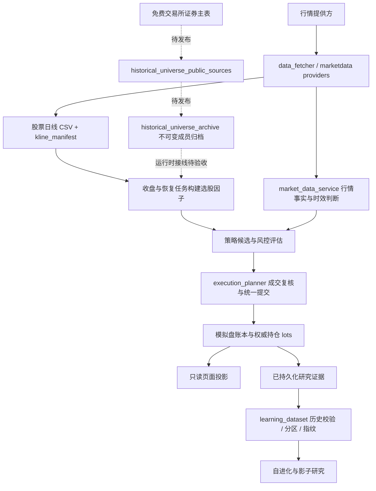
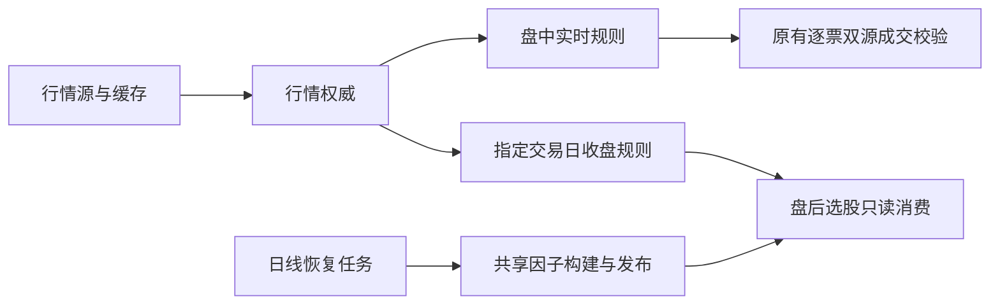

# 运行架构核对与下一步边界

核对日期：2026-10-14（UTC+08:00）。核对对象是本地 `389687e` 工作树及服务器 `606addfa`；本轮独立修复只发布研究数据集改动，四个本地后续提交仍待各自验收。性能数字是当次观测，不是固定承诺。系统仅使用模拟资金。

## 完成标准

1. 明确数据、历史成员、因子、研究数据集、交易账本和页面投影各自的权威来源。
2. 将服务器的实际阻断、内存退出和本地未部署修改定位到代码路径。
3. 修复本次已证明的研究数据集内存问题；原有样本、排除原因、分区与内容指纹必须保持一致。
4. 用真实证据的隔离副本验证峰值内存；测试与部署分别记录。

## 数据流与所有权

| 数据或行为 | 当前权威边界 | 必须保留的约束 |
| --- | --- | --- |
| 历史上市与退市成员 | `historical_universe_archive`；免费源只负责采集和归一化 | 当前行情快照不能证明历史股票池完整；交易所身份到六位市场代码的转换须查重 |
| 行情时间、有效性与核验 | `market_data_contract` / `market_data_service` | 来源时间 `quote_at` 与文件保存时间不能混用；展示缓存不代替交易时效校验 |
| 已缓存日线 | `universe.refresh_history` 写入；`data_fetcher.load_shared_kline` 读取 | 保留逐票文件锁、清单合并锁和原子替换；来源及复权证据必须随缓存保留 |
| 因子文件 | 当前有 `paper_trading._rebuild_selection_factor_cache` 和 `main._load_selection_base` 两条构建路径 | 这是待收敛的双写边界，不能仅靠相同文件名视为同一校验规则 |
| 研究训练样本与分区 | `learning_dataset.build_dataset` | 保留全部证据；冲突标签拒绝；历史可用性、标签成熟度和重叠剔除规则保持一致 |
| 资金、订单和成交 | 资金各 owner + `execution_planner.commit_fill` | 研究结果不获得成交权限；统一提交者拥有成交后的账本修改 |
| 前端显示 | dashboard / activity / risk 等只读投影 | 缺失不显示成零；刷新读投影不应重新扫描全市场或修改账本 |

这里的“权威”指同一事实由一个明确模块维护，其他模块读取其结果；“PIT”指按指定历史时刻判断当时可知、可用的数据。

## 服务器核对结果

下列为本轮修复前的现场，核对时间约 09:26；部署和验证结果单独报告。

- 四个应用服务运行同一镜像，环境中的代码提交为 `606addfa`；宿主源码工作区干净。它尚未包含本地 `3120d4e`、`04261b3`、`267ee32`、`389687e` 四个后续提交。
- `history-recovery.log` 最近的日线恢复已更新 85 只、还有 13 只未覆盖目标日；随后因子重建被“历史 universe 源未证明完整性”阻断。来源是服务器旧代码路径，不能归因于页面未刷新。
- 10 月 13 日收盘快照任务返回 0 行；10 月 14 日盘前选股仍报实时覆盖不足。需要按“收盘保存 → 恢复 → 因子 → 盘后/盘前消费”检查各阶段的目标日期和时效政策。
- 内核记录 `astock-task-worker` 在 10 月 13 日 16:03:41、16:23:37 两次发生内存限制退出。数据库中对应的研究运行都停在 `learning_dataset` 阶段；该容器上限 720 MiB，被杀进程匿名内存约 697 MiB，另有文件页占用。
- 当次证据表有 110,812 条特征样本、282,139 条收益标签，其中 83,042 条特征样本属于 `legacy_unproven`。旧代码先把完整 SQL 结果读入，再构造嵌套证据、规范样本、完整指纹 JSON，形成数份同时存活的副本。
- 证据关联的原查询计划只按收益表主键中的 `start_date` 找标签，再逐条过滤股票代码；没有匹配 `(start_date, code)` 的索引。为每只股票重复读取同日多只股票的标签，是独立的查询瓶颈。

容器的 `cgroup` 是给进程设置内存和 CPU 上限的资源隔离机制。容器主进程仍在运行、自动重启次数为零，不代表内部的一次性任务没有被内存限制杀掉。

## 本次修复：降低研究数据集构建峰值内存

复用 SQLite 组合索引（官方 Query Planning 文档的 Multi-Column Indices 章节）、游标和标准库 [JSONEncoder.iterencode](https://docs.python.org/3.14/library/json.html#json.JSONEncoder.iterencode)：

1. 在既有 `learning_dataset.ensure_schema` 入口幂等安装 `idx_alpha_returns_evidence(start_date, code, horizon, end_date, label_available_at, forward_return_pct)`，匹配关联条件和原有确定性排序；不改变表、查询条件或样本范围。
2. 第一遍游标只记录标签端点，识别冲突身份；不保存全部原始证据。
3. 第二遍在同一 SQLite 读快照中执行原有分类规则，只保留合格的规范样本。
4. 排序样本引用，编码时逐条生成规范字段，逐段更新 SHA-256；不同时保存完整规范字典列表和整块 JSON 文本。
5. 分区完成后释放中间样本副本。兼容的列表读取入口继续保留。

读快照通过嵌套 `SAVEPOINT` 实现：两遍读取期间其他连接的新提交不混入同一数据集，也不会提交或回滚调用者自己的事务。内容指纹仍使用原有 v1 字节序列与版本号。

验证包括旧 v1 完整 JSON 与新编码的逐字节哈希对照、原有历史校验回归、两遍之间新增冲突标签的并发测试、以及调用者事务保真。服务器全量证据验证使用仅包含两张研究证据表的隔离副本，断网、只读运行；不会执行研究调参或模拟订单。

当次隔离容器限制为 384 MiB、0.35 CPU。完整关联得到 287,721 条证据，构建耗时 78.49 秒，进程峰值 RSS 107.21 MiB，`oom` / `oom_kill` 均为 0；这是数据集构建阶段的实测，不代表完整学习周期已验证。旧未索引检查被主动停止，不能把该次时间当成完成耗时计算倍率。

第二次加入旧 v1 完整 JSON 的全量指纹对照，结果完全一致：80.10 秒、峰值 121.23 MiB、零内存退出。额外内存来自对照用的旧 JSON 构造；源码普通构建不会生成这份副本。

原有校验保留 11,093 条分区样本（train 5,540 / validation 0 / test 5,553）；248,871 条关联证据因旧历史不可证明被排除，5,582 条缺标签，22,175 条因跨分区标签重叠被剔除。validation 仍为空，性能修复不把它改成“科研就绪”。

## 后续优先级

| 顺序 | 待收敛问题 | 最小下一步 |
| --- | --- | --- |
| 1 | 历史成员、因子和实时快照分处不同阶段，失败原因目前容易混在“行情有问题”中 | 先验证免费成员源在服务器的完整名单与当前日线覆盖，再验证收盘消费日期；保留各自阻断原因 |
| 2 | 两条因子构建路径会分别持有全市场日线，且采用不同成员证明方式 | 明确唯一构建服务，API 读取其结果；逐票计算并释放日线，保留完整递归指标历史 |
| 3 | 日线清单重建的增量优化尚未部署，解析与数据加载口径需等价核对 | 对脏日期、重复日期、空 close、删除及并发替换做回归，再确认节省的读盘量 |
| 4 | 全市场强制请求复用只存在于一个进程的短时间窗口 | 分清进程内复用与跨进程锁；在同一输入上验证重复调用次数和来源时间，不能宣称所有服务已共享一次请求 |
| 5 | 资源准入检查只判断任务开始时的内存水位 | 保留现有租约和 `flock`；继续查每个重阶段的峰值，先减少数据副本，不直接扩大内存限额 |
| 6 | `data_paths` 支持数据目录配置，但 `data_fetcher` 仍把缓存目录固定在源码根目录 | 后续统一目录解析入口；本轮隔离镜像测试为这些默认目录挂载临时内存文件系统，不挂载生产数据 |

这轮不需要新增消息队列、数据库或通用缓存框架。先统一事实来源、减少同时存活的数据副本，再按实际调用和资源观测决定拆分。

## 下一步收敛：共享因子快照

- `paper_trading._rebuild_selection_factor_cache` 是唯一缓存构建入口；盘后任务、恢复任务及手动更新均使用它。网页 `_load_selection_base` 只读已验证文件，缺失或过期返回等待更新，不在请求线程中计算全市场。
- `factors.compute_price_factors` 兼容原有字典，也接受一次性的 `(code, DataFrame)` 迭代器。构建时每只股票只读一次完整日线；首板判断同次收集，RSI/MACD 保留完整递归历史。因子值及历史时点诊断与原字典输入保持一致。
- 复用标准库 `fcntl.flock` 和 `tempfile.mkstemp`：构建锁非阻塞，重复任务报告 deferred；短发布锁只保护 CSV/元数据的替换和读取，重建期间仍可读上一份快照。Windows 开发环境沿用数据层的线程锁；跨进程锁在 Linux 服务器验证。
- 新元数据保存 CSV 的 SHA-256。若替换两个文件之间进程中断，下次读取明确拒绝不匹配版本；旧无哈希元数据仍按原日期、覆盖率及日线清单规则校验。重建期间清单改变则不发布；因子文件本身更新也会使网页结果缓存失效。
- 免费证券主表使用沪深交易所在市及退市名单、北交所在市名单和新旧代码对应表。北交所已知退市公告用于核对映射缺口；尚不能把这份重建名单称为所有历史时点的完整行情或财务证据。证券上市/退市生效日也不代表本系统当日实际采集过该数据。
- 公共查询页偶发 500 时，复用 requests/urllib3 的有限重试，只重试失败页；失败仍阻断新因子发布。深交所表格严格解码并保留稀疏列位置、共享字符串，避免中文名称乱码或缺列错位。

本步没有部署另外两项待验证优化（日线清单增量解析、强制全市场查询复用）。历史研究验证集仍需补齐，模拟交易的订单、资金比例及风控阈值未由本步改变。

## 实时行情降级链：东财 clist 返回 0 行的处理

现场：服务器收盘快照与盘中扫描被东方财富全市场接口返回 0 行阻断，选股与候选扫描整轮 fail-closed。腾讯批量个股接口实测可用（5,574 只约 3.81 秒），因此接入为**价格-only 全市场回退**。

三条边界决定了它不能当成"换个主源"：

1. **只补价格，不补字段**。腾讯响应只提供代码/名称/价格/昨收/涨跌幅/时间；资金流、估值、量比、行业等东财 `clist` 独有字段一律保持 `None`。缺失字段不会被旧值或默认值填充——"不知道"不是"零"。
2. **门槛与主源同级，且更严**。正式名单规模、90% 代码覆盖、90% 行级新鲜度（容忍 120 秒未来漂移）任一不达标就不发布快照。残片绝不能变成正式横截面。
3. **永不冒充双源**。持久化 artifact 带 `source="tencent_public_quote_full_snapshot"`，契约据此判 `degraded` + `reason=price_only_coverage`，而不是 `fresh`。`verification_method` 为 `none`，`is_cross_source_verified` 恒为假。

成交路径另有一层护栏：主报价若来自腾讯（价格-only 回退），逐票核验源自动改走新浪。同一来源与自己比较只是"自己核验自己"，不构成双源证据。

缓存写入统一走全市场单飞锁，避免东财刷新与腾讯回退交错覆盖同一份 artifact；读取端按 `source` 区分两种事实，不会把价格-only 切片当成已验证的全市场横截面。

回归见 `backend/test_tencent_quote_fallback.py`：23 个测试覆盖名单、行数、覆盖率、新鲜度和时间漂移门禁，过期缓存及刷新失败判定，发布锁、并发来源绑定，以及新浪失败、空响应或错误来源时禁止同源自证。完整后端运行 5,735 项，仅两项缓存测试因进程内行情健康记录残留失败；旧基线在相同污染条件下也复现两项失败。只在这两项测试中隔离健康记录，生产缓存行为不变；修复后带污染记录的缓存测试及 106 项相关组合测试通过。

隔离联调使用服务器当时的正式名单 5,572 只，只读生产名单并把输出写入临时目录。在 384 MiB / 0.35 CPU 限制下，实际回退返回 5,557 只（99.73%），冷请求 3.72 秒、进程峰值 RSS 104.40 MiB，缓存复用 0.21 秒。经行情权威入口刷新（只模拟东财为空，腾讯请求真实联网）耗时 4.21 秒，结果为 `degraded / fresh / price_only_coverage`，不是双源事实。缺失资金流、行业和估值保持 `None`；本次未生成模拟订单。

全部使用真实接口的完整刷新链首次 6.89 秒、缓存复用 0.73 秒；当时部分股票时间戳停止更新，按原 240 秒窗口过滤后剩 5,210 只，仍满足正式名单的 90% 门槛。8 只真实样本经过模拟盘报价入口，腾讯主报价均改用新浪独立核验且通过；成交与账本写入没有执行。

腾讯在收盘后仍返回持续更新的源时间戳；本次验证没有回拨时钟，也没有放宽实时窗口。现有收盘政策 `CLOSE_SNAPSHOT_POLICY` 把 `max_age=0` 同时用于强制联网与源时间新鲜度，因此零秒窗口仍可能阻断收盘消费。这是独立的政策问题，本轮不把盘中回退通过宣称为收盘链路已恢复。

## 收敛数据生命周期：实时、收盘与因子等待分开

后续现场核对（2026-10-14 16:35）四个服务仍为 `bb29e6b`，5,574 条日线清单中有 4,239 条更新到当日；16:50 后后台发布了当日 5,121 行因子，记录的可交易范围覆盖率为 92.1%。这些是当时的观测，恢复任务仍继续更新数据。

本步复用现有行情契约与缓存入口，集中修复三处职责混淆：

- `force` 仅控制是否重新请求，报价能否消费由政策判断。盘中维持 240 秒、成交维持原双源与 1,200 秒门槛；收盘事实锚定指定交易日 15:00，沿用一分钟容忍、90% 行覆盖与 120 秒未来漂移限制。前一日、下一日、缺时间和盘中旧行不会被计为该日收盘证据。
- `market_data_contract.close_snapshot_window/close_snapshot_rows` 是唯一收盘时间规则。收盘任务复用权威结果并保留 4,000 条新鲜行的绝对门槛；模拟盘收盘扫描不再叠加另一套滚动 30 分钟窗口。价格回退仍只提供价格，不标为双源。
- 网页盘中读取实时政策，盘后读取指定交易日收盘事实；跨日的历史收盘查询只读缓存，不请求今天的价格填入过去。因子读取保留缺失、损坏、日期与覆盖门禁的原因，等待状态按文件签名复用；新日线、名单或因子文件会立即使其失效。请求不重建全市场因子，后台构建所有权不变。

回归见 `backend/test_market_session_boundary.py`：覆盖收盘时段、跨日查询、时间漂移、比例与绝对行数门槛、失败保留旧事实、指纹不随读取政策改变，以及因子等待状态缓存和文件更新失效。独立验证，不迁移账本，不补发历史信号，不改变资金分配。

用服务器同一份只读名单、因子和价格快照在隔离环境运行完整选股，发现名单有 15 个重复代码；按既有代码索引消费，避免重复展开后因子拼接报错。`cProfile` 进一步测得 9,980 次 pandas 单元格赋值占用约 8.8 秒（0.5 CPU 限额、带分析开销），因此报价覆盖改用 pandas 列级批量赋值。零值、未知值、占位符和显式 NaN 的行为保持原样，不改变评分或候选门槛。

## 资金流查询退出选股请求等待（2026-10-15）

复用原有资金流缓存、线程和文件发布锁：冷缓存也异步刷新，同一进程只保留一次在途查询，失败后从查询结束起退避 30 秒，成功缓存仍沿用 300 秒周期。空结果和异常不改写已有数据及其时间；过期/缺少时间的资金流继续由选股入口排除，缺失数据沿用已有未知值与质量门禁。

文件签名变化会重新读取其他进程发布的数据，并使选股结果缓存失效；本进程取得新数据后也清除旧选股结果。发布锁内绑定文件签名与内存数据，避免把旧行误记为新版本。回归覆盖慢接口不阻塞请求、并发合并、失败退避、异常保留原事实、文件更新失效和既有日期过滤。

## 财报与情绪冷缓存退出选股请求等待（2026-10-15）

公开选股的财报与情绪缓存为空时，复用现有后台线程按需查询，同一进程的每类数据只保留一次在途任务；空结果、异常和线程启动失败等待至少 30 秒后重试。缺失值沿用原有未知值和选股门槛，不生成默认财务数值或改写披露日期。非空上下文沿用原有使用规则，本轮不扩大定时刷新职责或改变正式模拟盘的选股调用方式。

有效数据返回后更新内存上下文并清除选股结果；结果缓存键加入上下文代次，防止后台任务在选股计算中途完成时，缺数据的旧结果仍被缓存 60 秒。财报提供方返回空数据时不再把仅含元数据的字典缓存六小时；有效财报仍沿用原六小时缓存。提供方合并同进程的并发缺失查询，空结果或异常从结束起等待 30 秒再试，避免多策略重复请求；不宣称跨进程共享。回归覆盖两个慢源、并发合并、失败退避、在途结果失效、冷缓存完整选股及原披露时间保真。

网页结果附带实际缺失的 `context_pending`，页面与策略对比据此显示“数据待补充”，并提示稍后再次选股；不把空上下文解释为没有合格股票。此类结果不会覆盖网页最近已完成的选股归档，不新增页面轮询或后台定时任务。

异步仅由 HTTP `/api/select` 显式启用；`_select_uncached` 默认保留同步上下文读取，供 `selection_runner` 和 `paper_selection._run_one` 等短生命周期任务使用，避免任务启动查询后立即退出而丢失有效数据。回归在同一真实选股路径中分别验证网页不等待源、默认任务先取得财报和情绪再计算。

## 财报、情绪上下文生命周期与风控历史查询

上下文沿用提供方既有时限：财报六小时、情绪五分钟。有效期扣除提供方缓存已有年龄，防止转存到上层时重新获得完整寿命；跨日重新核验。过期或没有有效期证据的数据保留在内存中，但不再进入本轮选股，网页沿用“数据待补充”状态并在后台刷新。空结果、异常和重试退避不会刷新旧数据的有效期，财报披露时间不变。选股结果键包含上下文有效性，旧结果的六十秒缓存不能掩盖上下文到期。短生命周期任务依旧同步取得有效上下文。

风控历史按账本 ID 严格递减推进，过滤与总数在数据库查询层处理，日期采用范围条件；读取额外一行判断是否还有下一页。保留旧 `时间|ID` 游标的读取兼容，但不再让事件时间与 ID 两套排序混用，补写历史时间也不会漏行或重复。前端按日期、策略、实际可展示等级请求全历史，并使用上一页/下一页按钮；首次加载等待预取结果，查询竞态只允许最后一次请求更新当前容器。此项只改读取和展示，不改变风险决策、委托与账本事实。

真实账本只读验收又发现：无匹配日期的查询约 49 秒，查询计划为按主键顺序扫描整张宽表。复用 SQLite 的物化公用表表达式，仅从现有覆盖索引筛选 ID、排序并限制页大小，再按主键读取本页大字段；不指定索引名、不新增索引、不迁移数据库。无过滤的最近记录保持原主键快路径。参考 [SQLite 覆盖索引](https://www.sqlite.org/queryplanner.html#covering_indexes) 与 [物化查询说明](https://www.sqlite.org/lang_with.html#materialization_hints)；回归验证查询计划以及缺少可选索引时的正确性。
