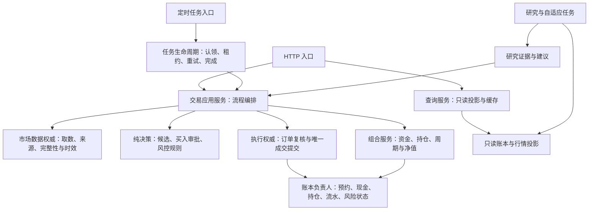
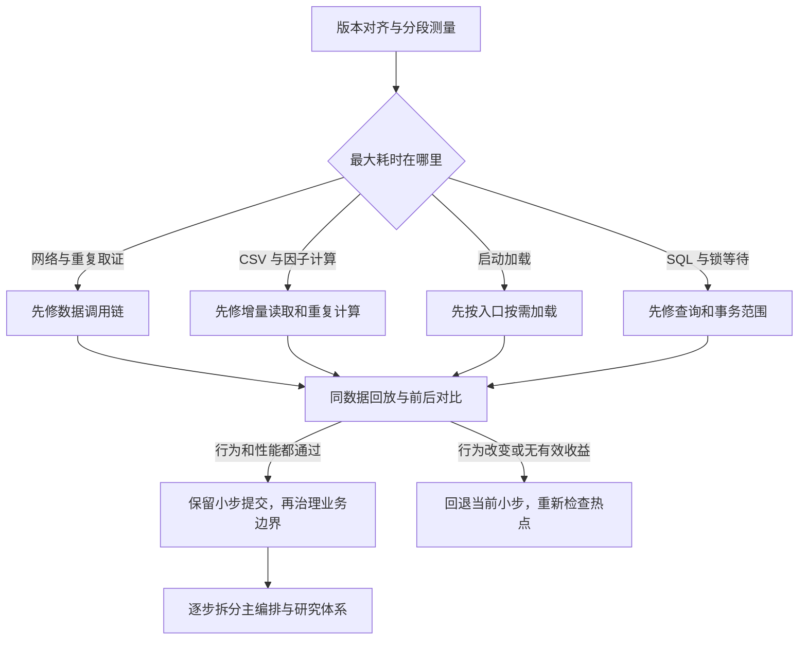
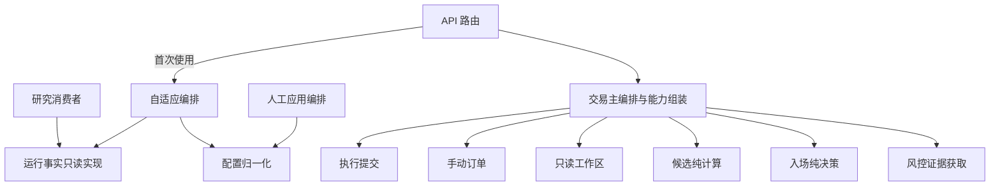
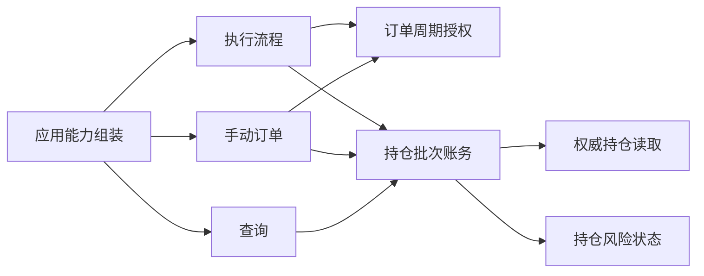

# 模拟盘整体架构梳理与性能改造路线

日期：2026-10-13。基线版本：`3fede53`。已完成性能热点、按需加载、两组导入闭环治理与职责提取；实际成果和验收见第九节。

第一至七节保留实施前的诊断与路线仿真，第八节保留首项优化阶段记录。

## 结论

可以重新梳理，但应该围绕实际调用链渐进改造，而不是整体重写，或把消除循环依赖当作唯一目标。

原目标包含两个不同的完成标准：

1. **结构更清楚**：查询、取证、决策、成交、任务生命周期各有明确负责人；模块不再通过主文件寻找所有能力。
2. **调用更及时**：分别缩短 API 启动、页面查询、风控与盘中任务、收盘任务的耗时。每项收益用同版本、同数据规模的前后测量确认。

结构改善不自动等于性能改善。优先解决实测热点，同时逐步缩小主文件的责任范围。

## 一、本轮证据与边界

### 版本先对齐

当前工作区找不到此前总结中的 `3120d4e`、`04261b3`、`267ee32`、`389687e` 四个提交，也没有 `paper_dynamic_allocation.py`。所以此前的 53% 收益、5690 个测试通过、11 模块闭环属于待核对的外部结果，不能作为本工作区已验证事实。

实现前应先确定以当前版本还是包含这些性能修复的版本为基线，避免重复修复或丢失已有成果。

### 源码扫描

扫描 backend 目录顶层、排除 `test_*.py` 后，共 239 个 Python 模块。依赖统计包含函数内的字面导入；不能覆盖动态导入、回调调用或全部运行时路径。文件长度只描述规模，不证明某个文件就是耗时热点。

| 模块 | 行数/依赖证据 | 含义 |
|---|---|---|
| paper_trading | 15789 行，直接导入 72 个项目模块，被 17 个项目模块导入 | 主编排同时承担基础能力提供者，改动影响面大 |
| adaptive_engine | 5046 行，直接导入 32 个项目模块 | 研究/自适应体系也需要单独梳理 |
| main | 2167 行，直接导入 23 个项目模块 | 应用组装与部分重业务路径混在一起 |
| execution_planner | 2131 行 | 成交权威已集中，但仍反向取用主文件辅助能力 |

`paper_trading` 最大的顶层函数包括：`_buy_order` 1164 行、`_candidate_rows` 745 行、`_bootstrap_signals_for_today` 477 行、`_strategy_entry_assessment` 452 行、`init_db` 393 行。

### 本机导入测量

环境：Windows、Python 3.14.5。每轮新建 Python 进程，使用 `-B -X importtime`，禁止 socket 连接和 DNS 查询，将受 `ASTOCK_DATA_DIR` 控制的账本路径指向临时目录。仅导入模块，不启动服务生命周期、不执行交易任务。部分行情/替代数据模块仍使用仓库内固定缓存路径，因此这不是所有文件路径都完全隔离的运行测试。

| 导入对象 | 第 1 轮 | 第 2 轮 | 第 3 轮 |
|---|---:|---:|---:|
| paper_trading | 5.7162 秒 | 1.3106 秒 | 1.2926 秒 |
| main | 3.3688 秒 | 1.9780 秒 | 2.0879 秒 |

六次导入全部成功。首轮与后续轮次差异明显，可能受到操作系统文件缓存等因素影响；没有清空系统缓存，因此不能称作严格的冷启动实验。`-B` 禁止写入 Python 字节码缓存，但仍可读取已有缓存；`importtime` 也带测量开销，不能直接对应线上启动耗时。

第 3 轮 main 导入中，paper_trading 的累计导入时间约 635ms，adaptive_engine 约 226ms，api_adaptive 约 267ms。累计时间存在包含关系，不能相加当作节省空间。paper_trading 自身导入时间还包含解析、执行模块顶层语句等成本，不只是业务计算。

完整启动还包括 `main._lifespan → P.init_db()`，本轮没有测量这一阶段。也没有实际测量 overview、risk、intraday、close 的运行耗时，不承诺 300ms 启动或具体性能改善比例。

## 二、按调用链重新看架构

| 调用链 | 当前路径 | 已有的正确设计 | 需要进一步确认的问题 |
|---|---|---|---|
| 服务启动 | main → 路由/业务模块；生命周期 → init_db | 大规模预热不阻塞启动，兜底调度线程默认关闭 | 路由注册为何必须加载研究实现；初始化、修复与日常入口检查的成本 |
| 页面查询 | api_paper.overview → 缓存 → paper_trading.dashboard → dashboard_queries | 30 秒缓存、账本变化失效、JSONResponse；查询使用缓存行情 | 缓存未命中时的 SQL、归档解码与投影成本；查询模块仍反向导入主模块 |
| 风控 | monitor_risk → 认领扫描 → paper_risk_service.run → 市场取证 → 短事务内校验/决策/成交 | 外部取数已移出主要写事务，周期在取数后再次核验 | 新闻、资金轨迹与价格校验各占多少时间；取证能否按本轮上下文安全复用 |
| 盘中 | monitor_intraday → 探活/全市场快照 → 风控、待成交处理、候选审批等 | 风控优先、覆盖率门禁、全局租约 | 重复取数、串行取证、初始化、尾部风险快照刷新分别占多少时间 |
| 收盘 | run_slot(close) → generate_signals → 历史更新/因子/全市场快照/研究观察/候选 → 持仓报价 → NAV | NAV 取价在写事务前，因子或覆盖不达标时阻断信号 | 全量 CSV 扫描、每账户重复计算、研究观察与信号主链的时长 |
| 成交 | 各调用方 → execution_planner.commit_fill → 订单/预约/现金/持仓/流水/核验/审计 | 唯一成交入口、周期证明、原子提交 | 主文件回调依赖过多，难以单独验证与复用 |

补充证据：

- `_quotes` 依次取主源、必要时资金流补充、独立核验源，再组合本地元数据。串行等待是性能候选，但不能据此宣布网络就是实际最大热点。
- `marketdata_transport._session` 已按线程复用连接池。若还有大量 SSL 关闭，应追查失败重连、备用源切换、线程生命周期和响应处理，不能直接得出“缺少连接复用”。
- 当前 `rebuild_kline_manifest` 仍枚举 CSV 并逐个加载。因此增量对账仍值得核对，但要先确认是否已在另一个基线版本修复，以及真实调用频次。
- 风控/盘中任务尾部可有界等待风险快照刷新，上限为 20 秒；上限不等于每轮实际花费 20 秒。
- 一次性 `paper_runner` 每次启动都会导入交易主模块。加载优化对它可能有持续收益；常驻 API 进程通常只在启动时支付这笔成本。

## 三、建议的目标边界

保留当前单体部署、SQLite 账本和公开兼容入口。先明确内部责任，不引入微服务、消息队列或第二套成交写入路径。

图中的方框是责任边界，不要求一框一个新文件。优先复用现有模块：查询用 dashboard_queries；行情用 market_data_service；执行用 execution_planner；风控用 paper_risk_service 与纯决策模块；账本能力沿用已有 owner（唯一负责某类事实和写入的模块）。

研究建议仍须经过交易审批，不能绕过执行门禁。调度与交易写入的隔离不等于可以同时写账本；现有全局租约保持，直到并发安全有独立证明。

主文件最终应主要保留兼容入口与少量组装，不再同时提供所有查询、账本和研究辅助能力。依赖通过明确入参或窄接口注入；窄接口就是只提供本流程需要的少数能力，不传入整个主模块或万能上下文对象。

## 四、改造路线与分支仿真

### P0：对齐版本，建立四类基线

先确定包含已有性能修复的实施基线。分别记录：

1. 导入时间、生命周期初始化时间、首个请求与重复请求时间。
2. overview 缓存命中/未命中，以及含历史订单时的查询时间。
3. risk/intraday 从任务启动到完成的总时长，并单列行情、决策、账本提交、锁等待、尾部投影刷新。
4. close 的历史更新、manifest、因子、候选、研究观察、报价和 NAV 时间。

使用固定数据副本与可回放行情；正常源、慢源、失败源分别测量。重复请求应报告中位数与 P95（95% 的请求在这个时间以内）；样本不足时只列原始值，不给貌似精确的统计结论。

**通过标准**：慢在哪个阶段有证据，能在同输入下复现；每个拟修改点有对应验收场景。

### P1：先缩短实际等待，不等待全体解耦

按 P0 结果选当前最大的热点：

- manifest 如果主要重复读未变化文件，做增量对账，并验证删除、变更、损坏文件及多进程更新。
- 同一任务内重复取相同事实，考虑用带周期、日期、观察时间、来源和策略口径的取证上下文复用。共享范围只限满足相同证据条件的调用，不能让旧快照冒充新行情。
- 网络占主导时，先定位连接关闭与重试来源，再评估独立取证是否可并行。不得绕过双源校验或失败阻断。
- 锁等待占主导时，缩短持锁范围、排查写事务中的外部或重计算操作。不得直接取消全局租约。
- 查询占主导时，先优化查询/归档投影；不要用交易写链重构替代页面性能修复。

**通过标准**：相同输入下结果和审计事实一致，目标阶段及端到端耗时改善，没有把等待转移到另一条关键路径。

### P2：让启动只加载当前入口需要的能力

优先检查 `main → api_adaptive → adaptive_engine/self_evolution` 等加载路径，再检查交易主模块里只在盘后或特定功能使用的依赖。沿用已有 `_get_pr()` / `_get_se()` 范式，避免从头设计一套加载框架。

拆分数据库建库/迁移、启动恢复与每次业务入口的必要检查前，必须先测量 `init_db`。它包含账户、周期、租约恢复和状态对账，不能为了速度整体跳过，也不能只用进程内“初始化过”标志替代跨进程事实。

**通过标准**：路由仍完整注册；新数据目录能正常启动；首次访问研究功能也通过测试；导入、完整启动、首请求分别对比，不能只展示启动变快。

### P3：按业务边界减少反向依赖

先用只读查询作边界试点，再改执行层，最后改手动订单链。当前字面导入图的推演为：

| 假设完成的改造 | 包含 paper_trading 的闭环模块数 |
|---|---:|
| 当前 | 5 |
| dashboard_queries 完全不再反向导入主文件 | 4 |
| 再移除 execution_planner 的全部反向导入 | 2 |
| 再移除 manual_orders 的反向导入 | 1，主模块退出闭环 |

这是删边仿真，不是实现收益承诺；回调若仍回到主文件，运行时的耦合仍可能存在。

`commit_fill` 使用主文件 16 种成员；另有 7 个函数通过 `_pt()` 依赖主文件。只纯化 `commit_fill` 不会移除整个 execution_planner 的反向依赖。建议按周期/租约校验、预约与资金、持仓写入、审计与投影分组整理，保留唯一成交提交流程。

另外，adaptive_engine、ai_analysis、ai_research_runtime_adapter、deepseek_research、evolution_apply 构成独立的 5 模块闭环。它应按研究任务与交易适配器的实际边界单独治理，不能声称交易闭环消失后它也自然消失。

**通过标准**：不仅无反向字面导入，还要确认没有通过万能回调绕回主文件；公开调用方式、异常识别和测试中的依赖替换方式保持可验证。

### P4：持续提取主文件中的具体职责

不一次搬走 `_buy_order` 或 `_candidate_rows` 整个大函数。先拆出可明确输入输出的候选纯计算、入场决策，再整理取证和应用编排。任务生命周期可独立提取，但仍保持租约、认领、重试与完成顺序。

每步保留兼容入口，补充相应的源码边界检查和必要的行为测试。已有纯计算可以提前提取；不把“所有闭环全部消失”设为每次拆分的硬前置。

**通过标准**：职责更集中、调用输入更明确、没有第二套实现；只有减少重复计算或加载时，才把该拆分计为性能收益。

## 五、分支决策与回退

不用固定“3–5 天”排期。P0 后按实际依赖给每个小步估计范围；如果一次改造需要同时修改查询、执行、研究和调度才能通过，说明边界仍过大，应再次缩小。

## 六、行为验收底线

- 订单周期来自持久订单事实；调用方传入的周期不能取代成交阶段的再次核验。
- 保持租约 → 周期来源 → 订单身份 → 执行周期校验 → 写账本的顺序。
- 一笔成交全部成功或全部回滚；不得留下部分现金、持仓、成交流水或风险状态。
- T+1、涨跌停、报价新鲜度、来源核验、同日/周期证据边界保持。
- 重复成交不重复写账，部分成交保持数量与流水一致。
- 持仓风险过程的结束仍以同周期权威持仓余量为准。
- 查询不得为了刷新页面隐式联网或执行交易恢复写入；首次建库由启动流程负责。
- 研究与自适应建议不拥有成交授权；调度失败仍可见、可重试。

执行层回归重点复用现有 `test_execution_planner.py`、`test_strategy_buy_commit_convergence.py`、`test_sell_fill_commit_convergence.py`、`test_deferred_fill_cycle_binding.py`、`test_entry_capital_asof.py` 及架构护栏。实际实施后再运行对应测试与 CI 要求的全量检查；本轮没有运行这些测试，不沿用先前的全量通过结论。

## 七、路线仿真阶段的交付（实施前记录）

本轮完成了整体调用链梳理、静态依赖扫描、删边仿真、六次隔离账本/禁联网的导入探测，以及上述路线设计。没有执行真实 close/risk/intraday，也没有修改运行逻辑。

下一步最小动作是 **P0：确定性能修复所在的实施版本，建立完整任务的分段基线**。后续优化按最大实际等待选择，不再预设“先断循环才能解决慢”。

主要源码索引（行号以本次版本为准）：main.py:494；api_paper.py:297；dashboard_queries.py:14；paper_trading.py:1854、5793、6563、7635、9133、10811、10884、12683、13399、13639、13668；paper_risk_service.py:208；execution_planner.py:1805；marketdata_transport.py:25；data_fetcher.py:89、1531；api_adaptive.py:15；paper_runner.py:25。

## 八、首项优化交付：K 线清单增量对账（阶段记录）

日期：2026-10-13。在上述工作区基线上完成，尚未提交或部署。

`universe.refresh_history` 每个完整交易日的首次恢复会调用 `data_fetcher.rebuild_kline_manifest`。原实现即使 CSV 完全未变化，也会全部读取。现在只有清单缺少文件签名、文件修改时间或大小变化、或元数据不完整时才重读 CSV；没有变化且没有待落盘更新时，也不重写清单。

签名由实际读取并核对过的 CSV 生成，不仅凭 `save_kline` 的入参认定文件已验证。这保留了原有读取过程对日期排序与去重的行为。旧清单首次完整核对，之后复用持久签名；损坏文件不更新签名，修复后仍能重新核对。读取期间文件变化时不认证旧版本；扫描结束前已经发布的较新元数据优先。

没有新增删除清理行为，也没有修改市场数据有效性、双源校验或成交规则。修改时间和大小是常规文件变更检测手段；同时保持这两项不变的外部内容修改不在检测范围内。

隔离基准：300 个本地 CSV，每个 250 条日线；先完成一次对账，再测三轮重复对账。

| 状态 | 三轮耗时 | 每轮 CSV 读取次数 |
|---|---|---:|
| 修改前 | 0.6554 / 0.8441 / 1.5169 秒 | 300 |
| 修改后 | 0.0081 / 0.0072 / 0.0073 秒 | 0 |

另验证仅改变一个 CSV 后只重读 1 次，并正确更新为 251 条日线。文件未变化时，返回清单内容保持一致。该结果只代表对账步骤，不代表线上 close 总耗时。

验证结果：

- 11 项新增增量对账测试与数据管线、时点选股、因子校准、运行简化、生产路径回放、架构护栏共 235 项测试通过（40.987 秒）。
- `python -m ruff check backend` 通过。
- `python -m compileall -q backend` 通过。
- `git diff --check` 通过。
- 未运行全量测试、真实行情请求或真实收盘任务。

业务修改范围仅 `backend/data_fetcher.py` 的清单对账函数；新增回归文件为 `backend/test_kline_manifest_incremental.py`。

## 九、全部阶段实施结果

日期：2026-10-13；基线为本工作区 `3fede53`。第七、八节是之前的阶段记录，本节汇总后续实施结果。用户明确要求全部阶段继续完成，本轮覆盖性能、启动加载、依赖整理、职责提取和最终验收；未提交或部署。

### 1. 重复数据工作

K 线清单增量对账结果见第八节。成功的强制源探测新增显式任务作用域：同一 `run_slot` 内最多复用 30 秒，窗口从真实成功返回时开始；失败不入窗口，到期重新探源，异常或正常离开作用域均清理。作用域外 `force=True` 仍真实探源，返回独立副本防止调用方污染复用结果。7 项新增测试覆盖成功、失败、到期、嵌套、异常与副本隔离。

现有 HTTP 传输层已经按线程复用 Session；当前工作区没有此前所述“67 次 SSL close”的可比剖析结果，因此本轮没有据此调整连接池或并发参数。没有把未实测的网络收益计入结果。

### 2. 启动按需加载

`api_adaptive` 与 `api_settings` 在注册全部路由时不再导入 adaptive_engine、self_evolution 和 learning_evaluation；首次需要时才加载，保留原有模块别名及测试替换方式。训练/研究工作的加载成本会移动到首次使用，不保证首次研究请求同幅加速。概览刷新把加载放在原后台 worker 中，避免把这项成本加到概览请求主路径。

采用相同 Python、空独立缓存、临时数据/报告目录，阻止联网，不执行应用生命周期或交易任务。通过 `git archive HEAD` 导出基线，交替测量基线/修改后各四轮独立进程，去掉首轮预热；下表是余下三轮中位数。此处测的是无字节码缓存的模块导入，并非 API 完整启动。

| 导入入口 | 基线 | 修改后 | 结论 |
|---|---:|---:|---|
| main | 3.9905s | 3.6154s | 降低约 9.4% |
| paper_trading | 2.5508s | 2.5432s | 差异处于噪声范围，不计性能收益 |

基线/修改后的 OpenAPI 路径集合一致，main 导入后 adaptive_engine 从已加载变为未加载。原始采样见 `work/architecture_optimization_import_benchmark.json`。没有得到“启动 300ms”或“完整 close 下降 53%”的当前版本证据。

### 3. 两组导入闭环

交易侧用不可变、固定字段的依赖对象替代反向导入：ExecutionDependencies、ManualOrderDependencies、DashboardDependencies。主编排负责绑定，工厂在调用时解析现有函数与状态，保持异常类型、测试替换和运行状态兼容；不把整份主模块交给下层。常规调用仍通过原应用/主编排入口；单独使用垂直模块时需先绑定能力，或对支持显式参数的入口传入依赖，未绑定时明确报错而不隐式启动引擎。commit_fill 可直接接收执行依赖，并将同一对象传入执行上下文解析。

研究侧把运行事实的类型、验证、只读 SQL 和分页提取到 adaptive_runtime_facts；adaptive_engine 仍是运行状态写入者，同名导出和包装保持类型身份及旧读取器替换行为。adaptive_configuration 承载原配置归一化；evolution_apply 消费明确的配置和身份能力，去掉反向训练引擎导入。无人值守开关与 shadow_only 规则原样保留。

| 字面导入闭环 | 改造前模块数 | 改造后模块数 |
|---|---:|---:|
| 包含 paper_trading | 5 | 1，退出闭环 |
| 包含 adaptive_engine | 5 | 1，退出闭环 |

扫描覆盖模块内全部 import，包括函数内 import；不包含动态回调。原始结果见 `work/architecture_optimization_dependency_graph.json`。一些能力仍实现于主编排，因而导入无环不等于运行时完全解耦。没有取消周期、租约、成交再验证或事务。

### 4. 主编排职责提取

改造后的主要依赖方向（箭头表示调用/导入，不表示成交授权）：

- paper_candidate_projection：实时字段覆盖和候选通道保留/排序，保持原顺序、数量与历史因子。
- paper_entry_decision：追高门禁与切片数量准备，输入政策、涨停阈值、计划生成能力和交易日；不自行读取当前时钟。
- paper_risk_market_inputs：通过五项具名能力取得行情、新闻与轨迹；保持取证顺序、空持仓行为和可选轨迹失败降级。
- adaptive_runtime_facts：研究只读运行事实，不再为了读事实加载整个训练引擎。

paper_trading 仍负责权威交易编排、数据库事务和应用决策。没有把大函数整块搬到新文件伪装职责拆分；本轮交付的是上述已验证边界，后续长期细拆仍有空间。这些提取主要降低维护耦合，不单独计为速度收益。

### 5. 验证

已通过交易链相关 408 项、研究链相关 172 项和新边界测试 17 项；其中分页源码护栏同步追踪到提取后的真正实现，新增反例确保移除 OFFSET 或旧读取器转发时护栏能报警。首轮全量 5651 项中有两处旧位置源码护栏失败，0 错误、5 跳过；同步护栏检查实际实现与调用接线后，66 项相关测试通过。最终全量复跑：5654 项，0 失败、0 错误、5 跳过，测试本体 571.456 秒（含发现和汇总 574.28 秒）。原始日志 `work/architecture_optimization_tests_final.log`，汇总 `work/architecture_optimization_test_result.json`。

未运行真实行情或线上完整 close/risk/intraday；保留原有全局租约和事务范围。使用现有入口即可，无需新增配置或部署服务。

补充：完整空账本启动与真实 ASGI HTTP 首次读取已验证，所有样本的 `/api/health` 和 `/api/adaptive/ai/settings` 均返回 200。可复跑脚本为 `work/benchmark_architecture_startup.py`，实际启动不省略建库或恢复检查。

全量首轮结束后的隔离复测结果（三次中位数）：

| 测量阶段 | 基线 | 修改后 |
|---|---:|---:|
| main 导入 | 6.004s | 5.403s |
| lifespan（包含新账本 init_db） | 0.135s | 0.172s |
| 启动就绪（逐样本导入 + lifespan） | 6.139s | 5.575s |
| 首次健康 HTTP 请求 | 0.174s | 0.380s |
| 首次研究设置 HTTP 请求 | 0.182s | 0.680s |

该轮导入约改善 10%，首次研究请求多承担约半秒，健康接口未获得加速收益；不把导入收益等同于首次所有功能都加速。此前在全量测试同时运行时测得 main 导入约 5.60s → 5.60s，说明资源争用下收益不稳定。未改动 init_db 和健康计算逻辑，不能把其样本耗时差异直接归因为某个代码热点。低干扰原始数据见 `work/architecture_optimization_startup_benchmark.json`，争用轮次保存在 `work/architecture_optimization_startup_under_load.json`。

最终检查：`python -m ruff check backend work/benchmark_architecture_startup.py`、`python -m compileall -q backend work/benchmark_architecture_startup.py`、`git diff --check` 均通过。代码已在当前工作区可直接使用，原应用入口与配置方式保持；未提交或部署。Python 版本为 3.14.5，与仓库 CI 指定的 3.14 minor 一致。

后续基于当前工作区的全面审计见 [CURRENT_ARCHITECTURE_AUDIT.md](CURRENT_ARCHITECTURE_AUDIT.md)，包含全项目剩余四组字面导入循环、两个隔离确认的查询/等待问题及快照生命周期风险。它补充本报告的阶段成果，不把此前解除的两组循环表述为全项目无环。

## 十、业务解耦续跑：迁移真实实现

用户在确认“导入循环已解开、业务耦合仍存在”后，授权继续解耦。本轮先完成订单周期授权和持仓账务两个完整边界，保留此前未提交的全部性能改动；不再把固定字段的回调注入等同于业务解耦全部完成。

### 已迁出的实现

| 新负责人 | 实际拥有的能力 | 边界 |
|---|---|---|
| paper_order_execution_authority | 订单四态周期归属、账户/当前周期只读核验、成交周期授权、异常类型 | 只读 SELECT/PRAGMA；零项目导入；不创建周期 |
| paper_lot_ledger | 买入 lot 创建、同周期 FIFO 消耗、持仓镜像重建、旧参数形式持仓读取 | 不导入主编排；不拥有连接/事务；调用既有风险状态、权威读模型与交易日规则 |

lot 是记录一次买入所得股份、成本与解锁日期的持仓批次。新模块继续从来源订单继承周期，T+1 锁定份额不消耗；数量不足先检查再写，费用计入成本的口径保持；创建/吸收持仓风险过程继续委托唯一风险状态 owner。lot 和风险状态写入都留在调用方原成交事务内，调用方回滚时一起撤销。

执行层六项声明能力（含异常类型）直接指向上述 owner，手动订单两项、查询一项直接指向 owner；有重叠，不是九套实现。不是先调用主文件、再由主文件转发。绑定在每次取依赖时解析下层实现，保留 owner 替换测试能力。实际函数归属见 `work/business_decoupling_dependency_owners.json`。

主文件保留同名旧入口和异常别名。独立 lot owner 在没有来源订单时要求显式周期，兼容入口仍按原规则在当前事务解析周期后传入。手动订单和查询原有的位置参数形式由下层适配器承接。主文件从续跑开始的 15662 行减少到 15357 行；行数减少仅说明实现迁出，不计为性能收益。

### 验证与仍有的耦合

修正了迁移脚本切片错误与旧参数形式适配后，119 项相关回归、9 项新增独立模块/生产绑定/事务回滚测试通过。原投影护栏的函数级批准条目迁移到实际写入函数；禁止历史投影重新生成可成交持仓的护栏同步覆盖新 owner，避免实现搬出后检查变空。修正新增 SQL 护栏将 DELETE 误判成读取的错误后，最终全量 5663 项，0 失败、0 错误、5 跳过，测试本体 550.773 秒（含发现/汇总 552.51 秒）。ruff backend、compileall 和 diffcheck 均通过。日志 `work/business_decoupling_tests_final.log`，汇总 `work/business_decoupling_test_result.json`。

仍需整理的业务边界包括共享资金池与预约的编排、租约上下文、策略入场评估、查询账户指标与主任务生命周期。这些能力仍有主文件回调；本轮完成了上述两类真实实现的解耦，并未完成所有业务模块的独立化。源码变动已经可通过原应用入口使用，无新增运行配置。
