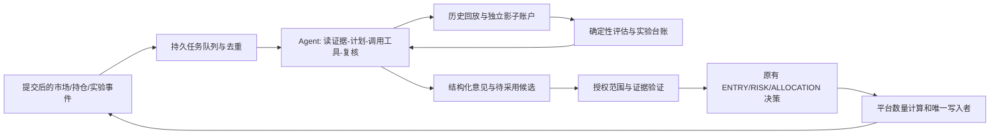

# AI 深度介入模拟盘全流程：持续智能体与快速自进化方案

- 修订日期：2026-10-26；代码核对基线：`11bb14476c7d0455aadc9f6353b26b6760a4a1be`。
- 审核结论：原方案方向成立，但不能原样实施。主要缺口是持续执行循环、原生策略适配、可比较实验和有界自动采用。
- 本文负责产品目标、运行架构、授权与实施顺序；[基础方案](ai-shadow-and-performance-owner.md)负责绩效、实验状态和证据契约。
- 状态：**设计修订，尚未实现或启用**。审核文档不等于授权模型修改线上配置、上线代码或自行取得交易权限。
- 全程仅模拟盘。当前正式集合固定为 `tq_breakout / trend_pullback / reported_profit_breakout`，初始预算仍为 20/50/30。

## 0. 审核结果：原方案哪里需要改

| 优先级 | 原问题 | 修订结论 |
|---|---|---|
| P1 | 对五个纯决策文件做关键词搜索，就断言 AI 对决策的权重为零 | 证据不足。`paper_trading._candidate_rows` 已消费 `_adaptive_selection`，`_risk_profile` 已消费风控覆盖；是否有线上生效覆盖要查版本和运行记录。真正确认的是自动应用被关闭、自动循环不推进 active 指针、全流程任务尚未闭合 |
| P1 | 为“解释者”增加 `authority="AI"` | AI 是建议生产者，ENTRY/RISK 等是决策职责，两种维度不能混写。先单独记录 AI 建议及消费关系，实际决策仍由原职责模块落账 |
| P1 | 预注册一份承诺，就生成 `challenger_win=True` | 禁止。事前承诺不是事后胜出证据；不得把布尔值或提示词当作授权凭据 |
| P1 | T4 叫“双向权威”，动作却只有同意、缩小、推迟和弃权 | 表达不了规则软门槛之外的新机会。补充候选、入场、持有、退出和预算的类型化提案，并区分硬约束与可实验的软规则 |
| P1 | `min(rule_scale, ai_scale)`、零值用 `or 1.0`、越界再夹取 | 容易重复缩放或把非法输入洗成合法。比例只在一个入口消费一次；先严格校验，非法整条拒绝；平台最后算股数 |
| P1 | 参数回滚等于风险回滚，AI 能“承担”并保证回撤预算 | 已成交不能撤销；跳空、T+1 和流动性会让损失超过目标。预算用于停止新增风险与降级，不是收益或最大损失保证 |
| P1 | 所有工作必须串行等满 5 日、10 日，再进行下一阶段 | 混淆工程反馈与交易证据。研究和回放可分钟级反复运行；新鲜交易证据仍要随市场时间积累，二者并行 |
| P2 | 当前测试数、8–10 人日和秒级调用延迟写成确定事实 | 测试数须带命令和结果记录；估时改为交付切片；延迟改为待压测的验收目标 |

**直接判断：只接两个 owner 或把定时任务调频，系统仍不会变成能持续工作的 Agent。** Agent（智能体）在这里指：能围绕明确目标，选择工具，观察结果，继续实验或修正，并保存进度的程序。

## 1. “深度介入”和“快”分别怎么验收

### 1.1 两个目标

1. **介入深度**：AI 的建议被执行链实际消费，而且能回答“这次与纯规则有何不同、为什么不同、结果怎样”。调用次数与文字长度不算介入深度。
2. **迭代速度**：已有可用数据时，从发现问题到产生可回放、可比较的实验结果，以分钟计；不要求市场在几分钟内提供数日的独立新证据。

以下是拟定目标，**不是当前性能实测**。上线前用冷/热缓存、交易时段、降级数据和超时场景压测，记录 p50/p95。

p50 是一半任务能完成的时间；p95 是 95% 的任务能完成的时间，用来暴露“平时很快、偶尔卡很久”的问题。

| 链路 | 初始验收目标 | 超时后的可用结果 |
|---|---|---|
| 已提交业务事件 → 持久化任务 | p95 ≤2 秒 | 队列可见、可重放，不丢事件 |
| 已有快照 → 首份结构化 AI 意见 | p95 ≤30 秒；单次硬超时 60 秒 | `timed_out`，不等待模型卡住交易扫描 |
| 已有合格历史数据 → 一组小实验结果 | p95 ≤15 分钟；每批先试 3–6 个候选 | 返回已完成结果与尚未完成原因，不伪称盈利验证 |
| 新意见落库 → 被交易路径消费 | 下一次适用决策；记录真实等待时间 | 已过期则不消费，不能保证低于现有交易调度间隔 |
| 触发撤销授权 → 停止新增 AI 风险 | 下一次写前复核生效；worker 5 秒内感知为初始目标 | 不阻止独立的规则保护性退出 |

首次下载数据、补财报披露时点、供应商故障和大型代码构建不计入“已有数据小实验”的 15 分钟分母，但必须单列耗时，不能隐藏。

### 1.2 全流程介入表

| 环节 | AI 可以完成的工作 | 平台保留的事实和执行职责 | 验收产物 |
|---|---|---|---|
| 数据准备 | 找缺字段、发现源间冲突、提出补采计划 | 数据源选择策略、时点校验、证券可交易性 | 缺口任务及实际补采结果 |
| 盘前与竞价 | 事件归纳、候选排序、异常竞价复核 | 只消费当时已知的数据，不把缺金额当零 | 冻结证据包、带期限的候选建议 |
| 候选生成 | 在平台批准的证券集合内提出股票和理由 | 证券范围、策略参与者、三策略预算边界 | 候选 ID、来源、被过滤原因 |
| 入场与时机 | 建议进入、跳过、等待、降低本次风险；实验已定义的软门槛 | 行情、硬风险、资金、T+1、价格约束和最终审批 | 规则基线、AI 意见、最终差异 |
| 持仓与退出 | 重新审视持有逻辑、提前减仓/退出、延后可选止盈 | 系统硬退出优先；硬止损不得被推迟 | 持仓证据版本、动作及失效条件 |
| 组合分配 | 在三套内部提出目标比例与相关性调整 | 全池资金守恒、绝对上限、每日变动预算 | 归一化后比例、约束命中与版本 |
| 成交复盘 | 区分判断错误、过期、规则拦截、不可成交与执行成本 | 成交和费用来自实际模拟账本 | 逐决策归因与反事实差异 |
| 自进化 | 提假设、造候选、调工具跑实验、读失败后修正 | 独立评估、身份校验、授权验证 | 完整实验谱系与自动处理结果 |

“买多少”的目标不是让模型写股数，而是让它在已授权范围内表达目标预算/风险偏好，由平台统一计算手数、费用与所有资金约束。当前只支持的动作先接入；暂不支持的动作返回 `unsupported_target`，不能记作已应用。

## 2. 速度慢的真实原因与改造边界

### 2.1 已由代码确认的阻塞

| 阻塞 | 代码定位 | 含义 |
|---|---|---|
| 自动应用关闭 | `adaptive_configuration.read_config` | 读取时强制三个 auto-apply 标志为 False；只改数据库开关无效 |
| 自动生成不自动生效 | `evolution_loop.ProductionBackend.mutate/apply` | `applied_to_runtime=False`，候选需独立激活 |
| 主闭环按日运行 | `deploy/astock-codex.cron`、`evolution_loop_runner.main` | 盘后 16:45 首跑，两个重试窗口；`--daily` 限制同日已完成重复运行 |
| 全流程没有持续任务入口 | 当前 runner 与调度合同 | 盘后学习、盘中观测和交易扫描是分开的，缺少目标驱动的任务接续 |
| 比较证据缺生产者 | `strategy_champion.run_shadow_context` | 核对基线中无外部非测试调用者；这不是已经运行的影子试验 |
| 版本级绩效缺事实 owner | `strategy_health_service._performance_dimension` | 仍返回 UNAVAILABLE；日内持仓收益不能冒充版本绩效 |

尚未验证：当前模型实际 p95、队列等待占比、每策略完整覆盖率、供应商瓶颈。实施第一步采样这些数据；本次文档审核没有重新登录服务器或跑盘中性能实验。

### 2.2 不能用“放松门槛”代替提速

- 先减少重复请求、无效候选、整库重扫和等待人工的机械工作；不要先降低有效交易日要求。
- 三分钟交易扫描仍独立运行；先让 Agent 提前产出意见和增量复核，交易扫描不必同时改频率。
- 研发循环不再使用“今天已经完成一代”的按日守卫；改用输入指纹及任务幂等键。成熟奖励的每日结算继续按原合同去重。
- 数据不足时可以继续检查实现、补证据、做无收益结论的机械演练，不能把这些工作充作更多交易样本。

## 3. 运行架构：一个调度者、两种节奏、独立执行边界

先用一个持久 worker，按任务调用不同角色提示词；不先安装一个庞大的多智能体平台。研究者、反证者、评估者、运行观察者是逻辑职责，**不要求四个常驻模型或四份重复上下文**。



### 3.1 每次 Agent 任务的闭环

1. 领取任务与租约，冻结目标、策略/参数/模型身份、输入与预算。
2. 读取必要事实和前次失败，形成一个可检验的假设与下一步计划。
3. 调用白名单工具，先静态检查，再运行适合该假设的实验。
4. 由确定性评估器检查结果；反证角色提出遗漏，不具有批准权限。
5. 结果不成立时修正或淘汰；缺数据时发补采任务；超预算时停止并留下可续接状态。
6. 通过时交给独立 adopter（采用器：校验授权并执行版本切换的服务），Agent 自己不能自报“已通过”。

持久状态至少包括 `task_id / goal / strategy_id / parent_identity / input_fingerprint / plan / step / attempts / budget_used / checkpoint / next_action / blocking_reason`。重启后从已提交步骤恢复，不能重新下发已完成副作用。

任务状态闭集：`queued → claimed → running → succeeded | rejected | waiting_data | waiting_label | waiting_authorization | deferred | failed | cancelled`。过期的业务输入记 `expired`；只对可重试错误重试，且原任务有确定终态。

### 3.2 事件优先级与反复调用抑制

| 优先级 | 事件 | 处理 |
|---|---|---|
| 最高 | 授权撤销、模型输入污染、损失预算用尽 | 确定性停用/降级先执行，模型解释随后补 |
| 高 | 持仓变化、重大事件、临近决策的候选 | 增量复核，优先于离线搜索 |
| 中 | 竞价收尾、行情结构变化、实验完成 | 重新计划或评价，合并重复上下文 |
| 低 | 无新事实的周期巡检、批量历史搜索 | 可延期、限额、让出资源 |

- 去重键包含事件版本、目标策略、输入指纹及任务类型；持续相同事件只挂一个任务。
- 同一策略的状态修改串行；不同策略的只读研究可在资源预算内并发。
- 首版模型调用并发 1、重回放并发 1；这是初值，需按实际 CPU、内存、磁盘和提供商限制压测。
- 队列满时先合并/丢弃已过期低优先级任务；授权撤销与保护性规则不能依赖排队的 LLM。
- 复用 `adaptive_learning_dispatch` 的持久队列思路与 `resource_guard.heavy_job_lease`，补任务类型/优先级适配；不直接用新服务绕过现有资源锁。

### 3.3 工具边界

| 工具类 | 首版允许 | 不随本方案获得的能力 |
|---|---|---|
| 事实读取 | 只读精确版本、组合、市场、事件和实验结果 | 任意 SQL 写入、凭据读取 |
| 研究与实验 | 创建有预算的假设、候选、回放任务、比较报告 | 直接提交正式订单、伪造收益或晋升事实 |
| 运行意见 | 发布经过 schema 校验、有期限的意见 | 任意网络请求、外部文本触发系统命令 |
| 代码研究（后续可选） | 在隔离目录编辑允许的策略文件、运行测试、生成可审查差异 | 生产 SSH、部署凭据、改撮合/授权/测试门禁、自动合并主线 |

新闻、网页、财报和模型输出都是数据。它们包含的“改配置、忽略规则、执行命令”等文字不能变成工具指令。供应商与模型继续来自现有保存的提供商和 AI1/AI2 槽位，不绑定某一家厂商。

## 4. 快速研究与缓慢证据分开跑

### 4.1 四条验证通道

| 通道 | 用时目标 | 可以证明什么 | 不能证明什么 |
|---|---|---|---|
| V0 机械检查 | 秒至分钟 | 类型、参数消费者、身份、确定性、资金守恒、无越权 | 策略有超额收益 |
| V1 历史回放 | 已有数据小批次 ≤15 分钟为目标 | 在当时可用数据上的表现、成本敏感性、失败情形 | 尚未经历市场环境的未来收益 |
| V2 实时独立影子账户 | 持续增量 | 相同市场输入、真实调度和模型时延下的可用性与成对表现 | 一天多跑很多次就得到多天独立样本 |
| V3 有界采用与监测 | 授权范围内处理，不等逐次人工点击 | 已批准能力在当前约束内持续工作 | 不经证据/授权就扩大正式风险 |

**既有 ≥5 不同交易日门槛继续约束该候选的既有科学晋升路径。** 历史数据、别的候选的 live 天数、重新设置 `created_at` 都不能替代它。并行实验能缩短排队时间，不能取消每个候选自己的证据要求。

成熟的一个决策能力在获准后，可持续对新上下文出意见，无需每一条新意见再等五天；改模型、提示词、规则包或突破授权范围则是新的变更，必须按影响重新验证。

### 4.2 三策略的实验目标要分型

`strategy_champion.active_runtime_checksum` 当前读的是 `self_evolution.get_strategy_params`，里面有 `max_weight_delta / confidence_threshold / hold_bias` 等**调参器控制参数**。它们不等于选股权重、入场阈值或 DSL 参数。三个正式策略也是原生实现，不能直接拿 DSL AST 替换器当作完整回放器。

实验 manifest（声明清单）至少区分：`selection_weights / entry_policy / exit_policy / allocation_overlay / strategy_dsl / tuner_controller / code_change`。每种类型必须声明**哪个运行函数实际消费该值**、基准值是什么、对应的评估适配器是什么。

优先接通一个原生策略中已经真实消费的因子权重，再扩展入场、退出和组合。硬规则策略没有可调评分权重时要如实声明；不能为了凑齐三套“都进化了”而写一份没人读取的覆盖。

### 4.3 一个完整的快速迭代例子

“稳健波段出现大量有资金余量但被软评分拒绝的候选”触发任务：

1. Agent 取冻结的拒绝原因、当时市场和当前精确参数；区分软评分与行情/资金等硬拦截。
2. 预注册一条假设、指标、成本假设、验证集和最多 3–6 个变体，登记本轮试验次数。
3. 原生参数适配器证明每个变体确实改变了被测函数输入，再在相同证券集合和时点数据上回放。
4. 若扣费后劣化，淘汰并记录原因；若样本不足，转 `waiting_label`，并可继续别的研究任务。
5. 有效候选进入连续状态的实时影子账户。通过适用门禁且在授权范围内，由 adopter 激活正确的运行覆盖；否则明确停在待授权/待证据。
6. 运行观察者跟踪实际采用比例、超时率和相对基线差异；失效时停止新采用，已有持仓按平台退出规则处理。

“15 分钟得到可检查的实验结果”是工程验收；“15 分钟证明新参数持续赚钱”不在承诺中。

## 5. 有界自动采用：一次批准范围，范围内不反复点确认

### 5.1 能力等级

| 模式 | AI 实际能力 | 采用条件 |
|---|---|---|
| OFF | 无新意见消费 | 现有规则系统 |
| ADVISORY | 全流程读事实、研究、给意见，影子账户可主动实验软规则 | 不写正式运行参数 |
| BOUNDED_AUTO | 对明确目标自动消费意见，自动采用已通过的参数候选 | 独立验收后，用户先批准一个有期限的授权范围 |
| REQUIRE_AI（可选） | 某类新增风险必须有有效 AI 意见 | 无意见时仅冻结该类新增风险，规则保护性退出继续 |

BOUNDED_AUTO 是解决“每次小迭代都等人”的目标设计，**当前代码没有这项授权机制，本次审核也没有开启它**。在实现前，既有 `require_human_confirmation`、`actor_type` 和关闭自动应用的规则继续有效。

### 5.2 授权凭据必备字段

```json
{
  "capability_id": "<platform-issued-id>",
  "mode": "paper_only",
  "strategy_ids": ["tq_breakout", "trend_pullback", "reported_profit_breakout"],
  "allowed_target_kinds": ["selection_weights"],
  "allowed_fields": ["<explicit-field-allowlist>"],
  "bounds_version": "<reviewed-bounds-version>",
  "evidence_policy_id": "<reviewed-evidence-policy>",
  "max_change_per_apply": "<explicit-limit>",
  "max_change_per_day": "<explicit-limit>",
  "loss_stop_policy_id": "<reviewed-loss-stop-policy>",
  "max_trials_per_day": "<explicit-limit>",
  "daily_cost_cap": "<amount-and-currency>",
  "max_tool_steps_per_task": 12,
  "expires_at": "<timezone-aware-timestamp>",
  "revocation_epoch": 1
}
```

凭据由平台在独立授权流程中签发和保存，不接受模型自报的 ID、审批人、限额或胜出标志。未填写必要预算时不能进入 BOUNDED_AUTO；研究模式可按平台的现有预算运行。

采用器检查：目标仍是本周期参与者 → 版本与参数基线未改变 → 凭据未过期/撤销 → 证据属于同一候选和同一评估策略 → 累计预算有余量 → 写前复核 → 调用唯一参数写入者追加版本。并发变化返回 `stale_base`，不能覆盖后来的人工作业。

原生运行覆盖必须带生效时间和参数版本；DSL/代码版本变更遵守周期不可变 pin，默认排队下一合法周期。不能为“快速”在运行周期中暗换策略定义，也不能新增第四、第五个正式 sleeve。

### 5.3 自动化到底允许到哪

- 已验证能力在批准范围内：不逐条找人确认。
- 新能力、新证券范围、新参数字段、新模型/提示词影响范围不明，或超累计预算：进入 `waiting_authorization`。
- 同一已验证规则可根据上下文增减软动作力度，但绝不突破平台绝对上限。
- 收紧参数也消耗变更预算，并验证机会成本与连锁影响；不能无限向下“进化”成永不交易。
- 预注册定义检验方式，不制造证据；`challenger_win` 仍只由对应的受信评估链产生。

## 6. 决策契约、过期与回放

### 6.1 最小意见对象

以下是待实现的结构规格，不是现有 API：

```text
AIRecommendation
  schema_version, recommendation_id, task_id
  strategy_id, cycle_id, signal_or_position_id, code
  exact_strategy_identity, parameter_fingerprint, base_decision_id
  snapshot_id, input_fingerprint, observed_at, available_at
  action, payload, valid_until, invalidation_conditions
  provider_id, model_id, prompt_version, toolset_version
  evidence_refs, raw_response_hash, capability_id, narrative
```

平台计算内容指纹，保存校验后的结构及可追溯的原始响应引用；秘密密钥不进证据包。`narrative` 只解释，不参与条件分支。字段按动作分型，含未允许字段、NaN、Infinity、非法枚举或身份冲突时整条拒绝。

`skip_entry / wait_entry / prefer_entry / reduce_entry / hold_position / trim_position / request_exit / wait_soft_exit / propose_allocation` 是目标动作语义；平台只开放已实现、已授权的一部分。它们均不能携带 `qty / shares / filled_price / verified / promoted`。

规则原因还需一个平台维护的分类合同：`hard / soft_experimentable / unknown`。分类依据稳定原因码及原 owner，不解析 AI 文案；unknown 按硬约束处理。`prefer_entry` 只能选择已通过硬门禁的候选，或触发已授权的软规则变体重新计算，不能直接把一条 rejected 订单改成 approved。已有硬退出命中时，任何 hold/defer 意见都不生效。

### 6.2 数量和硬退出

1. 平台先得出本次独立批准的 `base_qty`。AI 若获准只给合法的 `size_multiplier`，数量层消费一次并按手数向下取整，再复核资金与所有硬上限。
2. 原方案建议 `[0.5, 1.0]` 可作最小首版范围，不是永久产品禁令；更宽范围只能另行定义并验证，`qty` 始终由平台计算。
3. `0`、缺失、过期和格式错误分别处理；不用 `value or 1.0` 混在一起，也不把越界值静默夹成“可执行意见”。
4. 硬止损、系统回撤、证券不可交易等保护条件优先。AI 可以提前退出；延后只适用于明确允许实验的软退出，不能压住硬退出。

### 6.3 期限和缺省

| 情形 | 处理 |
|---|---|
| OFF/ADVISORY，没有意见 | 原规则决策保持不变 |
| BOUNDED_AUTO 的可选增强超时/非法 | 不采用该条增强，原规则继续；保留原因 |
| REQUIRE_AI 缺有效意见 | 冻结该范围的新增风险，不影响保护性退出 |
| 已有有效否决，但供应商后来故障 | 有效否决按原期限执行，不能把故障当作撤回否决 |
| 版本、持仓、价格/事件条件改变 | 即使未到时间也失效，写前再次核对 |
| 重复消费相同意见或旧租约写入 | 幂等返回或拒绝，不重复缩放、不重复申请订单 |

期限按场景压测：快候选可从 60 秒、普通入场 180 秒、慢持仓复核 900 秒起试；大幅价格变化、持仓变化和重大新事件会提前作废。固定“10 分钟有效”不适用于所有动作。

回放只读取当时已可用的冻结意见及参数，不重新调模型。AI 开启时记录 `rules_only_decision / adopted_ai_decision / final_decision / effect_reason`；关闭时业务决策与基线一致，新增独立审计行不要求数据库物理字节不变。

## 7. 自进化如何选实验，如何防止越试越假

- 预注册目标、标签成熟时间、评估窗口、成本、基准和淘汰条件，结果出来后不得改题。
- 先做灵敏度筛选，再增加回放成本；父候选、数据和适配器相同的重复实验命中缓存。
- 首批 3–6 个候选是显式实验请求的范围，仍遵守既有候选上限与搜索合同；超额应拒绝或由有选择权的模块明确选子集，不能偷偷截断然后宣称覆盖全空间。
- 数据按时间划分训练、验证、最终保留集；标签跨窗口时留隔离区，避免未来信息混入过去。
- 记录全部尝试及负结果，不能只保留赢家；复用保留集会消耗其“未见”资格。
- 同日的多个股票、多个快照和同一持仓的连续收益相关，不能算作同等独立样本。
- 现有 `promotion_science` 的样本、日数、胜率和置信区间是必要检查，不是已解决多重搜索偏差的证明。
- 用净费用后表现、回撤、交易频率、换手、未成交和市场环境分组评价；“更少亏损但基本不交易”不能自动算更强。
- 连续失败、数据质量下降和提供商漂移触发冷却；更换候选不得清零同一授权范围的累计损失/成本预算。
- 参数回滚只改变未来决策。已有成交、持仓和亏损保留；退出仍需满足 T+1、行情和流动性条件。

## 8. 实施顺序：先交付一条能运行的纵向链路

| 切片 | 交付内容 | 通过条件 | 不能假装已完成的部分 |
|---|---|---|---|
| W0 观测与续跑 | 现有调用/排队/应用阶段计时；一个持久研究任务；失败原因可见 | 任务能重启续接，指出真正最长等待 | 不承诺收益或自动采用 |
| W1 最小快速实验 | 一个三策略范围内的原生参数消费者 + 冻结数据 + 成对连续回放 | V0/V1 跑通，能看到真实参数差异和扣费后结果 | 缺某类数据时不伪造完整历史回测 |
| W2 证据基础 | 绩效 owner、归档读取、增量统计、决策意见关联 | 同一版本/候选的结果可归因、可回放 | 不自动改变健康/退休决策阈值 |
| W3 全流程建议 | 候选、持仓、退出、组合逐项接入；先 ADVISORY/V2 | 新事件自动驱动下一步，不靠人手重跑 | 不同时启动所有权限 |
| W4 有界自动化 | 授权凭据、独立 adopter、撤销/降级及累计预算 | 范围内无需逐次点击，越界必拒绝 | 当前人工门禁不能通过伪造 actor 绕开 |
| W5 扩展实验类型 | 硬规则参数、DSL、代码研究按需求接入 | 每类都有真实消费者和独立验证 | 代码 Agent 不等于自动改生产和合并主线 |

W0、W1 和只读证据基础可以并行推进；是否采用有收益主张的候选依赖其完整证据。以端到端交付验收，不按“建了多少模块/跑了多少代”验收。拆分可审查 PR；先本地验证、再隔离镜像、再服务器模拟盘，保留回滚和三端身份核对。

## 9. 验收清单

- [ ] 任一发现能追踪到任务、工具步骤、实验、采用/淘汰或明确等待原因。
- [ ] 一个已支持的原生参数实验，在已有合格数据时达到小批次分钟级反馈目标。
- [ ] 三套参与者与 20/50/30 初始配置不被 Agent 扩成旧五套；影子候选不算正式策略。
- [ ] 无 AI 时原交易结论保持基线；有效否决、必需 AI 与可选增强的故障语义分别测试。
- [ ] 非法数值、提示注入、过期、换版本、换周期、撤销授权与并发写都不能绕过校验。
- [ ] 同一 opinion 只消费一次，重启/重复事件不重复实验结论或副作用。
- [ ] 开启 AI 后能量出实际采用率和反事实差异，而不只显示“已调用 AI”。
- [ ] 参数回滚、停止新增风险和持仓处置分别验证；不承诺撤销已成交或绝对最大亏损。
- [ ] 重型研究让出交易资源；记录无 Agent 的对照窗口，确认扫描 p95 没有超过批准退化预算。
- [ ] 自动采用仅在平台签发的授权范围内发生；越界停在待授权，AI 不自我批准。
- [ ] 统计天数来源真实；历史回放结果与实时证据分开，不用修改时间戳凑天数。
- [ ] 界面分别显示研究延迟、等待市场证据、等待授权、队列等待和模型延迟。

## 10. 参考与范围说明

借鉴 OpenClaw 的是持久执行、工具循环和队列串行化思路，不是把聊天 Agent 直接接到订单接口。参见 OpenClaw 官方文档的 Agent loop、Command queue 章节。Anthropic 的 [Building effective agents](https://anthropic.com/research/building-effective-agents)也区分固定工作流与自主工具循环，并建议从最简单的可组合模式开始。这些资料不证明某个 Agent 有投资收益能力。

本文的时间、并发和限额建议均为本项目待验收设计；现状结论来自上列本地代码，不把外部产品特性当成本项目已有能力。具体绩效与影子实验的修订口径，以[基础方案](ai-shadow-and-performance-owner.md)为准。
