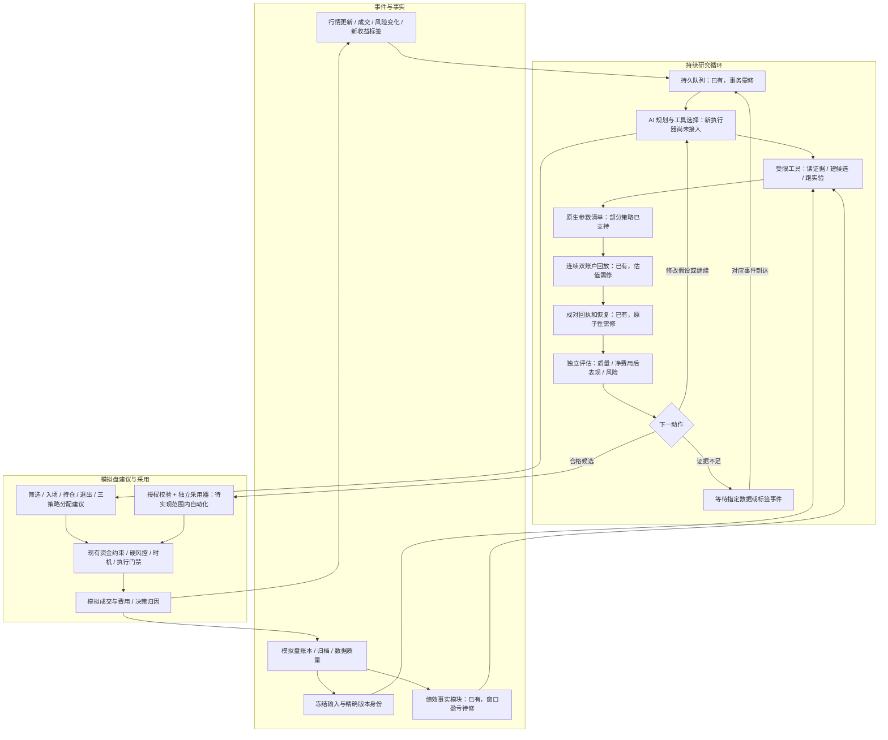
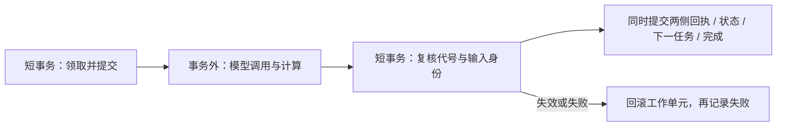

# AI 深度介入改动审核与后续技术路径

审核日期：2026-10-26。审核本地 `codex/three-strategy-unified`，HEAD `d89fe4a`，比较基线 `11bb144`。重点检查 `d89fe4a` 的任务队列、执行器、绩效事实、实验清单、成对回放及增量接续；同时检查依赖提交 `15505a8` 的命名兼容改动。

**结论：方向正确，但暂不通过“可持续运行、实验结论可信”的验收。确认 4 项 P1、3 项 P2 缺陷。当前交付是研究基础模块，还没有把新的 AI 持续循环接入生产流程。** P1 表示接入自动迭代前需要修复；P2 表示影响特定功能、身份追踪或可用性，需要在扩大实验前修复。

本次只进行了本地审查、隔离复现和报告编写。没有修改业务实现，没有核验本次提交的 GitHub/服务器部署，也没有证明盘中提速或收益提升。两份方案文件是设计依据，其待办内容不当作已经实现的功能或部署授权。

## 1. 正确的部分与实际接通程度

| 部分 | 当前实现与判断 |
|---|---|
| 任务独立存储 | `agent_task_queue` 使用独立研究库，避免直接争用正式交易账本；方向正确。但执行期间仍会占住研究库的写锁，见 R4。 |
| 可恢复任务 | 有任务状态、领取代号、去重、重试、检查点与阶段计时；具备基础能力，不代表已有长期运行的 Agent 服务。 |
| 原生参数实验 | `experiment_target_manifest` 指向真实参数消费者，`native_paired_replay.strategies_selector` 调用现有选股实现，避免虚构一个没人使用的参数。 |
| 适用范围 | 支持激进做T的 `first_board_relay`，稳健波段的 `pullback_reversal / trend_continuation`；财报策略明确返回不支持，不能宣称三套都已具备参数实验。模型族是策略内部的选股方法，其数量不等于正式策略数量。 |
| 双账户连续回放 | 基线组与挑战组各有现金、持仓、费用与后继状态，整段/增量复用同一会话推进函数，设计合理。估值与发布仍有缺陷。 |
| 证据边界 | 历史回放的 `require_promotion_eligible()` 固定拒绝产生晋升资格；没有把历史样本冒充新增交易日。应保留。 |
| 版本绩效 | 有精确版本身份、活动/归档读取和只读连接；缺数据不直接填零是正确方向，但观察窗口盈亏仍有错误。 |
| 命名兼容 | 新迁移仅改指定运行字段，不重写归档快照；旧模型名通过兼容入口归一化。相关回归通过；不据此宣称服务器已完成迁移。 |

未接通的具体证据：

- `agent_task_runner.py:353`：命令行新进程没有注册处理器，`run` 返回 `no_handlers`，代码也明确说明只交付 W0 骨架。
- `experiment_increment.register_handlers()` 目前需要调用方手动调用，未找到新的生产启动入口负责注册并持续运行。
- 对新增模块的非测试引用搜索，未找到生产行情/成交事件、部署调度或前端调用这些新模块形成闭环。
- `strategy_health_service.py:247` 仍是占位实现，返回 `strategy_performance_owner_unavailable`，没有消费新的绩效模块。
- 新执行器没有连接模型调用来完成“读结果→修正假设→再调工具”；现有旧 AI 功能另有入口，不能把两者当作已经连通。

## 2. 已确认缺陷

### R1 · P1：观察窗口盈亏混入窗口外收益

位置：`backend/strategy_performance.py:913–931`、`:393–415`、`:458–474`。

归档读取把所有身份匹配的卖单盈亏装进没有日期的 `archived_sell_pnl`。后续只裁剪净值和成交流水，保留完整盈亏数组，最终把它们全加起来。

隔离复现：同一周期 10-05 已实现盈利 500 元，10-19 盈利 100 元；请求 `[10-15, 10-21)`，应为 100 元，实际返回 **600 元且状态 AVAILABLE**。这样 AI 无法正确判断“最近一段是否改善”，参数评价和版本比较都会受影响。

最小修复：让盈亏事实保留可核验的成交日期与成本来源，再按同一半开窗口筛选。跨日分批成交需要对应的成本分摊证据；无法可靠拆分时返回不可用及原因，不能凭订单日期猜分。活动周期的累计 owner 读取也应补同一窗口回归，避免只限制截止日而没有处理起始日。

验收：窗口前/内/后卖出、空窗口、多周期、跨日分批成交、活动/归档两条路径分别核对，窗口外收益不得进入窗口内指标。

### R2 · P1：持仓缺报价时，市值被算成零

位置：`backend/native_paired_replay.py:653–655`。

估值只累加当天存在报价的持仓，没有报价的持仓仍留在账户，但从市值求和中被跳过。资金守恒检查使用同一个缺项结果，检测不出错误。

隔离复现：账户现金 1000 元，持有 100 股、成本价 10 元，当天仅另一只股票有报价。实际返回 **持股仍为 100 股、持仓市值 0、净值 1000**；这会制造并未发生的亏损，后面报价恢复还可能制造虚假上涨。

最小修复：当前优先拒绝发布缺少持仓估值的会话，保留可恢复状态，等待数据；以后若支持历史估值延续，必须明确价格日期、数据来源、质量降级以及评估限制。不能默认成本价或零值就是当天公允估值。

验收：一侧独有持仓缺价、停牌、报价补齐、次日恢复，均不得生成虚假收益或在不完整估值上评出胜负。

### R3 · P1：成对回执可能只写一侧，却显示实验完成

位置：`backend/replay_receipt_ledger.py:196–205`、`:228–234`；`backend/agent_task_runner.py:258–263`。

“两侧先预检”只解决内容冲突，不能保证后续两个 INSERT 都成功。第二侧写入异常时，执行器把异常转成失败任务，没有回滚第一侧的写入，外层连接随后提交。`published_sessions` 又只要看到任意一侧就把当天算作已发布。

故障注入复现：在隔离库为挑战组 INSERT 安装失败触发器。任务变成 **failed**，关闭并重开数据库后，**只剩 champion 回执，但 progress.complete=true**。触发器用于模拟第二次写入失败，不涉及正式数据库。

最小修复：用数据库保存点或显式短事务保证“两侧回执+后继状态+下一任务+本任务完成”一起提交；失败先回滚该工作单元，再另写失败状态。完成判断必须验证两侧、会话、序号、版本和身份完整匹配。旧的单侧残留应明确报损坏或待修复，不能自动跳过。

验收：A/B 写入各阶段异常、写后进程中断、重复提交、单侧历史残留、恢复续跑；只能出现完整一对或完全未发布。

### R4 · P1：执行工具期间一直持有数据库写锁

位置：`backend/agent_task_runner.py:207–226`、`:279–293`、`:358–359`；`backend/agent_task_queue.py:302–312`。

默认连接要等退出整个上下文才提交，领取/启动后立即进入处理器，批处理期间也没有分段提交。因此未来模型请求或耗时回放会把领取状态和心跳一起留在未提交事务中，并阻塞别的研究任务写入。

双连接复现：处理器运行时，第二连接看到的仍是 **queued**，尝试写研究队列得到 **database is locked**。独立研究库保护了交易库，但没有解决研究内部的并发与恢复。

最小修复：短事务领取并提交→事务外调用模型/计算→短事务重新核验领取代号、任务取消及输入身份后发布。心跳和取消走独立短事务；不要用取消全部事务保护的办法换取速度。

验收：模拟长模型请求时，其他任务仍可入队、取消和读取运行状态；进程被终止后，已提交领取记录能被其他进程按租约恢复；多任务不能重复发布。

### R5 · P2：第 13 个交易日起把会话序号当作任务步数

位置：`backend/experiment_increment.py:131`、`:200`。

每个会话单独创建任务，预算是 12 个工具步骤，但完成时写入的是实验累计会话序号 `index+1`。第 13 天起，即便该任务只处理了一个会话，也触发超预算。并且在检查点报错前已经写回执和排了下个任务。

隔离复现：14 日实验产生 **14 个任务、后 2 个 failed、28 条回执，进度仍为 complete=true**；失败原因为 `step 13/14 超过 max_steps 12`。

最小修复：任务内步骤计数与实验会话游标分开，后者留在 payload/checkpoint；先核验工作预算，再发布事务。不要把工具预算简单调大以掩盖语义错误。

验收：20/60 日实验无人工改预算可跑完；失败会话不得同时冒充成功发布；进度同时呈现发布完整性与任务失败。

### R6 · P2：环境身份没有包含真正影响选股的因子表

位置：`backend/native_paired_replay.py:161–167`、`:185–188`。

`environment_hash` 只包含日期、报价与首板代码，没有包含 `factor_table`。冻结数据表仍可变，声明 frozen 也不会冻结其内部内容。

隔离复现：仅把第一只股票的 `pct` 改成 -99，真实选择器的首选由 **600001 变成 600002，但 environment_hash 完全相同**。不同输入会被标成同一环境，影响缓存和证据追踪。

边界：`record_run` 还会比较完整会话 payload，因此同一个 experiment_id 重登记时不一定被静默接受；这里确认的是环境身份碰撞，不夸大成已绕过所有防重逻辑。

最小修复：因子值、索引、影响语义的列类型/元数据、数据时点及来源纳入规范化快照身份；持久化与重建走同一格式；双方消费同一不可变快照或隔离副本。升级身份版本，旧回执不能直接冒充新格式证据。

验收：任何会影响决策的输入改变必须改变身份；序列化重建不改变输入语义和选择结果；一侧计算不能修改另一侧数据。

### R7 · P2：进度查询命令启动即报 NameError

位置：`backend/experiment_increment.py:236–240`。

`__main__` 调用 `main()` 早于 `experiment_progress` 的定义。导入模块的测试不会暴露这个问题，实际命令行访问已初始化数据库时会直接报 `NameError: name 'experiment_progress' is not defined`。

最小修复：把 `__main__` 放在所有函数定义之后；补子进程调用的命令行冒烟测试。

验收：已存在实验、缺实验、未初始化库三种查询都返回受控 JSON 与预期退出码，没有堆栈报错。

## 3. 附加边界观察

另做一项租约探针：领取 1 秒租约，启动后在第 60 秒、尚未执行回收前，旧 token 仍能完成任务，因为 `_authorize` 只检查 token 和状态，不检查截止时刻。**不单独计入以上 7 项缺陷**：当前代号隔离的承诺主要是拒绝已被接管的旧 worker，未被接管前是否绝对禁止写入需要明确合同。后续发布事务应统一验证租约策略，不能让任务表和回执表各自定义权限。

## 4. 后续优化调整路径

建议继续使用现有模块，先交付一个真实贯通的样本。无需增加更多 Agent 角色、重写交易引擎或先扩展实验种类。

| 阶段 | 具体调整 | 完成标准 |
|---|---|---|
| S0 修正底座 | 修 R1–R7；补窗口、缺价、双连接、长窗口、半侧失败和命令行回归；明确发布事务和版本身份 | 所有复现转成验证正确行为的回归用例；缺证据不产生有效实验结论；重启无重复副作用 |
| S1 打通一个 AI 循环 | 选择一个已支持的真实参数；增加明确的生产注册/启动入口；接现有模型提供商；AI 读工具结果并选择继续、改假设、淘汰或等待 | 一个真实研究事件无需手动调用 Python 函数，即能从入队走到实验结果；重启后能续接，模型看得到结果 |
| S2 加快实验反馈 | 行情/成交/新标签事件驱动；相同输入去重；缓存冻结因子；增量推进；优先处理已具备数据的候选；等待标签任务自动唤醒 | 在可比较输入和资源条件下记录端到端耗时分布；能定位队列、模型、计算、证据等待各自占比；正式扫描资源不退化 |
| S3 逐项接入模拟盘 | 依次接研究筛选、入场建议、持仓/退出建议、三策略组合分配；接绩效 owner 到健康检查和复盘 | 每一步能关联规则基线、AI 意见、最终动作、执行结果；无效/过期意见处理有测试；三套正式参与者不扩成五套 |
| S4 范围内自动采用 | 实现期限、参数范围、成本/风险累计预算及撤销；由独立采用器校验，逐类开放 | 已授权范围内的小迭代无需逐次点击；越权拒绝；预算不会随换候选清零；异常能降级并回滚未来配置 |

速度目标沿用主方案的候选指标，**尚未实测达成**：已提交业务事件到持久任务 p95 ≤2 秒；已有快照到首份结构化 AI 意见 p95 ≤30 秒、单次硬超时 60 秒；已有合格数据的小批实验 p95 ≤15 分钟。p95 即 95% 的样本耗时不超过该值。先记录当前基线，跑通一个候选后再评估扩大到每批 3–6 个；不能靠增加并发直接挤占交易资源。

把两种等待分开：参数消费错误、重复计算、队列锁和模型调用可以加速；次日收益标签与新增有效交易日必须等真实数据。历史回放加快筛选，持续实时影子积累新证据，两者身份、数量和采用资格分开记录。

AI 深度介入的验收单位是“一个决策产生了什么变化，结果如何，再如何调整”，不是新增了几个模块或生成了几份建议。

## 5. 技术图：目标链路及当前缺口

实线表示目标数据/控制流，节点中标明当前状态；整图不代表已经部署。



运行实现应明确分成三个阶段，模型调用和重计算放在事务外：



推进顺序：**S0 修正可信度 → S1 一个循环跑通 → S2 测量并提速 → S3 扩到全流程 → S4 范围内自动采用**。S3 内建议与研究可以先运行；采用门禁在 S4 完成前继续沿用现有规则。

## 6. 验证记录与复现入口

本地测试结果：

- 新增功能及命名测试 7 个模块：168 项通过，耗时 5.772 秒。
- 命名兼容、选股、AI 控制、进化应用等相关回归 11 个模块：270 项通过，耗时 23.320 秒。出现测试读取文件未关闭的 ResourceWarning，未导致用例失败。
- 合计 438 项通过。没有运行全仓库测试，未以这些结果替代生产验证。
- 额外隔离探针复现上述 7 个缺陷，并观察租约边界。故障复现成功表示问题存在，不表示实现通过验收。

新增功能测试模块：`test_agent_task_queue / test_agent_task_runner / test_experiment_target_manifest / test_native_paired_replay / test_strategy_performance / test_experiment_increment / test_strategy_naming`。

相关回归模块：`test_adaptive_structure_gating / test_ai_controls / test_candidate_factor_wiring / test_evolution_apply / test_factor_unit_contract / test_legacy_factor_unit_migration / test_paper_account_specs / test_paper_selection / test_strategy_factor_requirements / test_strategy_selection_provenance / test_tuning_baseline`。

隔离复现脚本及输出位于仓库忽略目录，只创建临时 SQLite 数据库：

- `.codex-test-tmp/mimo-ai-review-20261026/reproduce.py`
- `.codex-test-tmp/mimo-ai-review-20261026/observations.json`
- 新增测试日志：`.codex-test-tmp/mimo-ai-review-tests.log`

从仓库根目录执行：

```powershell
$env:PYTHONIOENCODING = 'utf-8'
& ./.venv/Scripts/python.exe ./.codex-test-tmp/mimo-ai-review-20261026/reproduce.py
```

修复时应把探针转写成正式回归测试，断言期望的正确行为；当前脚本特意断言缺陷仍存在，不应加入正常通过的验收套件。

后续需要部署时，再独立核对本地/GitHub/服务器源码、镜像构建身份、运行容器、调度入口、任务恢复与交易账本。当前本地审核不构成这些环节已经同步的证据。
