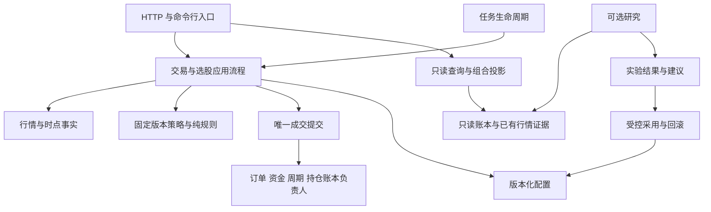

# 模拟盘解耦与简化审计报告

日期：2026-10-27。范围：本地模拟盘源码、前端、测试、部署入口及文档。性质：只读审计与改造设计，本轮未改业务代码、删除模块、调整交易规则、连接服务器或操作现有账本。

## 1. 审计结论

**项目需要减小职责交叉和功能表面，继续沿用模块化单体最合适。** 模块化单体就是保持现有应用与部署形式，在内部让事实、规则、流程、写入各有明确负责人。当前主要问题不是缺少文件，而是部分文件拆开后仍依靠主文件取得大量能力；同时研究路线、兼容层和迁移工具持续累积，缺少明确的收尾条件。

建议按收益与风险安排工作：

1. **先收尾明确负担**：核验后删除未消费工具；为账户绩效建立明确预期测试，再删除生产旧实现；清理无法兑现的设置和功能表述。
2. **先解小而清楚的依赖环**：共享格式函数、日历读取、低层常量归属；让选股应用脱离 HTTP 主入口。
3. **公共能力统一实现、相同输入结果复用，再迁真实业务职责**：先检查重复取数、重复查询和重复计算，让同一轮的合格结果供多个消费者取用；候选输入、策略评估、周期资金、任务生命周期逐簇归位，缩窄主文件向下层提供的能力。不能只把重复代码移到公共函数，却让每个调用者仍完整计算一次。具体补充见第 13 节。
4. **研究功能选择主线，其余按需保留**：先核实使用与有效产出，暂停重复扩张；不能由代码量推断交易收益，也不能直接整包删除。
5. **旧策略和迁移工具有证据后退役**：停止新入口、保留退出和历史解释，最后删除不再需要的实现。

不建议整体重写、改成微服务、换前端框架，也不建议“一函数一文件”。已有唯一成交提交、持仓批次账本、严格证据检查等边界应继续保留。

## 2. 完成标准、版本与证据限制

本轮完成标准：生成当前规模与依赖清单；识别真实回边和职责交叉；逐项分清可清理、应合并、可降级及待证退休的内容；给出目标职责、执行顺序和验收场景；通过现有测试核验关键历史问题的当前状态。以上已完成。

审计开始于 `e7fc3601983577dd98bccf057919073977625598`，分支 `master`。期间工作区 HEAD 变化为 `b1158bc14608bd5e529b7d372927f4d4c2d3e3bd`；已核对，两者仅 `docs/COUPLING_BUDGET.md` 增加 27 行，业务代码无差异。本轮没有执行 Git 切换、提交或同步。原有未跟踪文件 `plans/ai-full-flow-runtime-review-20261027.md` 保留，没有把其旧版本运行结论当作当前生产事实。

证据附件：`plans/modularity-simplification-evidence-20261027.json`。含 885 个已跟踪文件清单、308 个顶层生产 Python 文件的初步职责归属、源码规模、导入关系统计、SQL 字面写入候选、前端依赖环及验证记录。文件归属是设计建议，不是要求立刻移动全部文件；逐调用链深入检查集中在本报告的问题清单，不能解读为逐函数审完所有源码。

证据层次：

- **当前源码确认**：文件、函数、字面导入、接口和可见调用者。
- **本轮隔离验证**：47 项现有测试，全部通过，失败/错误/跳过均为 0；数据目录隔离，网络被禁止，联网尝试为 0。
- **尚未验证**：服务器实际功能使用、历史库中的克隆和配置、自然交易时段耗时、完整镜像体积、模型费用及各研究功能的实际收益。本报告不据此宣布生产健康、完成清理或完成部署。

## 3. 当前规模：耦合在哪里

Python 统计采用仓库现成 `backend/tools/coupling_metrics.py`，读取语法结构，不导入交易模块。范围为 backend 顶层非 `test_` Python 文件；包含函数内字面导入，不覆盖全部动态导入、回调和嵌套包。前端采用相对 JS 导入静态扫描。

| 指标 | 当前值 | 应怎样理解 |
|---|---:|---|
| 已跟踪文件 | 885 | 排除本地虚拟环境、数据缓存和未跟踪工作记录 |
| 后端顶层生产 Python | 308 文件，160,313 行 | 含注释和空行；不是建议删除量 |
| 后端顶层测试 Python | 354 文件，150,097 行 | 测试多有保护价值，不能按占比裁剪 |
| `paper_trading.py` | 16,454 行 | 直接依赖 96 个项目模块，被 15 个模块字面导入 |
| `adaptive_engine.py` | 4,622 行 | 37 个直接项目依赖；研究编排和配置恢复仍较集中 |
| `main.py` | 2,323 行 | HTTP 组装与选股流水线混在一起 |
| 后端导入闭环 | 5 组 | 函数内导入也计入；不等于已发生启动故障 |
| 下层模块私有属性访问点 | 205 | 提醒检查接口边界；没有统计回调后的隐性访问 |
| 有 execute 类调用的模块 | 140 | 语法上的 execute/executemany/executescript 调用，不能直接当成 140 个写入负责人 |
| 出现 `paper_orders` / `paper_accounts` 字样的模块 | 50 / 45 | 包含读取、迁移和说明，不能据此认定多处违法写入 |
| 同名顶层 helper 名称 / 数值 helper 定义 | 312 / 54 | 同名不等于同语义，不支持机械批量合并 |
| 前端 JS | 20 文件，6,108 行，2 组闭环 | 已拆文件，但页面间仍相互依赖 |

最大的职责热点：

| 位置 | 行数 | 主要交叉职责 |
|---|---:|---|
| `paper_trading._buy_order`，9221–10415 | 1,195 | 取证、审批、等待池、数量、预占、订单生命周期、成交编排 |
| `paper_trading._candidate_rows`，5673–6443 | 771 | 输入加载、财务/资金/概念取数、策略分支、候选整理 |
| `paper_risk_service.run`，201–922 | 722 | 风险应用编排；已独立，但仍可按阶段整理 |
| `dashboard_queries.dashboard`，75–610 | 536 | 多种展示投影组装；应复用读模型，避免再扩展主查询 |
| `paper_trading._strategy_entry_assessment`，6993–7461 | 469 | 策略规格获取和多策略入场规则 |
| `manual_orders._manual_order_plan`，99–557 | 459 | 人工预览中的组合分配、入场复核和数量计算 |
| `paper_trading.init_db`，1875–2283 | 409 | 迁移、恢复、登记、周期与状态对账 |

这些数字用于定位审查范围，不证明性能瓶颈。当前预算测试通过，仅证明没有超出现有额度；预算本来允许这 5 组闭环，不能等同于完成解耦。

## 4. 核心解耦发现

### A1：依赖声明仍把大量能力送回主文件【高优先】

证据：`manual_orders.py:27`、`dashboard_queries.py:33`、`execution_planner.py:1019` 分别声明 55、24、22 项依赖，字段均用宽泛的 `Any` 表达。`paper_trading.py:16405–16451` 动态绑定，分别仍有 **53、23、16 项从主文件全局变量取值**。字段不全是函数，手单还直接取得 DE、PAPolicy、PAW、PRS、PRuntime、RSET 等整模块。

问题：没有反向 import 仍可能有反向业务依赖。独立文件难以说明“只读、不联网、使用哪个周期”；改一个主文件状态可能影响多个下层模块。

最小处理：真实下层负责人直接提供能力，时钟、外部行情、连接等少数可替换能力才用窄接口传入。窄接口就是只给本流程实际需要的几项能力。不再增加万能 Runtime/Context；不为了消灭 import，把所有调用变成回调。

验收：列出每次迁移前后的字段及其实际负责人；待迁字段从 globals 绑定消失；下层能脱离交易主文件独立验证。查询、执行与手单的能力边界分别验证。

### A2：候选计算与策略评估尚未真正归位【高优先】

证据：`paper_candidate_scan.py` 约 100 行，主要负责取证顺序；真正的候选加载和分支仍在 `_candidate_rows` 的 771 行中。`paper_trading.py:5819/5870/5905/6047/6292` 可见不同输入与策略处理；469 行的入场评估还在主文件中按身份分支，并通过 `_spec_for` 取得规格。

最小处理：输入准备 → 固定版本的策略计算 → 输出整理。复用已有策略插件与因子存储，把同一轮输入明确传入。纯计算是同样输入始终得到同样结果，不偷偷访问数据库、网络或当前时间。

验收：相同证据下三策略候选数量、顺序、评分、阻断理由、版本和校验身份一致；缺证据仍不可用；缓存不能省略新鲜度和来源校验。先迁行为簇，不按行数切割文件。

### A3：自动与人工入场有共同计算，也有必须分开的流程【高优先】

证据：`paper_trading.py:9221` 与 `manual_orders.py:99` 都处理组合分配、策略入场复核和数量计算；最后已有统一执行权威。

最小处理：共用事实读取与纯评估，自动路径保留冻结等待池和重试，人工路径保留预览和二次确认。统一已有成交入口，避免再造第二套“统一下单大服务”。

验收：预览不写成交，确认时重新核验；自动等待、拒绝与人工取消语义不变；T+1、涨跌停、部分成交、预占释放和事务回滚保持。

### A4：资金负责人尚需主文件决定周期和账户范围【高优先】

证据：`paper_trading.py:2760` 决定共享账户范围；`:2838/2878/2926` 再转调现金与预占模块；执行器经依赖回调返回这些入口。

最小处理：由已有周期所有权、共享现金和预占模块组成显式周期的资金应用接口。周期相关的资金读取与写入明确携带目标周期及事务连接；全局预占汇总仍覆盖旧周期尚未释放的有效预占。不要同时修改预算或资金规则。

验收：周期错配拒绝、旧预占仍占用实际现金、部分成交/撤单/退款正确，同一事务全成或全败。此项是结构问题，本轮未复现新的资金错误。

### A5：任务生命周期与初始化仍集中主文件【中高优先】

证据：`paper_slot_service.py` 只做参数与清扫；`paper_trading.py:13802–14144` 的 343 行仍处理认领、状态和业务分派；409 行初始化混合数据库升级、启动恢复、登记与业务检查，风控和手单入口也会调用初始化。

最小处理：先迁认领、续期、完成、失败和恢复，再处理业务分派。区分版本升级、启动恢复与业务前置检查。沿用已有生命周期机制，不新增第二套任务平台。

验收：重复任务不重复成交；活任务不被误抢、死亡任务可恢复；旧代际不可写入；升级和数据库替换仍能正确处理。不能用永久“已初始化”标记直接跳过检查，也不能由调用次数推断耗时。

### A6：只读研究为了任务类型加载交易引擎【中优先】

证据：`ai_research_runtime_adapter.py:123` 导入 `paper_trading`，主要取得任务事实类型及状态；相关事实位于 `paper_trading.py:15868–16400`。已有 `adaptive_runtime_facts` 可作参考。

最小处理：把任务事实类型与读取归到独立下层事实模块；旧入口保留同一个类对象的别名，逐步迁调用者。

验收：研究只读事实无需加载交易编排；类型、状态闭集与证据校验保持，未知状态不可升级成可执行状态。

### A7：非 HTTP 选股反依赖 HTTP 入口【高优先，可先独立做】

证据：`paper_selection.py:413–416` 导入 main 调 `_select_uncached`；`paper_selection_runner.py:20–23` 只为日历也导入 main；`selection_runner.py:8–11/46/53/106` 使用主入口私人能力。真正流水线在 `main.py:1381–1712`。

最小处理：日历直接依赖 universe；选股应用流水线实移到 HTTP 下层，API 与两个命令行入口共同调用，旧函数暂作薄转发。

验收：命令行无需加载 FastAPI 应用；候选输出、排序、因子版本、来源与时效拒绝保持。正式 Top5 与研究 Top10 用途不同，可共享计算，不能仅凭相似实现删除产品结果。

### A8：五组导入环有明确的最小解法【分批处理】

| 闭环 | 当前回边证据 | 建议 |
|---|---|---|
| main ↔ paper_selection | 上述 A7 | 下沉选股应用流水线 |
| market_data_service ↔ universe | `market_data_service.py:355` 备用行情读取证券列表；`universe.py:12` 导入行情服务 | 证券列表读取归到更低层，或刷新调用明确提供证券集合；保留备用源和覆盖语义 |
| strategies ↔ strategy_plugins | `strategy_plugins.py:98` 回调 `_run_strategy_legacy`；`strategies.py:1828/1848` 调插件 | 默认算法独立于分派，或组装时绑定 runner；不要再新建平行注册表 |
| self_evolution ↔ evolution_activation | `self_evolution.py:34`；`evolution_activation.py:585/827` 读取版本与边界 | 共同常量归低层契约，激活仍走唯一受控入口 |
| tradability_ingestion ↔ observation_ledger | `tradability_observation_ledger.py:74–85` 为一个常量反导摄取层 | 单一常量归低层事实契约；不复制字符串，不改变来源链接与事务 |

后两项常量归属很小，可以独立推进；不用等所有环消失才做其他改进。

## 5. 简化与删除清单

### B1：未消费通用工具【优先核验后删除】

`backend/cache.py` 161 行、`logger.py` 21 行、`pagination.py` 111 行，合计 **293 行**。本轮顶层导入图均无入边；进一步检查仓库导入、具体接口、动态导入映射和部署入口，未发现消费点。`logger.py:6–17` 还在导入时创建目录并配置日志。

建议列为高置信清理候选，而不是为了“统一”把它们重新接到全项目。最后核验仓库外调用约定、运行入口与公开支持范围后可删除。`marketdata_cache.py`、现有 API 缓存与分页输出有真实消费者，不在此清单。没有静态入边的 runner/CLI 也不能类推删除。

验收：删除前记录调用检索结果；删除后本地导入解析、仓库卫生、API/前端相关回归通过；不要顺带换掉现有缓存和分页实现。

### B2：账户绩效旧实现【补测试后可删除】

`paper_trading.py:14152–14371` 的 `_legacy_account_metrics` 共 **220 行**，正式实现已在 `paper_account_metrics.py`。所有后端 Python 引用扫描仅发现 `test_paper_account_metrics.py:37` 使用旧实现生成期望值。

问题是当前等价测试只有空账户，不能支撑直接删除后的完整行为承诺。先以固定期望覆盖有持仓、已实现/未实现盈亏、费用、跨日净值、跨周期、缺报价和核验不明，再删旧函数。不要把旧实现搬到另一个生产文件继续双份维护。

B1+B2 共定位 513 行候选旧代码；这是待处理规模，**本轮删除量为 0，也不是最终净减行数承诺**。

### B3：退役策略专属新入场车道【先隔离、再有条件删】

`paper_trading.py:4420–4530` 板块异动、`:4567–4649` 概念扩散、`:4652–4754` 同花顺热点合计 **297 行**，主要由 `style == "sector"` 分支调用（`:6269/6327/6353/6364`）。另有旧身份的追高例外与审查名额逻辑。

它们不是当前已确认死代码：插件仍可直接取到，用户策略/克隆可能借用 sector 风格或 source_strategy。先盘点账户、策略版本、克隆与回放引用，隔离退役账户的新候选入口，才能删除专属实现。

必须保留旧身份解释、真实资金与持仓所有权、未完成订单和保护性退出；共享板块背景与主力确认仍被正式策略使用。不能清掉现金、解绑周期来达成表面退役。

### B4：菜单隐藏了旧策略，但直接调用入口仍在【支持范围需收口】

已有成果：`strategy_registry.py:77–95` 分为三项 BUILTIN 与两项 LEGACY，`:384–385` 仅在历史身份存在时补旧登记。

剩余问题：`strategy_plugins.py:284–290` 只过滤枚举，`:260/301/322/333` 仍支持直接取插件；`strategies.py:49/72/1267–1268` 保留旧算法，`main.py:1389/1715` 的研究选择入口仍可调用。隐藏不等于移除。

建议建立“正式新入场 / 独立研究 / 历史回放 / 旧持仓退出”四列支持表，明确哪些保留。独立研究页的 three_day/five_day/ten_day 不能凭名字当作模拟盘五策略遗留删除。现有正式周期门禁仍在，本轮不据研究可调用推断旧策略已经重新参与交易。

### B5：合并真实重复的 AI 提供商配置与调用层【中高优先】

`deepseek_advisor.py:11–41` 已说明 review 迁通用槽位，但 realtime tuning 仍走旧路径；`:110–145/549/1068` 有厂商环境配置与独立调用。`adaptive_engine.py:2158/2820–2830` 仍能进入；新研究通过 `ai_review_service` 与 `ai_provider_transport` 使用槽位配置。

建议先统一配置读取、可调用状态、请求和超时负责人，旧键名/表名用适配层过渡；暂不同时重做候选及采用生命周期。`dual_ai_tuner.py:1–17` 已是薄兼容入口，不能误报为两套完整实现，也不应先删掉仍有调用者的门面。

验收：只配通用槽位而不配厂商环境变量时各路径行为一致；关闭后不发请求；历史键可读、密钥不暴露；费用和调用次数按用途可追踪。

### B6：多条研究路线的维护成本真实，收益尚不能由静态审计证明【选择主线、冻结扩张】

| 路线 | 当前入口和职责 | 选定主链规模 |
|---|---|---:|
| 旧盘后学习与有界调参 | cron → adaptive_runner / evolution_loop；调参与边界演化 | 13 文件，13,618 行 |
| 事件驱动参数实验 | research_worker → agent 队列 → research_candidate → 配对回放；`research_candidate.py:16–22` 当前仅支持 tq_breakout 的 flow 字段 | 12 文件，4,817 行 |
| 规范策略生成与历史验证 | `api_strategies.py:568–603` → strategy_ai_candidate_service；候选搜索、历史验证与晋升证据 | 16 文件，6,681 行 |

选定文件互不重叠，合计 41 文件、25,116 行，含注释空行，**不是完整子系统规模，也不是可净删除量**；很多证据模块共享。三条路线目的不同，不能因为都叫候选/实验而机械并表。

建议为当前三策略选一条可贯通“事实→建议→验证→人工处理”的主线，其他路线暂停新增功能和重复自动触发，保留需要时运行的能力。依据真实调用次数、独立有效实验、人工采用/淘汰原因、模型费用及等待时间决定后续去留；这些应复用现有任务与日志记录，不新建一套大监控平台。

验收：关闭可选实验时规则交易、持仓退出和历史查询仍可工作；开启时单条任务可追踪，重复事件不重复调用或发布。历史回放不冒充实时效果，实验完成不等于候选通过，研究结果不直接成为成交授权。

### B7：神经网络产品表述超过当前消费能力【降级展示，保留证据】

`neural_shadow.py:55–100` 当前组合数据、评估、人工确认状态，返回 shadow_only 与 trading_impact=none，同时可能给 max_rank_adjustment=0.05；`adaptive_engine.py:2640` 审批只改配置。本轮搜索未找到交易策略对该控制量的实际排序消费点。前端 `adaptive.js:579` 却承诺“最多影响排序分”“启用有界影子评分”。

建议普通概览将其收为按需查看的“模型研究条件检查”，删减当前无法证明已实现的评分启用表述，不为让按钮有用再补一整套训练平台。保留 learning_dataset / learning_evaluation 的数据和样本外证据检查，它们有其他消费者。

验收：界面明确区分条件满足、已确认、已训练、有效预测、实际参与排序；缺少消费者时不声称影响候选。概览读取成本需要另测，本轮不承诺提速。

### B8：固定禁用的自动应用选项仍被描述为可开启【清理产品表面】

`adaptive_configuration.py:4–24` 每次读取强制三个旧 auto_apply 为 False；`adaptive_engine.py:211–212` 拒绝开启 llm 自动应用。但 `:184` 元数据仍说可开启，`:614` 留有 selection 默认 True，下游 `adaptive_selection.py:896`、`adaptive_risk.py:1439` 还有相关分支。

建议弃用普通设置中不可开启的选项，明确只读/不支持；确认所有调用路径后再清理无效分支。必须保留旧库 True 的归一化护栏，避免删除护栏后旧配置重新生效。人工采用、回滚和新的独立受控采用能力不在删除范围。

验收：旧库值、直接接口更新、重启都不能自动开启；人工明确采用和回滚仍可用；说明与实际行为一致。

## 6. 前端与 API 的简化

### C1：两组页面依赖环，先去掉不必要的回边【高优先】

六模块环为 navigation、paper、selection、settings、strategies、ai-provider-settings。证据：`core/navigation.js:4–10` 静态导入页面，多个 feature 又反导导航；`settings.js:10` 与 `ai-provider-settings.js:5` 互相依赖。

建议导航只持有当前路由并通知页面，入口登记页面加载函数；共享导航常量下沉，提供商保存用明确参数和完成回调，不反导整张设置页。另一环是 adaptive ↔ execution：`execution.js:7` 仅为 `adaptiveValue` 反导 adaptive；这个函数可归现有 `core/format.js`，无需新建服务。

验收：深链接、后退、页签切换、设置保存刷新和数值空值/精度保持，两组环消失。按需调用不等于按需加载；要做分包时另测启动和导航收益，不先引入新框架。

### C2：全局桥接仍是大量页面的接口【逐页退出】

`bridge.js` 有 121 个 window 全局赋值；前端出现 38 个不同 `window._*` 私有状态名；`boot.js:27–48` 还直接承接分摊/调参的应用与回滚操作。

建议改动页面时用容器事件委托处理按钮，让页面自行拥有缓存、过滤器和写操作；调用者撤掉后再删对应桥接。事件委托就是由页面容器统一接收其内部按钮事件，减少 HTML 对全局函数名的依赖。

验收：预览、二次确认、取消、重试、旧响应丢弃和请求授权头不变；桥接数量逐步下降。本轮 11 项前端契约通过，说明旧桥受保护，不说明它已解耦。不能一刀切删除 bridge。

### C3：旧文案通过整页观察器反复修补【清理源模板后删除】

`boot.js:81–100` 监听 document.body 全部新增节点，调用 `strategies.js:27–35` 遍历文字替换旧策略称谓；而 `adaptive.js:572` 仍硬编码“/ 5 当前账户”。

建议当前视图直接使用当前参与集合与权威显示字段，修好源模板；旧缓存只做范围有限、带版本的转换，验证后删除整树观察器。历史周期的真实五策略记录仍需如实展示，不可全局改成三策略。

### C4：研究 API 承担实验应用流程【中优先】

`api_adaptive.py:451–543/605–785` 在路由内部组装十余种仓库、恢复数据、校验身份、运行验证和稳健性报告。路由知道太多下层细节。

建议把完整应用流程交给已有研究验证负责人，API 只解析请求、调用服务和映射错误。不能只搬到 api_helpers 继续保持所有依赖。验收须保持持久化身份、拒绝行为、错误码和报告结果，CLI 可共用该能力。

## 7. 部署、测试与文档的取舍

| 项目 | 当前证据 | 处理判断 |
|---|---|---|
| 原生 CentOS 部署分支 | README 与 deploy/README 仍明确保留；`install-centos9.sh:27` 前段只接收 native，`:37–50` 又接受 native/native-centos9，显式传文档推荐的 native-centos9 会在前段被拒绝 | 存在需统一的参数守卫；实际使用未知，不能直接删除。若无支持用户，再独立退休脚本、文档和相关约束；不运行安装脚本来验证 |
| 一次性三策略启动器 | `astock-three-strategy-start.cron:4–13`、`resume_three_strategy_cycle.sh:4–6` 标为一次迁移；`preflight.sh:52–72` 却永久要求其存在 | 读取真实周期、启用集合、标记与日志，证明启动完成且不需重试后，从日常健康条件退休；日期过去本身不够 |
| 发布镜像带测试和文档 | Dockerfile 拷整个 backend 与 docs；顶层测试源码约 7.38 MB | 低优先。可在确有发布体积收益时拆测试构建目标与发布目标；不能从源码字节推断完整镜像收益，保留运行运维脚本 |
| frontend/dist | 当前服务与 Docker 直接使用已提交产物，CI 构建并检查一致性 | 保留。删掉会破坏当前交付方式，不是重复垃圾 |
| 四个容器 | 当前设计承担任务/资源隔离，静态源码不足以证明可合并 | 保留，需运行证据才讨论简化 |
| 文档累积 | ARCHITECTURE.md 已 4,236 行并含大量阶段记录；frontend/src/README 中手写行数与实际明显不同 | 当前职责与接口文档保留一个入口；阶段记录标基线并归档，删除易漂移的手写行数。存储收益小，主要减少理解成本 |
| 耦合预算与测试框架 | 已有预算、共享语法缓存及守卫 | 保留已有机制，逐簇收紧。不要以新增额度代替收尾；不要为统一而机械给所有一次解析接缓存 |

## 8. 建议的目标职责与文件归属

以下是职责地图，不是一框一个新文件，也不要求一次重排目录。先让依赖和写入归属稳定，再考虑文件移动；否则同时产生大量路径兼容负担。

| 职责 | 复用的现有文件/簇 | 允许负责 | 需要移出的内容 |
|---|---|---|---|
| 入口与鉴权 | main、api_*、operator_auth | 请求解析、鉴权、返回码、应用组装 | 选股流水线、研究实验细节 |
| 交易/选股应用 | paper_trading、manual_orders、paper_selection、signal_service | 按顺序协调事实、决策与提交 | 实际算法、资金归属、任务状态机实现 |
| 规则与风控决策 | paper_entry/risk/replacement_decision、paper_sizing、entry_timing、news_risk_policy | 明确输入下评估和阻断理由 | 隐式联网、写成交、可变主模块状态 |
| 策略定义与生命周期 | strategies、strategy_plugins、registry/runtime/roster、user_strategy_* | 身份、版本、参数、插件能力与准入 | HTTP 对象、直接写成交 |
| 市场与时点证据 | market_data_contract/service、provider/transport/cache、universe、historical/financial/disclosure/tradability_* | 数据取得、来源、时效、当时可知的证据 | 订单授权、资金和策略收益判断 |
| 成交与资金账本 | execution_planner、order_execution_authority、lot_ledger、shared_cash、capital_reservations、cycle_ownership | 事务内重验、成交、资金/批次及周期权限 | 网络取数、研究调参、展示组装 |
| 组合应用与读投影 | portfolio_*、paper_*read_model、account_metrics、dashboard_queries | 组合流程和一致口径的只读展示 | 查询触发业务写入、补造事实 |
| 任务生命周期 | slot_service、runner/worker、lease/queue 现有实现 | 认领、心跳、完成、失败、重试、恢复 | 复制业务规则和第二套成交入口 |
| 研究与受控采用 | research_*、experiment_*、ai_*、adaptive/evolution_* | 候选、实验、证据、建议及明确授权的配置应用 | 直接提交交易、放宽硬限制、混淆历史与实时效果 |
| 基础设施与运维 | storage、migrations、data_paths、build_info、deploy/scripts | 连接、升级、路径、版本、运维 | 成为业务规则与全局能力仓库 |
| 前端 | core、features、ui | core 提供通用能力，页面持有本页状态，入口登记页面 | 页面互相反导、启动文件承接业务、长期全局桥 |

完整 308 文件初步归属位于 JSON 的 `backend_file_responsibility_proposals`，保留模块说明摘要。跨职责文件只标建议主归属，不据此宣布内部全部纯净；拆迁时以本报告调用链为准。tools/test_support 等嵌套辅助代码也另列，未混入 308 的生产统计。



数据库写入按“表、字段、动作”确定负责人。订单成交数量、撤销状态、周期归属可能分别属于合法的执行、生命周期、迁移流程；不能为了做到整表只有一个文件写入而破坏原子提交顺序。

## 9. 三位子 agent 的交叉讨论结果

本轮分为核心交易边界、历史遗留与功能价值、前端/API/运维三条线；独立检查后交换结论并相互挑战。主审计补充全局扫描、使用检索和隔离验证。

| 讨论点 | 最终判断 |
|---|---|
| 是否继续把大文件切成更多服务 | 只搬真实职责簇，沿用已有负责人；拒绝一函数一文件、万能 Context 和一行回调包装扩张 |
| 旧策略是否直接整包删除 | 否。先停新入口、盘点克隆和回放，保留真实经济归属、未完成订单及旧持仓退出 |
| 多套研究是否合并成一套队列 | 否。先选主线，统一真实重复配置与调用层；不同证据和生命周期不能按名字合并 |
| 绩效旧实现能否立即删除 | 产品无消费，但当前等价样本太弱；先建立非空账本固定期望，再删除 |
| 前端是否整体换框架、一次撤桥 | 否。先去小环，再逐页撤调用者和对应桥接，保持确认/重试等行为 |
| 正式 Top5 与研究 Top10 是否重复 | 可共用底层计算；用途不同，没有消费证据不能直接裁掉任一结果 |
| 原生部署和迁移脚本是否过期垃圾 | 需要真实使用/迁移完成证据，本轮不列立即删除 |
| 如何评估低收益 | 以可观察的使用、有效结果、维护和调用成本判断；没有收益数据时明确写“未证明价值”，不编造亏损或提速数字 |

## 10. 推荐实施顺序与每批完成判据

每批单独提交、可独立回退。以下是后续建议，本轮尚未实施。

| 批次 | 范围 | 完成判据 |
|---|---|---|
| 1：低风险收尾 | B1 未消费工具；B2 绩效旧实现；B7/B8 无效表述与配置；文档职责入口 | 调用与支持范围确认；固定期望覆盖非空账本；旧实现引用归零；旧库 True 不复活；说明符合真实行为 |
| 2：小去环 | adaptiveValue；runner 日历；低层常量；只读任务事实 | 对应回边消失；类身份/常量唯一性保持；CLI 与研究不为辅助事实加载主引擎 |
| 3：选股归位与结果复用 | A7 选股应用、A2 输入与评估；第13节公共输入与计算结果复用，分开迁移 | API/runner 共用流水线；同轮同输入底层重复读取/计算减少；固定输入下结果和拒绝理由一致；主入口只转发 |
| 4：资金与入场 | A4 显式周期资金；A3 共同评估与各自流程 | globals 能力减少；周期/租约/证据顺序保持；预占、部分成交、撤单和回滚通过 |
| 5：任务与 API | A5 任务生命周期；C4 研究 API 流程 | 生命周期负责人明确；重复执行和恢复可核验；HTTP 不再组装实验细节 |
| 6：前端收口 | 导航/设置去环；业务回页模块；逐页去桥；删除整树文案修补 | 两组环消失；本页状态归属清楚；对应桥接递减；历史/当前文案各自正确 |
| 7：功能与兼容退役 | B3/B4 旧入口；B5 配置调用统一；B6 研究主线；迁移/原生分支 | 有真实使用和支持范围证据，先撤调用者后删接口；正式三策略与历史解释不变 |

重构验收不能只看文件变短。至少同时看：是否少了一条反向依赖、是否有真实负责人、是否减少了旧实现/无效入口、是否减少了同输入下的重复取数/查询/计算、原行为是否守住。每批收紧相应预算；不同时迁移规则和事务。

性能工作另用已有分段计时核对同输入下的取数、计算、锁等待和写事务成本；正常源、失败源、不同持仓和账本规模分别比较。本轮没有形成速度或收益提升结论。

## 11. 已修问题与保留项

本轮核对并通过相关测试，不再作为现存待修问题重复列入：

- 缺账本时回退旧五策略：当前 `adaptive_engine.py:1904` 返回空参与集合；三策略范围与旧提案拒绝测试通过。
- 仪表盘缺卖出报价时联网、查询补周期：当前只读与禁止联网行为测试通过。
- 缓存等待递归重复超时：当前单次等待返回不可用的测试通过。
- 一次性任务退出前风险快照生命周期、租约释放后刷新与失败可重试：对应测试通过。
- `adaptive_engine` 直接导入下单模块：当前依赖守卫通过；不表示所有间接依赖已消失。

明确保留：唯一 `execution_planner.commit_fill`、lot 写入负责人、来源与时效证据、T+1/涨跌停/止损、周期与租约校验、历史账本、迁移及旧值防复活保护、研究与成交权限隔离。

## 12. 本轮验证与复跑

使用仓库 `.venv/Scripts/python.exe`。现有 7 个测试模块共 **47 项通过**：

| 模块 | 验证内容 |
|---|---|
| test_coupling_metrics | 度量器自身口径 |
| test_architecture_boundary_audit | 当前预算与已知闭环 |
| test_adaptive_dependency_boundary | 研究不直接导入下单模块 |
| test_architecture_boundary_fixes | 查询只读/不联网、等待期限、快照生命周期 |
| test_three_strategy_runtime_scope | 三策略参与范围、旧提案拒绝与周期保持 |
| test_paper_account_metrics | 已提取绩效模块绑定和现有等价样本 |
| test_frontend_module_contract | 内联事件桥、跨模块名称和交付布局 |

复跑脚本在本地忽略目录：

```powershell
.venv/Scripts/python.exe -B .codex-test-tmp/modularity-audit-20261027/scan.py
.venv/Scripts/python.exe -B .codex-test-tmp/modularity-audit-20261027/verify.py
.venv/Scripts/python.exe -B .codex-test-tmp/modularity-audit-20261027/enrich.py
```

scan 仅解析源码；verify 在导入前设置独立数据路径并阻断网络；enrich 补齐文件归属与验证记录。脚本是本机审计材料，不属于运行功能，不随产品发布。测试运行约 24.6 秒，仅代表本次所选检查，不是完整测试集或业务性能数据。

本轮交付是审计报告和证据清单。代码清理、重构、GitHub PR、服务器部署均未执行。

## 13. 补充：公共能力与同一结果复用

根据用户补充，将**减少重复计算与重复取数**作为独立的审计目标。公共层应做到“有明确负责人、同一份事实、相同计算只做必要次数、各模块按职责取用”。代码共用与结果共用需要分别验收：A、B、C 都调用同一个昂贵函数三遍，只完成了代码整理，没有节省那三次计算。

本节在原报告之后补充，仅核对相关生产源码并修改审计材料，没有实施缓存、修改业务或重跑上文 47 项测试；上文测试结果仍属于原审计时点。

### 13.1 当前已有可复用机制，先扩大正确覆盖

| 现有能力 | 当前源码证据 | 后续检查/改造重点 |
|---|---|---|
| 同轮证券列表、财务输入与相同基本面计算复用 | `paper_candidate_inputs.py:10` 的 CandidateScanInputs，证券列表和财务返回独立副本；基本面按输入内容、财务截止日和快照时间识别同一计算 | 沿用此窄范围能力，不另起万能全局缓存；不同输入与截止日不能误命中，空输入/源失败仍允许后续恢复 |
| 候选入口共享同一个输入对象 | `paper_candidate_scan.py:76–86` 在一次 prepare 中建立 shared_inputs 并传给各账户 | 这是正确方向；检查所有需要逐账户计算的入口是否真正接入 |
| 仍未接入上述复用的入口 | `paper_trading.py:7706` 收盘生成信号、`:7929` 研究补录逐账户调用 `_candidate_rows`，未传 shared_inputs；`:5685/5819/5839–5845` 显示未传入时各自读取输入、执行基本面计算 | 列为优先补齐候选。接入前明确各入口的快照时间和财务截止日；不同策略筛选后输入可能不同，不能承诺所有基本面计算无条件合并成一次 |
| 账户指标批量查询 | `paper_repository.py:65` 的 account_metric_inputs；`dashboard_queries.py:178–199` 一次批量读取后给各账户传 metric_cache | 保留并推广到同一请求中口径一致的消费者；不要让每张卡片/每个函数再次单独扫历史订单和净值 |
| 同一事务的组合证据读取复用 | `paper_portfolio_read_model.py:125/144/664`，相同连接、显式事务和读取范围内复用；本连接写入使缓存失效，退出清理，消费者拿副本 | 可作为受限复用范式；复用来源行不等于共用所有消费者的通过结论，每个持仓仍校验自身身份与来源关系 |
| 同轮报价复用 | `paper_trading.py:13216/13228/13252` 建立、放入和取用轮内报价，取用时仍查时效，任务 finally 清理 | 先核对各入口的证券集合是否可合并，缺失/过期部分再取；不能把估值兜底价变成成交证据 |

以上确认的是当前调用形状与已有复用能力，尚未测量这些入口的实际重复次数和耗时。provider 自身可能已有缓存，所以“多次调用”不直接等于“多次联网”；必须分别统计。

### 13.2 公共层按职责建设，避免成为新的杂物仓库

1. **公共事实读取**：同一轮合并所需证券和账户范围，批量取得行情、财务、因子、持仓及订单原始事实，保留版本、时间与来源。
2. **公共纯计算**：同样事实和参数下的通用指标由一个实现计算；同轮相同计算身份的结果可直接复用。策略权重、阈值、截止时间不同的部分单独计算。
3. **公共结果接口**：提供明确的指标、状态和证据身份，各模块读取自己需要的结果，不在内部复制另一套公式或偷偷重新取数。

优先复用已有 market_data_service、paper_candidate_inputs、paper_repository、读模型与数值/规则模块。只将语义一致的能力归并；不按同名函数批量合并，不增加包罗网络、资金、策略和写入权限的 CommonService/万能 Context。共用“计算事实”的能力，交易授权仍归执行负责人。

例如，批量读取一轮行情 → 计算一次相同口径的公共指标 → 候选、风控、展示分别消费该结果；各策略只算自己的差异部分。已产生同输入结果时，消费者不再重复扫原始表、重建相同 DataFrame（带列名的数据表）或重新请求行情。

### 13.3 复用范围和失效条件必须明确

| 数据/结果 | 默认复用范围 | 必须重新取得或计算的条件 |
|---|---|---|
| 无副作用的通用计算 | 相同完整输入与算法版本 | 输入、参数、算法/因子版本或时点变化 |
| 证券列表、财务与历史因子 | 同一轮已固定的来源快照；跨轮需已有版本机制证明一致 | 来源版本/文件身份/财务截止日变化；缺证据不能沿用旧成功状态 |
| 行情与市场状态 | 同一轮内且仍满足消费者的时效和用途要求 | 过期、交易日或用途变化、来源不合格、关键字段缺失 |
| 持仓、订单、现金、预占 | 同一一致性读取范围，明确连接、周期及查询边界 | 本地写入、另一事务、周期/版本变化；成交前必须按最新账本重验 |
| 同一个昂贵只读请求的并发调用 | 输入身份相同且可共享结果 | 身份不符或旧任务结果失效；沿用已有并发合并机制，不另建第二套 |

不要只用股票代码或当天日期作所有缓存键。计算身份须覆盖实际影响结果的输入：证券集合、时间范围、证据/因子版本、财务截止日，以及相关策略版本和参数；与本计算无关的字段不必强塞进去。键的构造、哈希和副本本身也有成本，应测量后选择。

共享结果不可由某个消费者原地改坏；按场景使用不可变对象或必要副本。失败不缓存成成功，缺报价不填零，无效结果不长期占住后续恢复机会。复用范围结束及时释放，避免把节省计算变成内存持续增长。

成交前重验账户状态、现金、持仓、预占、行情时效和周期/租约是必要检查，不能因“前面算过”而省略。可以复用此前的历史输入和纯计算结果，同时对变化中的权威事实重新核验。

### 13.4 增加可检查的节省资源验收

- **调用次数**：在三个消费者使用相同有效输入的固定场景中，公共源加载与昂贵计算每个复用键只执行一次；命中者直接取结果。失败后的重试、过期重取、不同参数重算分别测试，不把它们误算为无效重复。
- **批量效果**：统计实际 SQL 次数、读取行数、底层行情/财务请求数，区分公共接口调用与真实 I/O（数据库、文件或网络读写）。
- **结果等价**：候选顺序、评分、风险理由、资金与绩效口径保持；修改消费者 A 的工作副本不会改变 B 的结果。
- **失效反例**：同轮过期、输入更新、不同策略/周期、写入后再次读取、并发旧任务完成均不误用旧结果。
- **净资源收益**：同数据、同版本、同环境比较 CPU 时间、总耗时与内存；把哈希、复制和缓存维护开销计入。重复计算减少并不自动证明整轮更快。

后续每个改造批次除列依赖变化，还应列“原来哪些消费者各做了什么 → 现在由谁做一次 → 哪些消费者复用 → 何时失效 → 调用/查询/计算次数如何变化”。这样才能验证解耦与资源节省同时发生。

## 14. 2026-10-28 盘中优化与服务器同步补充

本节是后续实施记录，前文仍是 2026-10-27 的只读审计；本节不表示前文的全部改造建议都已实施。

### 已完成

- 修复盘中扫描与快速观察进程共同维护入场状态时可能相互覆盖的问题：对共享状态读写增加跨进程互斥，并在锁内读取最新状态，避免旧数据覆盖其他进程的观察、确认或已入场标记。没有修改买卖确认次数、追高或止损阈值。
- 修复候选计算原地修改调用方行情数据的问题：补充资金流前复制单只行情，保护同一轮多个策略共享的原始输入；针对相同输入的基本面计算增加复用验证。这是局部公共结果复用，不代表所有重复计算都已消除。
- 重建服务器披露缓存的 SQLite 索引，并逐项核对索引内容与原始披露数据一致，原始文件未改。受控测量中，读取整个 JSON 为 2.055 秒，通过索引读取 30 只股票为 0.0136 秒；两者读取范围不同，不能用来计算同口径加速比例。
- 本地及服务器部署版本为 `f5bff025eee6f7d6ab5bbd0ceb09f400f748af5d`；GitHub 草稿 PR 为 https://github.com/daviesjoin-afk/astock-paper-trading/pull/288，GitHub 主分支尚未合并，仍为 `dc93441314398a16945fa31fc4f4c52bf286b1e5`。

### 验证与限制

- 本地后端全量 7203 项测试通过；服务器候选镜像在隔离网络、未挂载生产数据的条件下 136 项通过，监测到 0 次联网尝试；PR 的 CI 检查全部通过。
- 切换时先备份数据库、暂停调度并等待现有扫描，切换前后账本数量一致；四个服务及调度恢复。部署前 09:33 一轮盘中扫描耗时 248.23 秒，属于单次观测；各阶段存在嵌套或并行，不能简单相加。
- 部署后 10:15 启动的首轮实际盘中任务正常完成，调度计时 185.87 秒；该轮披露阶段记录 4.43 秒，部署前 09:33 的一次记录为 38.34 秒。两次市场情况和任务输入可能不同，且更早之前的 10:09 任务从账本起止时间看约 163 秒；这些均为个别样本，不能据此断言总体提速比例或将差异全部归因于本次修改。
- 行情源总体健康，但全市场实时行情仍处于降级状态，资金流覆盖不足。曾观察到部分保护性卖出因交易状态证据不足被 `TRADABILITY_UNKNOWN` 拦截；报价新鲜和多源一致不等于已证明可交易，因此未放宽该硬风控。交易状态证据补齐与买卖门槛的定量优化仍需后续用真实数据验证。

## 15. 2026-10-28 A8 收尾：后端导入环 2 → 0

本节同样是后续实施记录。前文第 4 节 A8 表里剩余的两组环本轮关闭，其余条目状态见文末清单。

### 已实施

**`market_data_service` ↔ `universe`。** 新增下层事实 owner `backend/data_universe_store.py`，承接 `universe.json` 的读取边界（路径、`(路径, mtime, size)` 轮内复用、正式清单门槛）。`universe.load_universe()` 与行情备用报价都向它取同一份代码集合，行情侧不再 import 基础库构建流程。按 A8 的"证券列表读取归到更低层"执行，没有把刷新入口改成逐调用方传代码集合。

一处必须一并搬走的隐性耦合：正式清单门槛 `FORMAL_UNIVERSE_MIN_ROWS` 随读取一起下沉，并在调用时查找。门槛和"按门槛判定合格"的那份读取必须同属一个 owner，否则只要有人只改一侧，就会出现"读取方认为清单合格、构建方认为不合格"（或反之）的不一致。`build_universe` 因此改为直接读同一个门槛。

**`strategies` ↔ `strategy_plugins`。** 插件表不再 import `strategies`；需要原生算法的插件通过新增的 `bind_default_runner()` 由算法 owner 在组装期绑定，`strategies.py` 模块级那一行是唯一绑定点。默认 runner 内部仍按模块全局 `_run_strategy_legacy` 在调用时查找，替换该全局的调用方语义不变。刻意没有把 runner 塞进插件对象的 `candidate_runner` 字段——那样 `is_original_builtin_plugin` 会变 False，`scoring_factor_inputs` 会退回全量输入，属于行为变更。未绑定就调用默认路径时报明确错误，而不是在 import 处埋隐性顺序依赖。

### 度量与验证

- `backend/tools/coupling_metrics.py` 实测：import 环 **2 → 0**，跨模块私有属性访问 202 → 201（少掉 `S._run_strategy_legacy` 那处），延迟 import 621 → 618（`strategies` 里 3 处函数内 import 上移到模块级），跨域 import 边 666 → 664，顶层 import 副作用 23 → 24（组装期那一次绑定调用，仍在 PR272 基线 25 以内）。预算按实测收紧并记入 `docs/COUPLING_BUDGET.md`；`test_architecture_boundary_audit` 的已知环断言改为"一个环都不允许"。
- 新增 `backend/test_data_universe_store.py`（8 项）钉住下沉后的判据：正式清单门槛、`scope`/`requested_limit` 老文件不得当正式输入、缓存身份含路径（两个路径不得互相串用）、重建后按文件签名失效、读失败不被记忆成成功、`universe.UNIVERSE_PATH` 部署 seam 仍有效。
- 全量后端回归 7211 项：除 9 项 `test_deploy_profile_guard`（本机无 bash，HEAD 同样失败）外全部通过。
- 测试侧只移动 seam，不改断言：腾讯回退 3 处 patch 目标和回放夹具的规模放宽目标改指新 owner。移动 seam 时暴露过一个真实风险——夹具原来放宽 `universe.FORMAL_UNIVERSE_MIN_ROWS` 让 6 行样本可读，门槛留在旧位置会让小样本被 4000 行门槛挡掉、整条回放链路静默变成"无候选"；这正是上面把门槛一并下沉的原因。

### 本轮未做（仍待处理）

A1 剩余全局能力桥（`dashboard_queries` 23 项、`execution_planner` 16 项）、A4 显式周期资金接口、B3/B4 旧策略新入场车道与支持范围表、B5 AI 提供商配置与调用层统一、B6 研究主线选择、B7 `max_rank_adjustment` 这个无消费者的控制量、B8 剩余无效分支、C2 逐页撤 `bridge.js` 桥接。这些要么需要真实使用证据（账户/克隆/回放引用、迁移是否完成），要么需要先建立非空账本期望，不适合和去环混在同一批。

另外记录一个与本次改动无关的既有 flake：`test_strategy_roster.test_daily_policy_can_be_reauthorised_for_v2_bounds` 断言第二次调用全部返回 `already_authorized`，但 `authorize_daily_policy` 每次都用当前秒生成 `approved_at` 并整份 dict 比较，两次调用跨秒就会变成 `authorized`。8 分片并行下偶然触发，单跑稳定通过。要修得先决定是否让该迁移工具把 `approved_at` 排除在幂等比较之外，本轮未改。
